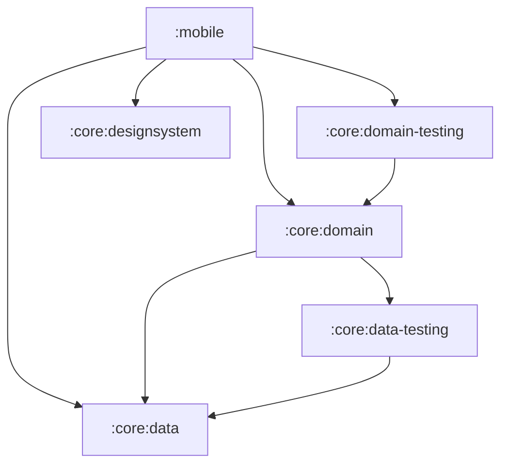
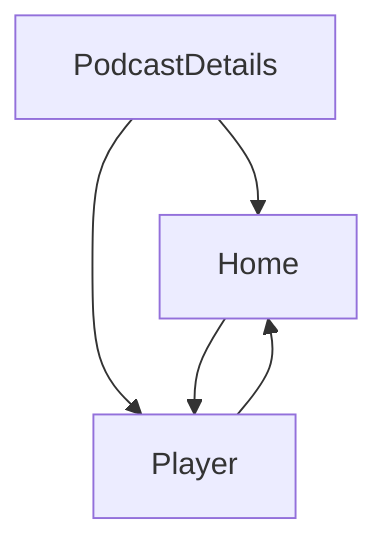

[//]: # (title: Jetpack Compose アプリの Kotlin Multiplatform への移行)

<secondary-label ref="IntelliJ IDEA"/>
<secondary-label ref="Android Studio"/>

<tldr>
<p>このチュートリアルでは IntelliJ IDEA を使用していますが、Android Studio でも同様に進めることができます。
   どちらの IDE も同じコア機能と Kotlin Multiplatform サポートを共有しています。</p>
</tldr>

このガイドでは、ビジネスロジックから UI に至るスタック全体において、Android 専用アプリをマルチプラットフォーム化する移行手順について説明します。
高度な Compose サンプルを使用して、一般的な課題とその解決策を解説します。
コミットの履歴を順番に追っていくことも、全体的な移行手順をざっと確認して興味のある部分を詳しく掘り下げることも可能です。

ベースとなるアプリは [Jetcaster](https://github.com/android/compose-samples/tree/main/Jetcaster) です。
これは、Jetpack Compose で構築された Android 向けのサンプルポッドキャストアプリです。
このサンプルは以下を活用した本格的なアプリとなっています：
* マルチモジュール構成
* Android のリソース管理
* ネットワークおよびデータベースアクセス
* Compose Navigation
* 最新の Material Expressive コンポーネント

これらの機能はすべて、Kotlin Multiplatform と Compose Multiplatform フレームワークを使用することで、クロスプラットフォームアプリへと適応させることができます。

Android アプリを他のプラットフォームで動作させる準備として、以下を学ぶことができます：

1. プロジェクトが Kotlin Multiplatform（KMP）への移行に適しているかどうかを評価する方法。
2. Gradle モジュールをクロスプラットフォームモジュールとプラットフォーム固有モジュールに分離する方法。
   Jetcaster では、プラットフォームごとに個別のプログラミングが必要だった一部の低レベルシステムコールを除き、大半のビジネスロジックモジュールをマルチプラットフォーム化することができました。
3. 動作する状態を維持しながら最小限の変更で進められるよう、ビルドスクリプトとコードを段階的に更新し、ビジネスロジックモジュールを順次マルチプラットフォーム化するプロセス。
4. UI コードを共有実装へと移行する方法：
   Compose Multiplatform を使用することで、Jetcaster の UI コードの大部分を共有できます。
   さらに重要な点として、この移行を画面ごとに段階的に実装する方法を確認できます。

完成したアプリは、Android、iOS、デスクトップ、およびブラウザ上で動作します。
また、デスクトップアプリは UI の動作を素早くイテレーションする手段である [Compose Hot Reload](compose-hot-reload.md) のサンプルとしても機能します。

## Kotlin Multiplatform 移行に向けたチェックリスト {id="checklist-for-a-potential-kotlin-multiplatform-migration"}

KMP 移行における主な障壁となるのは、Java コードと Android View です。
プロジェクトがすでに Kotlin で記述されており、UI に Jetpack Compose を使用している場合は、移行の複雑さが大幅に軽減されます。

プロジェクトやモジュールを移行する前に検討すべき準備事項の一般的なチェックリストは以下のとおりです：

1. [Java コードの変換または分離](#convert-or-isolate-java-code)
2. [Android/JVM 専用の依存関係の確認](#check-your-android-jvm-only-dependencies)
3. [モジュール化の技術的負債の解消](#catch-up-with-modularization-technical-debt)
4. [Compose への移行](#migrate-from-views-to-jetpack-compose)

### Java コードの変換または分離 {id="convert-or-isolate-java-code"}

オリジナルの Android Jetcaster サンプルには、`Objects.hash()` や `Uri.encode()` のような Java 専用の呼び出しや、`java.time` パッケージの広範な使用が含まれています。

Kotlin から Java を呼び出したり、その逆を行ったりすることは可能ですが、Kotlin Multiplatform モジュール内で共有コードを含む `commonMain` ソースセットには Java コードを含めることができません。
そのため、Android アプリをマルチプラットフォーム化する際には、以下のいずれかを行う必要があります：
* そのコードを `androidMain` に分離する（そして他のプラットフォーム向けに書き直す）、または
* マルチプラットフォーム互換の依存関係を使用して、Java コードを Kotlin に変換する。

もう1つの Java 固有ライブラリである RxJava は、Jetcaster では使用されていませんが、広く普及しています。これは非同期処理を管理するための Java フレームワークであるため、KMP 移行を開始する前に `kotlinx-coroutines` へ移行することをお勧めします。

Java コードを自動変換してプロセスを効率化できる [Java から Kotlin への移行ガイド](https://kotlinlang.org/docs/java-to-kotlin-idioms-strings.html) や [IntelliJ IDEA のヘルパー](https://www.jetbrains.com/help/idea/get-started-with-kotlin.html#convert-java-to-kotlin) が用意されています。

### Android/JVM 専用の依存関係の確認 {id="check-your-android-jvm-only-dependencies"}

多くのプロジェクト（特に比較的新しいプロジェクト）には Java コードがあまり含まれていないかもしれませんが、Android 専用の依存関係が含まれていることがよくあります。
Jetcaster では、代替手段の特定とその移行が作業の大半を占めました。

重要なステップは、共有を予定しているコード内で使用されている依存関係のリストを作成し、マルチプラットフォーム向けの代替手段が存在することを確認することです。
マルチプラットフォームのエコシステムは Java エコシステムほど大きくはありませんが、急速に拡大しています。
候補を評価するための起点として [klibs.io](https://klibs.io) を活用してください。

#### ライブラリ {id="libraries"}

Jetcaster におけるこれらのライブラリのリストは以下のとおりでした：

* **Dagger/Hilt**: 人気のある依存関係注入（DI）ソリューション（[Koin](https://insert-koin.io/) に置き換え）

  Koin は信頼性の高いマルチプラットフォーム DI フレームワークです。要件を満たさない場合や、必要な書き換えが大規模すぎる場合は、他のソリューションもあります。
  [Metro](https://zacsweers.github.io/metro/latest/) フレームワークもマルチプラットフォーム対応です。
  Dagger や Kotlin Inject を含む[他のアノテーションとの相互運用](https://zacsweers.github.io/metro/latest/interop/)をサポートしているため、移行を容易にするのに役立ちます。
* **Coil 2**: 画像読み込みライブラリ（[バージョン 3 でマルチプラットフォーム対応](https://coil-kt.github.io/coil/upgrading_to_coil3/)）
* **ROME**: RSS フレームワーク（マルチプラットフォーム対応の [RSS Parser](https://github.com/prof18/RSS-Parser) に置き換え）
* **JUnit**: テストフレームワーク（[kotlin-test](https://kotlinlang.org/api/core/kotlin-test/) に置き換え）
* **OkHttp**: HTTP クライアント（直接の利用は不要になりました。RSS Parser と Coil 3 が独自のリクエストを行い、Coil 3 は OkHttp が利用できないプラットフォーム向けに [Ktor ベース](https://ktor.io/)のネットワークレイヤーを備えています）

#### API {id="api"}
進めていくうちに、クロスプラットフォームの実装がまだ存在しないために、マルチプラットフォームで動作しなくなる細かなコードが見つかることがあります。
例えば Jetcaster では、2 つの Android 専用 API をサードパーティ製のマルチプラットフォームライブラリに置き換える必要がありました：

* `AnnotatedString.fromHtml()`: Compose UI ライブラリの一部ですが、Android 用にしか実装されていません（[htmlconverter](https://github.com/cbeyls/HtmlConverterCompose) に置き換え）。
* `android.net.Uri`: ナビゲーション引数をエンコードするために使用されていました（[uri-kmp](https://github.com/eygraber/uri-kmp) に置き換え）。

このようなケースを事前にすべて特定するのは困難なため、移行プロセスの途中で代替手段を見つけたりコードを書き直したりする準備をしておいてください。
これが、可能な限り小さなステップで動作する状態間を移行する方法を紹介している理由です。そうすれば、多くの部分を同時に変更している場合でも、単一の問題によって進行が滞ることがなくなります。

### モジュール化の技術的負債の解消 {id="catch-up-with-modularization-technical-debt"}

KMP では、モジュールごと、画面ごとに選択して段階的にマルチプラットフォームへ移行できます。
しかし、これをスムーズに進めるためには、モジュール構造が明確で扱いやすい状態になっている必要があります。
モジュールを構造化するための推奨プラクティスとともに、[高凝集・低結合の原則（high cohesion, low coupling principle）](https://developer.android.com/topic/modularization/patterns#cohesion-coupling) に従ってモジュール化を評価することを検討してください。

一般的なアドバイスは以下のように要約できます：

* アプリの機能の個々の部分をフィーチャー（機能）モジュールに分離し、データの処理やアクセスを提供するデータモジュールとは明確に分けておきます。
* 特定のドメインのデータとビジネスロジックをモジュール内にカプセル化します。関連するデータ型をまとめ、関連のないドメイン間でロジックやデータが混ざらないようにします。
* Kotlin の[可視性修飾子（visibility modifiers）](https://kotlinlang.org/docs/visibility-modifiers.html)を使用して、モジュールの実装詳細やデータソースへの外部からのアクセスを防ぎます。

明確な構造があれば、プロジェクトに多数のモジュールがある場合でも、それらを個別に KMP へ移行していくことができます。このアプローチは、完全な書き換えを試みるよりもスムーズです。

### Views から Jetpack Compose への移行 {id="migrate-from-views-to-jetpack-compose"}

Kotlin Multiplatform は、クロスプラットフォームな UI コードを作成する手段として Compose Multiplatform を提供します。
Compose Multiplatform へスムーズに移行するには、UI コードがすでに Compose で書かれている必要があります。現在 View を使用している場合は、新しいパラダイムとフレームワークを使ってそのコードを書き直す必要があります。
これは当然、事前に行っておくほうが容易です。

Google は長年にわたり Compose の発展と機能拡充を進めてきました。最も一般的なシナリオについては [Jetpack Compose 移行ガイド](https://developer.android.com/develop/ui/compose/migrate) を確認するか、[AI を使って移行するエージェントスキル](https://github.com/android/skills/blob/main/jetpack-compose/migration/migrate-xml-views-to-jetpack-compose/SKILL.md) を試してみてください。
View と Compose の相互運用性を利用することもできますが、Java コードと同様に、このコードは `androidMain` ソースセットに分離する必要があります。

## アプリをマルチプラットフォーム化するステップ {id="steps-to-make-an-app-multiplatform"}

初期の準備と評価が完了した後の一般的なプロセスは以下のとおりです：

1. [マルチプラットフォームライブラリへの移行](#migrate-to-multiplatform-libraries)

2. [ビジネスロジックの KMP への移行](#migrating-the-business-logic)
   1. 他のモジュールからの依存が最も少ないモジュールから始めます。
   2. それを KMP モジュール構造に移行し、マルチプラットフォームライブラリの使用へと移行します。
   3. 依存関係ツリーの次のモジュールを選択し、このプロセスを繰り返します。
   
   {type="alpha-lower"}
3. [UI コードの Compose Multiplatform への移行](#migrating-to-multiplatform-ui)
   ビジネスロジックがすべてすでにマルチプラットフォーム化されていれば、Compose Multiplatform への移行は比較的シンプルになります。
   Jetcaster では、画面ごとに移行するインクリメンタルな移行手法を示しています。また、一部の画面のみが移行され、他の画面が未移行である場合にナビゲーショングラフを調整する方法も示します。
4. サポートしたいプラットフォーム向けに[エントリーポイントを追加](#add-application-entry-points)します。

このサンプルをシンプルにするため、Android 固有の Glance、TV、ウェアラブルのターゲットは最初から削除しました。これらはマルチプラットフォームコードと相互作用せず、移行する必要もないためです。
この簡素化と、移行の残りの部分が依存する Gradle および AGP のバージョン設定は、単一の[準備コミット](https://github.com/kotlin-hands-on/jetcaster-kmp-migration/commit/0b55090eff4e36142d893c404e0d403e89a16b1c)にまとめられています。

> 以下のステップの説明を読み進めることもできますし、このガイドで解説している履歴そのものである Jetcaster サンプルリポジトリの [step-by-step-migration ブランチ](https://github.com/kotlin-hands-on/jetcaster-kmp-migration/commits/step-by-step-migration/) へ直接進むこともできます。
> 各コミットは、Android 専用から完全な Kotlin Multiplatform への段階的移行の可能性を示すため、アプリが動作する状態を表しています。リポジトリの `main` ブランチには、同じプロジェクトの最終状態が保持されています。
> 
{style="tip"}

### 環境の準備 {collapsible="true" id="prepare-the-environment"}

移行手順に沿って進めたり、提供されているサンプルをご自身のマシンで実行したりする場合は、環境が整っていることを確認してください：

1. クイックスタートから、[Kotlin Multiplatform 向けの環境設定](quickstart.md#set-up-the-environment)の手順を完了します。

   > Apple の要件に従い、iOS アプリケーションをビルドして実行するには、macOS と Xcode を備えた Mac が必要です。
   >
   {style="note"}

2. IntelliJ IDEA または Android Studio で、サンプルリポジトリをクローンして新しいプロジェクトを作成します：

   ```text
   git@github.com:kotlin-hands-on/jetcaster-kmp-migration.git
   ```

   コミットごとに移行を追うには、`step-by-step-migration` ブランチをチェックアウトします。
   `main` ブランチは同じプロジェクトの最終状態を保持しており個別に更新されますが、両方のブランチの最終状態は機能的に同じです。

3. サンプルのモジュールは Java 17 ツールチェーンを使用しているため、Gradle が自身を実行する JDK に加えて、JDK 17 が利用可能である必要があります。ビルドが `Cannot find a Java installation … matching {languageVersion=17}` で失敗した場合は、JDK 17 をインストールするか、[ツールチェーンのプロビジョニング](https://docs.gradle.org/current/userguide/toolchains.html#sec:provisioning) を設定してください。

## マルチプラットフォームライブラリへの移行 {id="migrate-to-multiplatform-libraries"}

アプリの機能の大部分が依存しているいくつかのライブラリがあります。
モジュールをマルチプラットフォーム対応に設定する前に、それらの使用方法を KMP 互換へと移行することができます：

* ROME tools パーサーからマルチプラットフォームの RSS Parser への移行。
  これには API 間の違いを考慮する必要があります。RSS Parser は独自のネットワーク呼び出しを行うため OkHttp は不要になりますが、公開日やエピソードの再生時間は手動でパースする必要があります。

  > [該当するコミット](https://github.com/kotlin-hands-on/jetcaster-kmp-migration/commit/2313082c6c350e06964786b9821b81e17e9b4dfb)を参照してください。
* Android 専用のエントリーポイントモジュール `mobile` を含む、アプリ全体での Dagger/Hilt から Koin 4 への移行。
  これには Koin のアプローチに従って依存関係注入のロジックを書き直す必要がありますが、`*.di` パッケージ外のコードはほとんど影響を受けません。

  Hilt から移行する際は、以前に生成された Hilt コードによるコンパイルエラーを回避するため、必ず `/build` ディレクトリをクリーンアップしてください。

  このステップは、別の形でも Android 専用依存関係のコストを示しています。Hilt のアノテーションプロセッサは Kotlin 2.4 のメタデータを読み取れないため、Hilt を排除するまでプロジェクトを最新の Kotlin に更新できません。排除された後は、同じコミットで Kotlin のバージョンが引き上げられます。

  > [該当するコミット](https://github.com/kotlin-hands-on/jetcaster-kmp-migration/commit/713b5846e5be3233874af556d6ada52405723a69)を参照してください。

* Coil 2 から Coil 3 へのアップグレード。ここでも変更されたコードは比較的わずかです。`coil.*` パッケージが `coil3.*` になり、画像の読み込みは Android の `Context` ではなく Coil 自身の `PlatformContext` に対して動作します。

  > [該当するコミット](https://github.com/kotlin-hands-on/jetcaster-kmp-migration/commit/e88ff3e62ec19e679c367e90deaef38e92f913b7)を参照してください。

* JUnit から `kotlin-test` への移行。これはテストを含むすべてのモジュールに関係しますが、`kotlin-test` の互換性のおかげで、移行の実装に必要な変更はごくわずかです。

  > [該当するコミット](https://github.com/kotlin-hands-on/jetcaster-kmp-migration/commit/90678b99b2b00f09fefc2d787694d08a073c22e6)を参照してください。

* ポッドキャストの説明文の HTML をレンダリングする `AnnotatedString.fromHtml()` を、マルチプラットフォーム対応の `htmlconverter` ライブラリに置き換え。この関数は Compose UI ライブラリの一部ですが、Android 用にしか実装されていません。

  > [該当するコミット](https://github.com/kotlin-hands-on/jetcaster-kmp-migration/commit/4e16a63029efae18f3bf14aa2faf6008caaf8ee9)を参照してください。

### Java に依存するコードの Kotlin への書き直し {id="rewrite-java-dependent-code-into-kotlin"}

主要なライブラリがすべてマルチプラットフォーム化されたので、Java 専用の依存関係を排除する必要があります。

Java 専用呼び出しのシンプルな例として `Objects.hash()` があり、これを Kotlin で再実装しました。

> [該当するコミット](https://github.com/kotlin-hands-on/jetcaster-kmp-migration/commit/f904e28113f50e9d26e1199842253093b92abc58)を参照してください。

しかし、Jetcaster の例でコードを直接共通化することを最も妨げているのは `java.time` パッケージです。
ポッドキャストアプリでは時間の計算がほぼ至る所にあるため、KMP のコード共有の恩恵を真に受けるには、そのコードを `kotlin.time` および `kotlinx-datetime` に移行する必要があります。
例えば、`kotlinx-datetime` には RFC 1123 形式の組み込みパーサーはありませんが、ライブラリのフォーマットビルダーを使用して構築できます。

> 時間関連のすべての処理が[このコミット](https://github.com/kotlin-hands-on/jetcaster-kmp-migration/commit/75d5571621529972187b01537e8988fdf8b83d32)で書き直されています。

## ビジネスロジックの移行 {id="migrating-the-business-logic"}

主要な依存関係がマルチプラットフォーム化されたら、移行を開始するモジュールを選択できます。
プロジェクト内のモジュールの依存関係グラフを作成しておくと役立ちます。
[Junie](https://www.jetbrains.com//junie/) などの AI エージェントを使用すれば、簡単に作成できます。
Jetcaster のモジュール依存関係の簡略図は次のようになります：



これにより、例えば次のような順序が導き出されます：

1. `:core:data`
2. `:core:data-testing`
3. `:core:domain`
4. `:core:domain-testing`
5. `:core:designsystem` — モジュールの依存関係はありませんが、これは UI ヘルパーモジュールであるため、UI コードを共有モジュールに移動する準備が整った段階で取り組みます。

### モジュールのビルドスクリプトで変更される点 {id="what-changes-in-a-module-s-build-script"}

このセクションの各モジュールの移行は、すべて同じパターンに従います。
以下は、Android からの移行前のライブラリモジュールと、その後の Kotlin Multiplatform モジュールの例です：

<compare type="top-bottom">
<code-block lang="kotlin" code="plugins {&#10;    alias(libs.plugins.android.library)&#10;}&#10;&#10;android {&#10;    namespace = &quot;com.example.jetcaster.core.data&quot;&#10;    compileSdk = 37&#10;&#10;    defaultConfig {&#10;        minSdk = 23&#10;    }&#10;}&#10;&#10;dependencies {&#10;    // Dependency example&#10;    implementation(libs.koin.core)&#10;}"/>
<code-block lang="kotlin" code="plugins {&#10;    alias(libs.plugins.kotlin.multiplatform)&#10;    alias(libs.plugins.android.kotlin.multiplatform.library)&#10;}&#10;&#10;kotlin {&#10;    android {&#10;        namespace = &quot;com.example.jetcaster.core.data&quot;&#10;        compileSdk = 37&#10;        minSdk = 23&#10;    }&#10;&#10;    jvmToolchain(17)&#10;    iosArm64()&#10;    iosSimulatorArm64()&#10;    jvm()&#10;    wasmJs { browser() }&#10;&#10;    sourceSets {&#10;        commonMain.dependencies {&#10;            // Dependency example&#10;            implementation(libs.koin.core)&#10;        }&#10;    }&#10;}"/>
</compare>

ソースコードも同様に移動します。宣言されたターゲットに合わせて、`src/main/java` から `src/commonMain/kotlin`、`src/androidMain/kotlin` などへ配置します。

以下のコミットでは、各モジュールはその時点で存在するターゲットのみを宣言しています。
`wasmJs` は、[Web エントリーポイントの追加](#add-a-web-entry-point)とともに最後に追加されます。

### :core:data の移行 {id="migrate-core-data"}

#### :core:data の設定とデータベースコードの移行 {id="configure-core-data-and-migrate-database-code"}

Jetcaster はデータベースライブラリとして [Room](https://developer.android.com/training/data-storage/room) を使用しています。
Room はバージョン 2.7.0 からマルチプラットフォーム対応となっているため、各プラットフォームで動作するようにコードを更新するだけで済みます。
現時点ではまだ iOS アプリやデスクトップアプリはありませんが、他のエントリーポイントを設定したときに呼び出されるプラットフォーム固有のコードをあらかじめ記述しておくことができます。
また、他のプラットフォーム用のターゲット設定を追加して、これ以降プラットフォームコードがコンパイルされるようにします。

Room のマルチプラットフォームバージョンに切り替えるにあたり、Android の[一般的なセットアップガイド](https://developer.android.com/kotlin/multiplatform/room)に従いました。

> [該当するコミット](https://github.com/kotlin-hands-on/jetcaster-kmp-migration/commit/c3a09588a8080d4caf38c564174888a34337da7d)を参照してください。

* `androidMain`、`commonMain`、`iosMain`、`jvmMain` ソースセットを備えた新しいコード構造に注目してください。
* コード変更の大部分は、Room 用の expect/actual 構造の作成と、それに対応する DI の変更に関するものです。データベースの作成はプラットフォーム固有であるため、`getDatabaseBuilder()` は expect/actual のペアとなり、`expect val platformDataModule` Koin モジュールを介して組み込まれます。
* `DateTimeTypeConverters` は不要になります。`kotlinx-datetime` を使用すると、変換処理はエンティティ自体に持たせることができます。
* 新しい `OnlineChecker` インターフェースは、Android でのみインターネット接続を確認しているという事実に対処するためのものです。[iOS アプリをターゲットとして追加](#add-an-ios-entry-point)するまで、この online checker はスタブとして機能します。

同時に `:core:data-testing` モジュールもマルチプラットフォーム向けに再設定できます。
[該当するコミット](https://github.com/kotlin-hands-on/jetcaster-kmp-migration/commit/a58fea51d94300a184654e7c1a734b4f70fc2877)を参照してください。
これには、Gradle 設定を更新し、ソースセットのフォルダー構造へ移動するだけで対応できます。

#### :core:domain の設定と移行 {id="configure-and-migrate-core-domain"}

すべての依存関係がすでに考慮されマルチプラットフォームに移行されている場合、行うべき作業はコードを移動してモジュールを再設定することだけです。テストは `commonTest` に移動され、JVM 上だけでなくすべてのターゲットで実行されるようになります。

> [該当するコミット](https://github.com/kotlin-hands-on/jetcaster-kmp-migration/commit/ccebc4fc011ee6181dd120dcd27884f3b3ee9c54)を参照してください。

`:core:data-testing` と同様に、`:core:domain-testing` モジュールも容易にマルチプラットフォーム対応へと更新できます。

> [該当するコミット](https://github.com/kotlin-hands-on/jetcaster-kmp-migration/commit/33fd4d010331f3e66ab42eac148a2b1a7e529913)を参照してください。

#### :core:designsystem の設定と移行 {id="configure-and-migrate-core-designsystem"}

移行対象として UI コードのみが残った段階で、フォントリソースとタイポグラフィを含む `:core:designsystem` モジュールの移行を開始します。
これは Compose コードを含む最初のモジュールであるため、Jetpack Compose の成果物（`androidx.compose.*`）が Compose Multiplatform の成果物（`org.jetbrains.compose.*`）に置き換えられる最初のモジュールでもあります。

KMP モジュールの設定と `commonMain` ソースセットの作成に加え、`MaterialExpressiveTheme` の `JetcasterTypography` 引数をコンポーザブル関数にし、マルチプラットフォームフォントの呼び出しをカプセル化しました。

> [該当するコミット](https://github.com/kotlin-hands-on/jetcaster-kmp-migration/commit/608c673db1732e0976bcaa0feb4c965078c06f13)を参照してください。

## マルチプラットフォーム UI への移行 {id="migrating-to-multiplatform-ui"}

すべての `:core` ロジックがマルチプラットフォーム化されたら、UI も共通コードに移動し始めることができます。
ここでも完全な移行を目指しているため、他のエントリーポイントはまだ追加せず、Compose 部分を共通コードに配置した状態で Android アプリが動作することのみを確認します。

従うロジックを視覚化するために、Jetcaster の画面間の関係を示す簡略化した図を以下に示します：

<!-- The deep link connections and the supporting pane are commented out for the sake of brevity but may be interesting. --> 



まず、共通化する UI コードのために共有 UI モジュールを作成しました。

> [該当するコミット](https://github.com/kotlin-hands-on/jetcaster-kmp-migration/commit/f2bef12555fa39038b50f151c602046ca80f494b)を参照してください。

UI を段階的に移行する様子を示すため、画面ごとに移動していきます。
各ステップは、アプリが動作する状態であり、完全に共有された UI へと一歩近づいたコミットで終了します。

上記の画面遷移図に沿って、まずはポッドキャスト詳細画面から開始しました：

1. 移行された画面は、Compose テーマがまだ Android モジュールにある状態でも動作します。
   必要な作業：
   1. ViewModel と対応する DI コードを更新します。
   2. リソースとリソースアクセサを更新します。
      マルチプラットフォームリソースライブラリは Android の使い勝手とよく一致していますが、対処が必要ないくつかの顕著な違いがあります：
      * リソースファイルの扱い方に若干の違いがあります。
        例えば、リソースディレクトリは `res` ではなく `composeResources` という名前にする必要があり、Android XML ファイル内の `@android:color` の使用箇所は 16 進カラーコードに置き換える必要があります。
        詳細については、[マルチプラットフォームリソース](compose-multiplatform-resources.md)に関するドキュメントを参照してください。
      * 生成されるリソースアクセサのクラス名は `Res` です（Android の `R` とは異なります）。
        リソースファイルを移動して調整した後は、アクセサを再生成し、UI コード内の各リソースのインポートを置き換えてください。
   3. `koinViewModel()` を Android 固有の `org.koin.androidx.compose` パッケージから、マルチプラットフォームの `org.koin.compose.viewmodel` パッケージに切り替えます。
   4. 画面がナビゲーション時にポッドキャスト URI をエンコードするために使用している `android.net.Uri` を、同等の `uri-kmp` に置き換えます。
      
   > [該当するコミット](https://github.com/kotlin-hands-on/jetcaster-kmp-migration/commit/cc045d7d9f01e1ef8d05a9f6568fac89ab2a852b)を参照してください。

2. Compose テーマの移行。
   Android のダイナミックカラーには `LocalContext` と API レベルのチェックが必要なため、カラースキームは expect/actual 関数となり、他のプラットフォームではスタブ実装とします。

   > [該当するコミット](https://github.com/kotlin-hands-on/jetcaster-kmp-migration/commit/5b0263faae912bce616487b71d17bcd4cb93c721)を参照してください。

3. ホーム画面の移行を続けます：
   1. ViewModel を移行します。
   2. コードを共有 UI モジュールの `commonMain` に移動します。
   3. リソースへの参照を移動および調整します。
   4. Android 専用のプレビューツールを置き換えます。`androidx.compose.ui.tooling.preview.Devices` に基づく `@DevicePreviews` を、マルチプラットフォーム対応の `@Preview` に置き換えます。

   > [該当するコミット](https://github.com/kotlin-hands-on/jetcaster-kmp-migration/commit/9d6903620f12db52fb287f9f0746f5731f603066)を参照してください。

4. 移行を細分化する別の方法を示すため、ナビゲーションの一部を移行します：
   共通コード内の画面と Android ネイティブの画面を組み合わせることができます。
   `PlayerScreen` はまだ `mobile` モジュールに配置されており、Android エントリーポイントのナビゲーションにのみ含まれます。
   これは、全体を統括するマルチプラットフォームナビゲーションに注入（inject）されます。

   > [該当するコミット](https://github.com/kotlin-hands-on/jetcaster-kmp-migration/commit/f5145cbd3a6b958b5947d4933f8db50aaef1be49)を参照してください。
   
5. 残っているものをすべて移動して完了します：
   * ナビゲーションの残りの部分を共通コードに移動します（[該当するコミット](https://github.com/kotlin-hands-on/jetcaster-kmp-migration/commit/54464f0d06bd2bdeffaca965ea2f6fcb9de077df)）。
   * 最後の画面である `PlayerScreen` を Compose Multiplatform に移行します（[該当するコミット](https://github.com/kotlin-hands-on/jetcaster-kmp-migration/commit/4d1be9975a4388f2db3315ebaf5965cf8201fe4f)）。

     この画面には、折りたたみやヒンジの状態に応じて 1 ペインレイアウトと 2 ペインレイアウトを切り替えるという、真に Android 固有の動作があります。その判定ロジックは expect/actual コンポーザブルに抽出され、Android では折りたたみ状態を認識するバージョンを維持しつつ、他のプラットフォームではウィンドウ幅のみを参照するようにします。

すべての UI コードが共通化されたので、これを利用して他のプラットフォーム向けのアプリを素早く作成できるようになりました。

この時点で、モジュール名は本来の意味を持たなくなっています。`:core` はもはやコアな Android ライブラリのセットではなく、`:mobile` も唯一のエントリーポイントではなくなろうとしています。
そこで、これらを `:sharedLogic` と `:androidApp` にリネームしました。

> [該当するコミット](https://github.com/kotlin-hands-on/jetcaster-kmp-migration/commit/ac13e72b16a77276ca5fa46b6c71e903c57bf087)を参照してください。

## アプリケーションエントリーポイントの追加 {id="add-application-entry-points"}

### JVM エントリーポイントの追加 {id="add-a-jvm-entry-point"}

このステップは以下に役立ちます：
* 完全にマルチプラットフォーム化された Android アプリから、いかにわずかな手間でデスクトップアプリを作成できるかを示すこと。
* Compose UI を素早くイテレーションするためのツールとして、現在はデスクトップターゲットでのみサポートされている [Compose Hot Reload](compose-hot-reload.md) を紹介すること。

すべての UI コードが共有されているため、デスクトップ JVM アプリ用の新しいエントリーポイントを追加する作業は、`main()` 関数を作成して DI フレームワークと統合するだけです。
共有モジュールが必要とする JVM 実装は、モジュールの移行によってすでに整っています。

> [該当するコミット](https://github.com/kotlin-hands-on/jetcaster-kmp-migration/commit/32dc94085c5163e5b830a7e95e2b2b6baa6591a0)を参照してください。

### iOS エントリーポイントの追加 {id="add-an-ios-entry-point"}

iOS エントリーポイントには、KMP コードとリンクされた iOS プロジェクトが必要です。

KMP プロジェクトで iOS アプリを作成して組み込む方法については、[アプリのマルチプラットフォーム化](https://kotlinlang.org/docs/multiplatform/multiplatform-integrate-in-existing-app.html#create-an-ios-project-in-xcode) チュートリアルで解説されています。

> ここで使用している直接統合方式は最もシンプルですが、ご利用のプロジェクトにとって最適とは限らない場合があります。
> さまざまな選択肢を理解するには、[iOS 統合方式の概要](multiplatform-ios-integration-overview.md) を参照してください。
>
{style="note"}

iOS アプリ側では、SwiftUI コードと Compose Multiplatform コードを接続する必要があります。
これは、埋め込まれた `JetcasterApp` コンポーザブルを持つ `UIViewController` を返す関数を iOS アプリに追加することで実現します。

実行可能な iOS アプリができたので、`OnlineChecker` スタブをマルチプラットフォームの [konnectivity](https://github.com/plusmobileapps/konnectivity) ライブラリに基づく実際の実装に置き換えます。

<!-- this probably needs more rigorous verification -->

> Xcode が自動生成するスキームに依存するのではなく、**共有（shared）** Xcode スキーム（`YourApp.xcodeproj/xcshareddata/xcschemes/`）をコミットしてください。
> 生成されたスキームは `xcuserdata` に配置されますが、これは通常 Git の無視対象に設定されています。その場合、Xcode が独自にスキームを生成した環境では、`xcodebuild -scheme YourApp` が「does not contain a scheme named YourApp」というエラーで失敗する可能性があります。
>
{style="tip"}

> 追加された iOS プロジェクトと対応するコードの更新については、[該当するコミット](https://github.com/kotlin-hands-on/jetcaster-kmp-migration/commit/1da471dfba711a4386e5ba1a9db49892c8a7e255)を参照してください。

### Web エントリーポイントの追加 {id="add-a-web-entry-point"}

Web ターゲットは最もプラットフォーム固有の作業を必要とします。JVM もファイルシステムもなく、同一生成元ポリシー（Same-Origin Policy）が強制されます。
これらの制約はそれぞれ、`expect`/`actual` メカニズムがどのようにプラットフォームの制限を回避できるかを示す好例となっています：

* **データベース:** SQLite はファイルシステムに直接アクセスできないため、[Origin Private File System](https://developer.mozilla.org/ja/docs/Web/API/File_System_API/Origin_private_file_system)（OPFS）を利用した Web Worker 内で動作します。
  モジュールにはワーカーを含む npm パッケージが追加されて `androidx.sqlite:sqlite-web` が使用され、常にバンドルされたドライバーを返す代わりに expect/actual 関数内でドライバーを作成できます。
  また、OPFS にはクロスオリジン分離ヘッダーが必要であり、これは webpack の設定によって追加されます。
* **ディスパッチャー:** Kotlin/Wasm には `Dispatchers.IO` が存在しないため、IO ディスパッチャーの取得も expect/actual 関数にします。
* **ネットワークアクセス:** ブラウザは CORS を強制し、すべてのポッドキャストフィードが適切なヘッダーを送信するわけではないため、サンプルフィードのリストも `expect val` とし、Web ビルドでは短いリストを使用します。
  このターゲットでは、Coil と RSS Parser は Ktor JS クライアントを使用します。

> [該当するコミット](https://github.com/kotlin-hands-on/jetcaster-kmp-migration/commit/58dd68fa34f88c9f7a9c89fc654018cb3a9bded0)を参照してください。

## Android モジュールのクリーンアップ {id="clean-up-the-android-module"}

Android モジュールにはアプリケーションのエントリーポイントのみが含まれるようになったため、不要な依存関係をクリーンアップし、Activity の処理と `@Preview` アノテーションに必要な Compose 固有のインポートのみを残すことができます。

> [該当するコミット](https://github.com/kotlin-hands-on/jetcaster-kmp-migration/commit/76fdba0f55c34eda7b325f3e836cc21a10a78e98)を参照してください。

## アプリの実行 {id="run-the-app"}

移行されたアプリの最終状態には、初期の Android モジュール（`androidApp`）と新しい iOS アプリの実行構成が含まれています。
デスクトップアプリは対応する `main.kt` ファイルから、Web アプリは `:wasmApp:wasmJsBrowserDevelopmentRun` Gradle タスクで実行できます。
すべてを実行して、共有された UI が各プラットフォームでどのように機能するかを確認してみてください！

## まとめ {id="final-summary"}

この移行では、純粋な Android アプリを Kotlin Multiplatform アプリへと変換するための一般的な手順を踏みました：

* マルチプラットフォーム依存関係へ移行する（不可能な場合はコードを書き直す）。
* 他のプラットフォームでも使用可能な Android モジュールを、1 つずつマルチプラットフォームモジュールへと変換する。
* Compose Multiplatform コード用の共有 UI モジュールを作成し、画面ごとに共有 UI コードへと移行する。
* 他のプラットフォーム向けのエントリーポイントを作成する。

この順序は固定されたものではありません。他のプラットフォーム用のエントリーポイントの作成から始めて、それらが動作するまで基盤を段階的に構築していくことも可能です。
Jetcaster の例では、一歩一歩追いやすい、より明確な変更手順を選択しました。

このガイドや紹介したソリューションに関するフィードバックがある場合は、[YouTrack](https://kotl.in/issue) で Issue を作成してください。