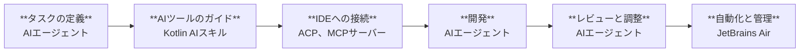

[//]: # (title: Kotlin開発のためのAIツール)
[//]: # (description: AIを活用してKotlin開発を加速させましょう。AI Assistant、Junie、JetBrains Air、Kotlin AIスキル、コーディングエージェント、およびIDE連携を使用して、コードの作成、テスト、レビュー、リファクタリングを行う方法を学びます。)

AIを活用したツールは、Kotlin開発における多くのタスクを支援します。コードの生成や解説、機能の実装、テストの作成、変更内容のレビュー、既存コードのリファクタリング、さらには定期的な開発タスクの自動化を行うことができます。

Kotlinエコシステムには、対話型の開発ツール、AIエージェント、そして大規模なエージェントオーケストレーション向けツールが含まれています。ワークフローに応じて、以下の選択肢があります。

* [IDE内での開発](#develop-in-the-ide): IntelliJ IDEAやAndroid StudioなどのIDE内でAI機能を直接使用する。
* [AIエージェントの活用](#use-ai-agents): Junieやサードパーティ製エージェントを選択し、Kotlin AIスキルを使ってそのKotlinに関する専門性を向上させる。
* [AI開発の管理とスケーリング](#manage-ai-agents): 対話型および自動化されたエージェントのワークフローを連携・調整する。

このページでは、各ツールの違いと、ワークフローの各段階においてそれらがどのように役立つかを説明します。

## IDE内での開発 {id="develop-in-the-ide"}

IDEは、開発環境内でAI機能を直接提供できます。IDEを離れることなく、Kotlinコードの記述、変更、レビューが可能です。

### AI Assistant {id="ai-assistant"}

[AI Assistant](https://plugins.jetbrains.com/plugin/22282-jetbrains-ai-assistant)は、[IntelliJ IDEA](https://www.jetbrains.com/idea/download/)などのJetBrains IDEや、[Android Studio](https://developer.android.com/studio)内で直接AI支援を提供します。個々の変更を自分でコントロールしながら進めたい対話型の開発タスクに適しています。

AI Assistantは以下の機能を提供します。

* [Junie](https://www.jetbrains.com/junie/)、Claude Code、OpenAI Codex、およびAgent Client Protocolをサポートするサードパーティ製エージェントを含む、各種AIエージェントへのアクセス。
* Gemini、GPT、Claudeなどのクラウドホスト型モデルや、ローカルモデルを使用したコンテキスト認識型AIチャット。
* AI支援によるコード補完および次の編集の提案。

詳細については、[JetBrains IDEにおけるAI Assistant連携](https://www.jetbrains.com/help/ai-assistant/about-ai-assistant.html)を参照してください。

### Air in IDEs {id="air-in-ides"}

[Air in IDEs](https://www.jetbrains.com/air/ides/)は、JetBrains IDE内でコーディングエージェントを操作するための環境を提供するプラグインです。プロジェクトをまたいでエージェントセッションを開始し、その進捗を追跡しながら、コードナビゲーションやインスペクションなどのIDE機能を使用して変更内容をレビューできます。diffにコメントを付け、エージェントに作業の修正を依頼することも可能です。

Airを使用すると、ローカルマシンにインストールされた互換性のあるエージェントを接続したり、[ACPレジストリ](https://agentclientprotocol.com/get-started/registry)からエージェントを選択したりできます。また、タスクをローカルで実行することも、[Air Teams](https://air.jetbrains.cloud/)を介して時間のかかるタスクをクラウドエージェントに委任することも可能です。

詳細については、[JetBrains IDEにおけるAir](https://www.jetbrains.com/air/ides/)を参照してください。

## AIエージェントの活用 {id="use-ai-agents"}

AIエージェントは、対話型のAIアシスタントよりも直接的な指示を減らして開発タスクを実行できます。例えば、プロジェクトの調査、実装手順の計画、複数ファイルの変更、コマンドやテストの実行などを行うことができます。

> どのAIエージェントを使用すべきかわからない場合は、[Kotlin Benchmark](https://kotlinlang.org/benchmark/)をチェックして、Kotlin開発タスクにおける各エージェントのパフォーマンスを比較してください。
> 
{style="tip"}

### Air Gateway {id="air-gateway"}

[Air Gateway](https://www.jetbrains.com/air/gateway/)は、Claude Code、Codex、Junie CLIなどのターミナルエージェントを、JetBrainsアカウントとJetBrains AIクレジットを使用して実行するためのコマンドラインツールです。エージェントは既存のターミナルワークフローを維持したまま、JetBrains Consoleを通じてエージェントやモデルへのアクセスを一元管理できます。

詳細については、[Air Gateway](https://www.jetbrains.com/air/gateway/)を参照してください。

### Air Context {id="air-context"}

[Air Context](https://www.jetbrains.com/air/context/)は、コーディングエージェントが関連するコード、API、依存関係、テスト、および実装パターンを見つけられるように、リポジトリのセマンティックインデックスを構築するコマンドラインインターフェース付きのコードベースインデックスサービスです。

エージェントが大規模なコードベースを調査する必要がある場合や、既存の実装やプロジェクトの規約を見つける必要がある場合にAir Contextを使用します。Claude Code、Codex CLI、Junie CLIなどのサポートされているエージェントと統合され、IDEやその他のサポートされているエディタから利用できます。

詳細については、[Air Context](https://www.jetbrains.com/air/context/)を参照してください。

### Junie {id="junie"}

[Junie](https://junie.jetbrains.com/)は、JetBrainsのAIエージェントです。[JetBrains IDEやAndroid Studio内](https://plugins.jetbrains.com/plugin/26104-junie-the-ai-coding-agent-by-jetbrains)、[ターミナルから](https://junie.jetbrains.com/docs/junie-cli.html)、またはCI/CDパイプライン内の[ヘッドレスモード](https://junie.jetbrains.com/docs/junie-headless.html)で使用できます。また、Junieを[GitHubワークフロー](https://junie.jetbrains.com/docs/junie-on-github.html)に統合することも可能です。

Junieは、単一のコード提案やチャットの応答にとどまらないタスク向けに設計されています。複数ファイルに関わる開発タスクや、計画と実行を要するタスクでJunieを活用してください。機能の実装、複数ファイルにわたるコードの更新、テストの追加、メンテナンス作業などを依頼できます。

JunieをIDEで実行すると、プロジェクトのインデックス作成、コードナビゲーション、インスペクション、リファクタリング、デバッグ、フレームワークを考慮したプロジェクト分析など、IDEの機能を活用することもできます。

詳細については、[Junie](https://junie.jetbrains.com/docs/get-started-with-junie.html)を参照してください。

### サードパーティ製AIエージェント {id="third-party-ai-agents"}

多くのサードパーティ製AI開発ツールがKotlinをサポートしています。これらはIDE拡張機能、スタンドアロンエディタ、コマンドラインツール、クラウドベースの開発環境として利用可能です。例：

* GitHub Copilot
* Google Gemini
* Claude Code
* OpenAI Codex

好みの開発環境に合っている場合や、ワークフローに適合する機能を提供している場合は、サードパーティ製ツールを選択してください。これらのツールの多くは、Kotlinコードの生成、解説、テスト作成、リファクタリングをサポートしています。

サードパーティ製ツールは単独で使用することも、ACPを介して互換性のあるエージェントをJetBrains IDEに接続して使用することもできます。

### MCPサーバー {id="mcp-servers"}

Model Context Protocol（MCP）は、AIモデルを外部のデータソース、ツール、システムに接続します。JetBrainsは、Kotlin開発をより生産的にするための複数のMCPサーバーを保守しています。

* [JetBrains IDE MCPサーバー](https://plugins.jetbrains.com/plugin/26071-mcp-server)は、IDEの機能を公開します。このサーバーを使用することで、AIエージェントはプロジェクトのインデックス作成、コードナビゲーション、リファクタリング、インスペクション、ビルド実行などのIDE機能を利用できるようになります。これにより、エージェントはKotlinプロジェクトをより深く理解し、より効率的にコードを生成・評価できます。
* [MCP Kotlin SDK](kotlin-ai-apps-development-overview.md#model-context-protocol-mcp-kotlin-sdk)は、Kotlin Multiplatformの実装です。KotlinでAI搭載アプリケーションを構築し、JVM、WebAssembly、iOSにわたるLLM環境と統合するのに役立ちます。
* Kotlin Multiplatformプロジェクト向けには、[klibs.io MCPサーバー](https://github.com/JetBrains/klibs-io/blob/master/integrations/mcp/README.md)が、利用可能なマルチプラットフォームライブラリのカタログへのアクセスを支援し、エージェントが既存のソリューションをより効率的に検索できるようにします。
* Compose Multiplatformプロジェクト向けには、[Compose Hot Reload MCPサーバー](https://kotlinlang.org/docs/multiplatform/compose-hot-reload.html#mcp-server-for-ai-agents)によって、エージェントがリロード可能なアプリと直接対話（リロードのトリガー、スクリーンショットの撮影、セマンティックツリーの読み取りなど）を行えるようになります。

### Kotlin AIスキル {id="kotlin-ai-skills"}

Kotlin AIスキル（Kotlin AI skills）は、Kotlin開発タスクを通じてAIエージェントを導くための再利用可能な指示セットです。エージェントがこれらのタスクを一貫性を持って実行できるように支援します。

慣用的なKotlinパターン、Kotlinコーディング規約、およびプロジェクト固有の要件にエージェントを従わせたい場合に、Kotlin AIスキルを使用します。スキルは、Kotlinコードの作成、言語機能の解説、ドキュメントの生成、テストの作成、コードレビュー、移行ガイドの適用などのタスクをAIエージェントが実行するのを支援します。

Kotlin AIスキルは、IDEベースのエージェント、コマンドラインエージェント、再利用可能な指示をサポートする外部AIツールなど、さまざまなエージェントやワークフローで使用できます。

詳細については、を参照してください。

### Kotlin固有の受け入れ基準 {id="kotlin-specific-acceptance-criteria"}

特にKotlin Multiplatformプロジェクトは複雑であるため、エージェントがプロジェクト全体の構造や特定の変更による影響を見失ってしまうことがあります。

エージェントを支援するために、全般的な受け入れ基準（[AGENTS.md](https://agents.md/)）またはタスク固有の成功基準として以下の例を含めることができます。

* 変更を加えた後、ターゲット固有のテストが利用可能な場合は必ず実行する。
* タスク完了と見なす前に、設定されているすべてのKMPターゲットが正常にビルドされることを検証する。
* 将来的にエージェント（または開発者）が共通コード内で誤ってプラットフォーム固有APIを使用してしまうのを防ぐため、共通コードにプラットフォーム固有のAPIが漏れ出していないか実装をレビューする。

## AIエージェントの管理 {id="manage-ai-agents"}

開発チームでは、定期的なタスクの自動化、エージェントアクティビティの監視、あるいは導入を決定する前の各種ツールの評価のために、複数のAIエージェントが必要になる場合があります。以下のツールは、個々のコーディングセッションを超えたAI支援開発をサポートします。

### Air Teams {id="air-teams"}

[Air Teams](https://www.jetbrains.com/air/)を使用すると、共有プロジェクトや専用のクラウド環境で、チームがエージェントタスクについて共同作業を行うことができます。チームは各プロジェクトのマシンリソース、ネットワークアクセス、変数、シークレットを設定し、MCPサーバーを接続することで、チームメンバーとエージェントが同じ外部ツールを使用できるようにします。

コラボレーションやレビューのために共有エージェント環境およびセッションが必要な場合は、Air Teamsを使用してください。

詳細については、[Air Teams](https://www.jetbrains.com/air/)を参照するか、[Air Teamsにアクセス](https://air.jetbrains.cloud/)してください。

### Air Governance {id="air-governance"}

[Air Governance](https://www.jetbrains.com/air/governance/)は、AI支援およびエージェント主導の開発に対して組織レベルの制御機能を提供します。管理者は、開発者が使用できるエージェント、モデル、MCPサーバーを制御し、AIクレジットの上限を設定できます。ポリシーは組織全体に適用することも、特定のチームや個人に合わせて調整することも可能です。利用状況の分析により、チームがどのツールを使用しているか、どこに投資すべきかを把握できます。

組織全体で異なるAIツールやプロバイダーへのアクセスとコストを管理する必要がある場合は、Air Governanceを使用してください。JetBrains AIを使用することも、組織独自のプロバイダーAPIキーを提供しながら利用を一元管理することもできます。

詳細については、[Air Governance](https://www.jetbrains.com/air/governance/)を参照してください。