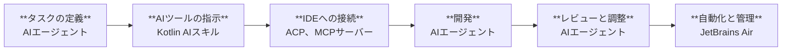

[//]: # (title: Kotlin開発向けAIツール)
<web-summary>AIを活用してKotlin開発を強化しましょう。AI Assistant、Junie、JetBrains Air、Kotlin AIスキル、コーディングエージェント、およびIDE統合を利用して、コードの記述、テスト、レビュー、リファクタリングを行う方法を解説します。</web-summary>

AI搭載ツールは、Kotlin開発における多くのタスクを支援します。コードの生成や解説、機能の実装、テストの作成、変更内容のレビュー、既存コードのリファクタリング、繰り返しの開発タスクの自動化などが可能です。

Kotlinエコシステムには、対話型開発向けツール、AIエージェント、大規模なエージェントオーケストレーション向けツールが含まれています。ワークフローに応じて、以下のことが行えます。

* : IntelliJ IDEAやAndroid StudioなどのIDEでAI機能を直接利用する。
* [AIエージェントの活用](#use-ai-agents): Junieやサードパーティ製エージェントなどのAIエージェントを選択し、Kotlin AIスキルによってKotlinに関する専門性を高める。
* [AI開発の管理と拡張](#manage-ai-agents): 対話型および自動化されたエージェントのワークフローを統括する。

このページでは、各ツールの違いと、開発ワークフローの各段階でそれらがどのように役立つかについて説明します。

## IDEでの開発 {id="develop-in-the-ide"}

IDEでは、開発環境内で直接AI機能を利用できます。IDEから離れることなく、Kotlinコードの記述、変更、レビューを行えます。

### AI Assistant {id="ai-assistant"}

[AI Assistant](https://plugins.jetbrains.com/plugin/22282-jetbrains-ai-assistant)は、[IntelliJ IDEA](https://www.jetbrains.com/idea/download/)などのJetBrains IDEや、[Android Studio](https://developer.android.com/studio)内で直接AIによる支援を提供します。各変更を自分でコントロールしながら進めたい対話型の開発タスクに適しています。

AI Assistantには以下の機能があります。

* [Junie](https://www.jetbrains.com/junie/)、Claude Code、OpenAI Codex、およびAgent Client Protocol（ACP）をサポートするサードパーティ製エージェントを含む、各種AIエージェントへのアクセス。
* Gemini、GPT、Claudeなどのクラウドホスト型モデルや、ローカルモデルを利用したコンテキスト認識AIチャット。
* AI支援によるコード補完および次の編集の提案。

詳細については、[JetBrains IDEとAI Assistantの統合](https://www.jetbrains.com/help/ai-assistant/about-ai-assistant.html)を参照してください。

### Air in IDEs {id="air-in-ides"}

[Air in IDEs](https://www.jetbrains.com/air/ides/)は、JetBrains IDE内でコーディングエージェントを操作するための環境を提供するプラグインです。プロジェクトを横断してエージェントセッションを開始し、その進行状況を追跡したり、コードナビゲーションやインスペクションなどのIDE機能を使って変更内容をレビューしたりできます。差分（diff）にコメントを付けて、エージェントに修正を指示することも可能です。

Airを使用すると、ローカル環境にインストールされた互換性のあるエージェントに接続したり、[ACPレジストリ](https://agentclientprotocol.com/get-started/registry)からエージェントを選択したりできます。また、タスクをローカルで実行するだけでなく、[Air Teams](https://air.jetbrains.cloud/)を通じて時間のかかるタスクをクラウドエージェントに委任することもできます。

詳細については、[JetBrains IDEにおけるAir](https://www.jetbrains.com/air/ides/)を参照してください。

## AIエージェントの活用 {id="use-ai-agents"}

AIエージェントは、対話型のAIアシスタントに比べて直接的な指示を減らしながら開発タスクを実行できます。たとえば、プロジェクトの探索、実装手順の計画、複数ファイルの変更、コマンドやテストの実行などが可能です。

> 使用するAIエージェントに迷った場合は、[Kotlin Benchmark](https://kotlinlang.org/benchmark/)をチェックして、Kotlin開発タスクにおける各エージェントのパフォーマンスを比較してみてください。
> 
{style="tip"}

### Air Gateway {id="air-gateway"}

[Air Gateway](https://www.jetbrains.com/air/gateway/)は、Claude Code、Codex、Junie CLIなどのターミナルエージェントを、JetBrains AIクレジットを使用してJetBrainsアカウント経由で実行するためのコマンドラインツールです。エージェントは既存のターミナルワークフローを維持したまま、JetBrains Consoleを通じてエージェントやモデルへのアクセスを一元管理できます。

詳細については、[Air Gateway](https://www.jetbrains.com/air/gateway/)を参照してください。

### Air Context {id="air-context"}

[Air Context](https://www.jetbrains.com/air/context/)は、コーディングエージェントが関連するコード、API、依存関係、テスト、実装パターンを見つけられるようにリポジトリのセマンティックインデックスを作成する、コマンドラインインターフェース付きのコードベースインデックス作成サービスです。

エージェントが大規模なコードベースを探索する必要がある場合や、既存の実装やプロジェクトの規約を見つける必要がある場合は、Air Contextを使用してください。Claude Code、Codex CLI、Junie CLIなどのサポートされているエージェントと統合でき、IDEやその他のサポートされているエディターからも利用できます。

詳細については、[Air Context](https://www.jetbrains.com/air/context/)を参照してください。

### Junie {id="junie"}

[Junie](https://junie.jetbrains.com/)はJetBrainsのAIエージェントです。Junieは[JetBrains IDEおよびAndroid Studio内](https://plugins.jetbrains.com/plugin/26104-junie-the-ai-coding-agent-by-jetbrains)、[ターミナルから](https://junie.jetbrains.com/docs/junie-cli.html)、またはCI/CDパイプライン内の[ヘッドレスモード](https://junie.jetbrains.com/docs/junie-headless.html)で使用できます。また、[GitHubワークフロー](https://junie.jetbrains.com/docs/junie-on-github.html)にJunieを統合することも可能です。

Junieは、単一のコード提案やチャットの応答以上のものを必要とするタスク向けに設計されています。複数ファイルが関係する開発タスクや、計画と実行が必要なタスクにはJunieを使用してください。機能の実装、複数ファイルにまたがるコードの更新、テストの追加、メンテナンス作業などを指示できます。

JunieをIDE内で実行すると、プロジェクトのインデックス作成、コードナビゲーション、インスペクション、リファクタリング、デバッグ、フレームワークを考慮したプロジェクト解析など、IDEの機能も活用できます。

詳細については、[Junie](https://junie.jetbrains.com/docs/get-started-with-junie.html)を参照してください。

### サードパーティ製AIエージェント {id="third-party-ai-agents"}

多くのサードパーティ製AI開発ツールがKotlinをサポートしています。これらはIDE拡張機能、スタンドアロンエディター、コマンドラインツール、クラウドベースの開発環境として提供されています。例：

* GitHub Copilot
* Google Gemini
* Claude Code
* OpenAI Codex

好みの開発環境に合っている場合や、ワークフローに適した機能を提供している場合は、サードパーティ製ツールを選択してください。これらのツールの多くは、Kotlinコードの生成、解説、テストの作成、リファクタリングをサポートしています。

サードパーティ製ツールを単独で使用することも、ACP経由で互換性のあるエージェントをJetBrains IDEに接続して使用することもできます。

### MCPサーバー {id="mcp-servers"}

Model Context Protocol（MCP）は、AIモデルを外部のデータソース、ツール、システムに接続します。JetBrainsは、Kotlin開発をより生産的にするためのMCPサーバーを複数提供しています。

* [JetBrains IDE MCPサーバー](https://plugins.jetbrains.com/plugin/26071-mcp-server)はIDEの機能を公開します。このサーバーを使用することで、AIエージェントはプロジェクトのインデックス作成、コードナビゲーション、リファクタリング、インスペクション、ビルドの実行などのIDE機能を利用できます。これにより、エージェントはKotlinプロジェクトをより深く理解し、コードの生成や評価をより効率的に行うことができます。
* [MCP Kotlin SDK](kotlin-ai-apps-development-overview.md#model-context-protocol-mcp-kotlin-sdk)は、Kotlin Multiplatformの実装です。KotlinでAI搭載アプリケーションを構築し、JVM、WebAssembly、iOSにまたがるLLMサーフェスと統合するのに役立ちます。
* Kotlin Multiplatformプロジェクト向けには、[klibs.io MCPサーバー](https://github.com/JetBrains/klibs-io/blob/master/integrations/mcp/README.md)が、エージェントによる利用可能なマルチプラットフォームライブラリのカタログへのアクセスを支援し、既存のソリューションをより効率的に探せるようにします。
* Compose Multiplatformプロジェクト向けには、[Compose Hot Reload MCPサーバー](https://kotlinlang.org/docs/multiplatform/compose-hot-reload.html#mcp-server-for-ai-agents)により、エージェントがリロード可能なアプリと直接対話（リロードのトリガー、スクリーンショットの取得、セマンティックツリーの読み取りなど）を行えるようになります。

### Kotlin AIスキル {id="kotlin-ai-skills"}

Kotlin AIスキルは、AIエージェントにKotlin開発タスクを実行させるための再利用可能な指示セットです。エージェントが一貫性を持ってこれらのタスクを実行するのに役立ちます。

慣用的なKotlinパターン、Kotlinのコーディング規約、プロジェクト固有の要件に沿ってエージェントを誘導したい場合は、Kotlin AIスキルを使用してください。スキルは、Kotlinコードの記述、言語機能の説明、ドキュメントの生成、テストの作成、コードのレビュー、移行ガイダンスの適用などのタスクをAIエージェントが実行するのを支援します。

Kotlin AIスキルは、IDEベースのエージェント、コマンドラインエージェント、再利用可能な指示をサポートする外部AIツールなど、さまざまなエージェントやワークフローで使用できます。

詳細については、を参照してください。

### Kotlin固有の受け入れ基準 {id="kotlin-specific-acceptance-criteria"}

特にKotlin Multiplatformプロジェクトは複雑であるため、エージェントがプロジェクト全体の構造や特定の変更が及ぼす影響を見失ってしまうことがあります。

エージェントを支援するために、全般的な受け入れ基準（[AGENTS.md](https://agents.md/)）またはタスク固有の完了基準として、以下の例を含めることができます。

* ターゲット固有のテストが利用可能な場合は、変更を加えた後に必ずそれらのテストを実行する。
* タスクを完了と見なす前に、設定されているすべてのKMPターゲットが正常にビルドできることを確認する。
* エージェント（または開発者）が後から誤って共通コード内でプラットフォーム固有のAPIを使用してしまうのを防ぐため、実装においてプラットフォーム固有のAPIが共通コードに漏れ出していないかをレビューする。

## AIエージェントの管理 {id="manage-ai-agents"}

開発チームでは、繰り返しのタスクを自動化したり、エージェントのアクティビティを監視したり、導入を決定する前にさまざまなツールを評価したりするために、複数のAIエージェントが必要になる場合があります。以下のツールは、個々のコーディングセッションを超えたAI支援開発をサポートします。

### Air Teams {id="air-teams"}

[Air Teams](https://www.jetbrains.com/air/)を使用すると、共有プロジェクトや専用のクラウド環境で、チームメンバーがエージェントタスクでコラボレーションを行えます。プロジェクトごとにマシンリソース、ネットワークアクセス、変数、シークレットを設定し、MCPサーバーを接続することで、チームメンバーとエージェントが同じ外部ツールを使用できるようになります。

コラボレーションやレビューのために共有のエージェント環境やセッションが必要な場合は、Air Teamsを使用してください。

詳細については、[Air Teams](https://www.jetbrains.com/air/)を参照するか、[Air Teamsにアクセス](https://air.jetbrains.cloud/)してください。

### Air Governance {id="air-governance"}

[Air Governance](https://www.jetbrains.com/air/governance/)は、AI支援およびエージェント主導の開発に対して組織レベルの制御を提供します。管理者は開発者が使用できるエージェント、モデル、MCPサーバーを制御し、AIクレジットの上限を設定できます。ポリシーは組織全体に適用することも、特定のチームや個人に合わせて調整することも可能です。利用状況の分析により、チームがどのツールを使用しているか、どこに投資すべきかを把握できます。

組織全体でさまざまなAIツールやプロバイダーへのアクセスとコストを管理する必要がある場合は、Air Governanceを使用してください。使用状況を一元管理しながら、JetBrains AIを使用することも、組織独自のプロバイダーAPIキーを提供することも可能です。

詳細については、[Air Governance](https://www.jetbrains.com/air/governance/)を参照してください。