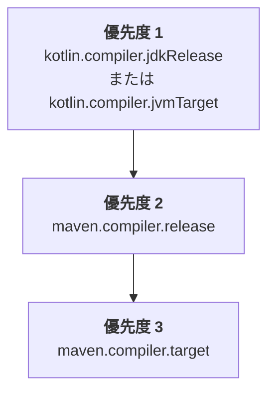

[//]: # (title: Maven プロジェクトの設定)

既存の Java Maven プロジェクトに Kotlin を導入する場合、または新しい Kotlin Maven プロジェクトを作成する場合は、Kotlin のソースコードとモジュールをコンパイルする Kotlin Maven プラグインを追加する必要があります。

現在、Maven v3 のみがサポートされています。

> プロジェクトを Maven 4 に移行する予定がある場合は、ビルドを自動的に移行するために [`mvnup`](https://maven.apache.org/tools/mvnup.html) Maven アップグレードツールを使用してください。移行の詳細については、[Starting with Maven 4](https://maven.apache.org/guides/mini/guide-migration-to-mvn4.html) ガイドを参照してください。
>
{style="note"}

## 自動設定 {id="automatic-configuration"}

`<extensions>` オプションを使用することで、Java と Kotlin の混在プロジェクトでも純粋な Kotlin プロジェクトでも、Maven の設定を簡素化できます。
このアプローチにより、Maven コンパイラプラグインを設定する必要がなくなるため、時間を節約できます。

`<extensions>` を指定して Kotlin Maven プラグインを適用するには、`pom.xml` ビルドファイルを次のように更新します。

1. `<properties>` セクションで、Kotlin と JVM のターゲットバージョンを定義します。

   ```xml
   <properties>
       <maven.compiler.release>17</maven.compiler.release>
       <kotlin.version>%kotlinVersion%</kotlin.version>
   </properties>
   ```

2. `<build><plugins>` セクションで、`<extensions>` オプションを有効にして Kotlin Maven プラグインを追加します。

   ```xml
   <build>
       <plugins>
           <!-- Kotlin コンパイラプラグインの設定 -->
           <plugin>
               <groupId>org.jetbrains.kotlin</groupId>
               <artifactId>kotlin-maven-plugin</artifactId>
               <version>${kotlin.version}</version>
               <extensions>true</extensions> <!-- エクステンションを有効化 -->
           </plugin>
           <!-- エクステンションを使用する場合、Maven コンパイラプラグインの設定は不要です -->
       </plugins>
   </build>
   ```

`<extensions>` オプションには以下の機能があります。

* `src/main/kotlin` および `src/test/kotlin` ディレクトリが既に存在し、かつプラグイン設定で指定されていない場合に、それらをソースルートとして登録します。
* プロジェクトで未定義の場合、[`kotlin-stdlib` の依存関係](maven-set-dependencies.md#dependency-on-the-standard-library) を自動で追加します。
* `compile`、`test-compile`、`kapt`、`test-kapt` の各 execution をビルドに追加し、適切な [ライフサイクルフェーズ](https://maven.apache.org/guides/introduction/introduction-to-the-lifecycle.html) にバインドします。
  これにより、`kapt`、Kotlin の `compile`、Java の `compile` の各 execution が正しい順序で実行されるように、`<id>` や `<goals>` を指定して `<executions>` セクションを手動で設定する必要がなくなります。
* [JVM ターゲットバージョンを、プロジェクトで設定されている Java コンパイラバージョンと自動的に一致させます。](#jvm-target-version)
   
Java と Kotlin の混在プロジェクトの場合、この設定により以下が保証されます。

* Kotlin コードが最初にコンパイルされます。
* Java コードは Kotlin の後にコンパイルされ、Kotlin クラスを参照できます。
* Maven のデフォルトの挙動によってプラグインの順序が上書きされません。

エクステンションの設定により、`<executions>` セクション全体が置き換えられます。execution を独自に設定する必要がある場合は、[Kotlin および Java ソースのコンパイル](#compile-kotlin-and-java-sources) の例を参照してください。

> 複数のビルドプラグインがデフォルトのライフサイクルを上書きしており、さらに `<extensions>` オプションも有効にしている場合、`<build>` セクション内の最後のプラグインがライフサイクル設定において優先されます。それより前に行われたライフサイクル設定の変更はすべて無視されます。
>
{style="note"}

<anchor name="maven-compiler-extensions-version"/>

現在、`<extensions>` とともに使用される Maven コンパイラプラグインのデフォルトバージョンは **%mavenExtensionsVersion%** です。
別のバージョンを個別に設定することもできます。

```xml
<build>
    <plugins>
        <!-- Kotlin コンパイラプラグインの設定 -->
        <plugin>
            <groupId>org.jetbrains.kotlin</groupId>
            <artifactId>kotlin-maven-plugin</artifactId>
            <version>${kotlin.version}</version>
            <extensions>true</extensions>
        </plugin>
        <!-- Java クラス用の Maven コンパイラプラグイン設定 -->
        <plugin>
            <groupId>org.apache.maven.plugins</groupId>
            <artifactId>maven-compiler-plugin</artifactId>
            <version>%mavenPluginVersion%</version>
        </plugin>
    </plugins>
</build>
```

### JVM ターゲットバージョン {id="jvm-target-version"}

`<extensions>` オプションは、Kotlin と Maven コンパイラが同じバイトコードバージョンをターゲットにすることを保証します。

Kotlin Maven プラグインは、以下の優先順序で JVM ターゲットバージョンを自動的に解決します。



#### Kotlin コンパイラのバージョン {id="kotlin-compiler-versions"}

プロジェクトで `kotlin.compiler.jdkRelease` または `kotlin.compiler.jvmTarget` プロパティのいずれかが定義されている場合、その設定値が優先されます。

これらの Kotlin コンパイラオプションは動作が異なる点に注意してください。

| Kotlin コンパイラオプション | 出力のバイトコードバージョンを制御 | API を指定した JDK に制限 |
|------------------------------|-----------------------------------------|-----------------------------------------------------------------------------------------------|
| `kotlin.compiler.jvmTarget`  | はい | コード内の JDK API に制限なし |
| `kotlin.compiler.jdkRelease` | はい | はい − 特定の API バージョンのみ許可（Java の `--release` コンパイラオプションと同等） |

> `kotlin.compiler.jdkRelease` と `kotlin.compiler.jvmTarget` に異なる JDK オプションを同時に設定しないでください。
> エラーが発生します。
>
{style="note"}

#### Maven コンパイラのバージョン {id="maven-compiler-versions"}

* `kotlin.compiler.jdkRelease` と `kotlin.compiler.jvmTarget` オプションのどちらも設定されていない場合、プラグインは `maven.compiler.release` のバージョンを採用します。

  `maven.compiler.release` のバージョンは、プロジェクトのプロパティとして定義することも、`maven-compiler-plugin` の設定内で定義することもできます。
* Maven の release バージョンが設定されていない場合、プラグインは `maven.compiler.target` のバージョンを採用します。

  これもプロジェクトのプロパティとして定義することも、`maven-compiler-plugin` の設定内で定義することもできます。

Maven コンパイラの `target` オプションと `release` オプションは動作が異なる点に注意してください。

| Maven コンパイラオプション | Kotlin の `jvmTarget` を設定 | Kotlin の `jdkRelease` を設定 | API を指定した JDK に制限 |
|--------------------------|---------------------------|----------------------------|----------------------------------------------|
| `maven.compiler.target`  | はい | いいえ | いいえ − ビルドの JDK クラスパスは可視のまま |
| `maven.compiler.release` | はい | はい | はい − 特定の API バージョンのみ |

> `<extensions>` オプションは、プロジェクトレベルのプロパティとグローバルな `maven-compiler-plugin` の設定のみをチェックします。
> プラグインの `<executions>` セクション内で定義された設定はチェックしません。
>
{style="note"}

## 手動設定 {id="manual-configuration"}

Kotlin Maven プラグインで `<extensions>` を有効にしない場合は、ソースコードが正しくコンパイルされるようにプロジェクトを手動で設定する必要があります。

Maven プロジェクトは、[Java と Kotlin ソースの組み合わせ](#compile-kotlin-and-java-sources) または [Kotlin のみのソース](#compile-kotlin-only-sources) をコンパイルするように設定できます。

### Kotlin および Java ソースのコンパイル {id="compile-kotlin-and-java-sources"}

Kotlin と Java の両方のソースファイルが含まれるプロジェクトをコンパイルするには、Java コンパイラの前に Kotlin コンパイラが実行されるように設定してください。

Java コンパイラは、Kotlin の宣言が `.class` ファイルにコンパイルされるまでそれを認識できません。
Java コードが Kotlin クラスを使用している場合、`cannot find symbol` エラーを防ぐために、それらのクラスを最初にコンパイルする必要があります。

Maven は、主に次の2つの要素に基づいてプラグインの実行順序を決定します。

* `pom.xml` ファイル内でのプラグイン宣言の順序。
* `default-compile` や `default-testCompile` などの組み込みのデフォルト execution。これらは、`pom.xml` ファイル内での位置に関係なく、常にユーザー定義の execution より前に実行されます。

実行順序を制御するには、以下のようにします。

* `maven-compiler-plugin` の前に `kotlin-maven-plugin` を宣言します。
* Java コンパイラプラグインのデフォルト execution を無効にします。
* コンパイルフェーズを明示的に制御するためにカスタム execution を追加します。

> デフォルトの execution を無効にするには、Maven の特別な `none` フェーズを使用できます。
>
{style="note"}

Kotlin Maven プラグインを適用するには、`pom.xml` ビルドファイルを次のように更新します。

```xml
<build>
    <plugins>
        <!-- Kotlin コンパイラプラグインの設定 -->
        <plugin>
            <groupId>org.jetbrains.kotlin</groupId>
            <artifactId>kotlin-maven-plugin</artifactId>
            <version>${kotlin.version}</version>
            <executions>
                <execution>
                    <id>kotlin-compile</id>
                    <phase>compile</phase>
                    <goals>
                        <goal>compile</goal>
                    </goals>
                    <configuration>
                        <sourceDirs>
                            <sourceDir>${project.basedir}/src/main/kotlin</sourceDir>
                            <!-- Kotlin コードが Java コードを参照できるようにします -->
                            <sourceDir>${project.basedir}/src/main/java</sourceDir>
                        </sourceDirs>
                    </configuration>
                </execution>
                <execution>
                    <id>kotlin-test-compile</id>
                    <phase>test-compile</phase>
                    <goals>
                        <goal>test-compile</goal>
                    </goals>
                    <configuration>
                        <sourceDirs>
                            <sourceDir>${project.basedir}/src/test/kotlin</sourceDir>
                            <sourceDir>${project.basedir}/src/test/java</sourceDir>
                        </sourceDirs>
                    </configuration>
                </execution>
            </executions>
        </plugin>

        <!-- Maven コンパイラプラグインの設定 -->
        <plugin>
            <groupId>org.apache.maven.plugins</groupId>
            <artifactId>maven-compiler-plugin</artifactId>
            <version>3.15.0</version>
            <executions>
                <!-- デフォルトの execution を無効化 -->
                <execution>
                    <id>default-compile</id>
                    <phase>none</phase>
                </execution>
                <execution>
                    <id>default-testCompile</id>
                    <phase>none</phase>
                </execution>

                <!-- カスタム execution を定義 -->
                <execution>
                    <id>java-compile</id>
                    <phase>compile</phase>
                    <goals>
                        <goal>compile</goal>
                    </goals>
                </execution>
                <execution>
                    <id>java-test-compile</id>
                    <phase>test-compile</phase>
                    <goals>
                        <goal>testCompile</goal>
                    </goals>
                </execution>
            </executions>
        </plugin>
    </plugins>
</build>
```

この設定により、以下が保証されます。

* Kotlin コードが最初にコンパイルされます。
* Java コードは Kotlin の後にコンパイルされ、Kotlin クラスを参照できます。
* Maven のデフォルトの挙動によってプラグインの順序が上書きされません。

Maven がプラグインの execution を処理する方法の詳細については、Maven 公式ドキュメントの [Guide to default plugin execution IDs](https://maven.apache.org/guides/mini/guide-default-execution-ids.html) を参照してください。

### Kotlin のみのソースのコンパイル {id="compile-kotlin-only-sources"}

Kotlin のソースファイルのみを持つプロジェクトをコンパイルするには、ソースルートを宣言し、Kotlin Maven プラグインを設定します。

1. `<build>` セクションでソースディレクトリを指定します。

    ```xml
    <build>
        <sourceDirectory>src/main/kotlin</sourceDirectory>
        <testSourceDirectory>src/test/kotlin</testSourceDirectory>
    </build>
    ```

2. Kotlin Maven プラグインが適用されていることを確認します。

    ```xml
    <build>
        <plugins>
            <plugin>
                <groupId>org.jetbrains.kotlin</groupId>
                <artifactId>kotlin-maven-plugin</artifactId>
                <version>${kotlin.version}</version>
                <executions>
                    <execution>
                        <id>compile</id>
                        <goals>
                            <goal>compile</goal>
                        </goals>
                    </execution>
                    <execution>
                        <id>test-compile</id>
                        <goals>
                            <goal>test-compile</goal>
                        </goals>
                    </execution>
                </executions>
            </plugin>
        </plugins>
    </build>
    ```

### JDK バージョンの設定 {id="set-jdk-version"}

Kotlin は、ビルド内の JDK バージョンを管理するのに役立つ [Maven Toolchains](https://maven.apache.org/guides/mini/guide-using-toolchains.html) をサポートしています。

ビルドで `maven-toolchains-plugin` を設定すると、Maven を実行している JVM バージョン（`JAVA_HOME` 環境変数で設定）とは無関係に、Kotlin のコンパイルに使用する JDK を指定できます。その後、Kotlin Maven プラグインは選択された JDK ツールチェーンを自動的に取得し、[`-jdk-home` オプション](compiler-reference.md#jdk-home-path) を使用して JDK のホームディレクトリをコンパイラに渡します。

これにより、Kotlin のコンパイルを含むビルド内のすべてのプラグインで使用される JDK を制御する単一のツールチェーンを設定できます。例：

```xml
<plugin>
    <groupId>org.apache.maven.plugins</groupId>
    <artifactId>maven-toolchains-plugin</artifactId>
    <version>3.2.0</version>
    <executions>
        <execution>
            <goals>
                <goal>toolchain</goal>
            </goals>
        </execution>
    </executions>
    <configuration>
        <toolchains>
            <jdk>
                <version>21</version>
            </jdk>
        </toolchains>
    </configuration>
</plugin>
```

Kotlin のコンパイルに使用する JDK は複数の方法で設定できます。JDK バージョンは以下の優先順位で解決されます。

```Mermaid
graph TD
    A["<b>優先度 1</b><br/>kotlin-maven-plugin の jdkHome オプション"]
    B["<b>優先度 2</b><br/>maven-toolchains-plugin で<br/>設定された JDK バージョン"]
    C["<b>優先度 3</b><br/>JAVA_HOME のバージョン"]

    A --> B
    B --> C
```

* `kotlin-maven-plugin` 設定の `jdkHome` オプションで設定された JDK バージョンは、ツールチェーンのバージョンよりも常に優先されます。
* `maven-toolchains-plugin` の JDK バージョンは、`JAVA_HOME` 環境変数で設定された JDK バージョンを上書きします。

また、プラグイン固有の `<jdkToolchain>` オプションを使用して、`kotlin-maven-plugin` のツールチェーンで直接 JDK バージョンを設定することもできます。`maven-toolchains-plugin` を使用する場合と比較して、このパラメータは Kotlin のコンパイルにのみ影響し、ビルド内の他のプラグインには影響しません。

ツールチェーン用の JDK バージョン（`maven-toolchains-plugin` または `<jdkToolchain>` オプションで設定）は、Kotlin コンパイラが使用する JDK にのみ影響します。生成されるバイトコードのバージョンは変更されません。

バイトコードのバージョンを制御するには、[`jvmTarget`](maven-kotlin-compiler.md#attributes-specific-to-jvm) オプションを明示的に設定します。これを設定しない場合、Kotlin Maven プラグインは [`jdkRelease`](maven-kotlin-compiler.md#attributes-specific-to-jvm) オプションの値を採用するか、`jdkRelease` も設定されていない場合はデフォルトの `%defaultJvmTargetVersion%` にフォールバックします。

> 現在、特定の JDK バージョンを使用するように `maven-toolchains-plugin` をセットアップしても、`kotlin-maven-plugin` の [`kapt` および `test-kapt` ゴールには影響しません](https://youtrack.jetbrains.com/issue/KT-79897)。代わりに、`JAVA_HOME` 環境変数に必要なバージョンを設定してください。
>
{style="note"}

## Java モジュール（JPMS）の設定 {id="configure-java-modules-jpms"}

Kotlin Maven プラグインは [Java Platform Module System (JPMS)](https://dev.java/learn/modules/) をサポートしているため、`module-info.java` ディスクリプタと一緒に Kotlin コードをコンパイルし、結果のモジュールを他の Java モジュールと同様に使用できます。

ビルドファイルに追加の JPMS 固有のオプションは必要ありません。
単に Maven より前に Kotlin コンパイラが実行されるように設定するだけです。

`module-info.java` ディスクリプタが存在する場合、Kotlin コンパイラはそれをソースファイルとして使用し、クラスパスではなくそのモジュールパスに対してコンパイルを行います。Kotlin コンパイラはディスクリプタを読み取ってモジュールグラフを解決し、その後 Maven コンパイラがそれを `module-info.class` ファイルにコンパイルします。

Java モジュールを設定するには、`${project.basedir}/src/main/java` ディレクトリに `module-info.java` ファイルを作成します。
モジュールディスクリプタで、モジュールが必要とするすべての依存関係とエクスポートするパッケージを宣言します。例：

```java
module org.example.myapp {
    requires transitive kotlin.stdlib;
    requires java.net.http;
    
    exports org.example.myapp;
}
```

以下の点に注意してください。

* Java モジュールで使用できるのは、宣言したもののみです。コンパイルではクラスパスではなくモジュールパスが使用されるため、ディスクリプタには Kotlin コードが使用するすべての依存関係（標準ライブラリ、`java.base` 以外の JDK モジュール、その他のライブラリ）を含める必要があります。そうしないと、`Unresolved reference` エラーが発生する可能性があります。
* モジュールの場合、`Package is empty or does not exist` ビルドエラーを回避するために、Kotlin ファイル内のパッケージ名は `module-info.java` のパッケージ名と一致している必要があります。
* `pom.xml` ビルドファイルは、[Java より前に Kotlin がコンパイルされる](#compile-kotlin-and-java-sources) ように設定されている必要があります。[プロジェクトの自動設定](#automatic-configuration) を使用している場合、`<extensions>` オプションによってこれが既に保証されています。

## 次のステップ {id="what-s-next"}

[Kotlin Maven プロジェクトでの依存関係の設定](maven-set-dependencies.md)