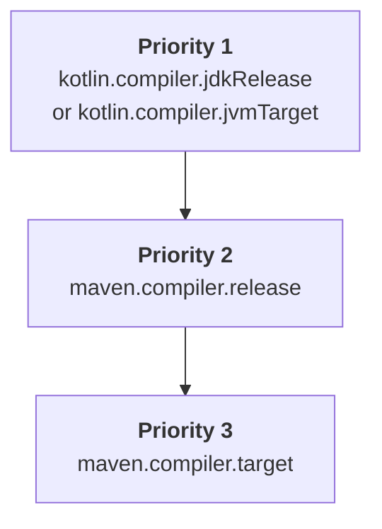

[//]: # (title: Maven プロジェクトの構成)

既存の Java Maven プロジェクトに Kotlin を導入する場合、または新しい Kotlin Maven プロジェクトを作成する場合は、Kotlin のソースとモジュールをコンパイルする Kotlin Maven プラグインを追加する必要があります。

現在、Maven v3 のみがサポートされています。

> プロジェクトを Maven 4 に移行する予定がある場合は、[`mvnup`](https://maven.apache.org/tools/mvnup.html) Maven アップグレードツールを使用してビルドを自動的に移行してください。移行の詳細については、[Starting with Maven 4](https://maven.apache.org/guides/mini/guide-migration-to-mvn4.html) ガイドを参照してください。
>
{style="note"}

## 自動構成 {id="automatic-configuration"}

`<extensions>` オプションを使用することで、Java と Kotlin が混在するプロジェクトおよび純粋な Kotlin プロジェクトの双方で Maven の構成を簡素化できます。
このアプローチにより、Maven コンパイラプラグインを個別に構成する必要がなくなるため、時間を節約できます。

`<extensions>` を指定して Kotlin Maven プラグインを適用するには、`pom.xml` ビルドファイルを次のように更新します。

1. `<properties>` セクションで、Kotlin と JVM のターゲットバージョンを定義します。

   ```xml
   <properties>
       <maven.compiler.release>17</maven.compiler.release>
       <kotlin.version>%kotlinVersion%</kotlin.version>
   </properties>
   ```

2. `<build><plugins>` セクションで、`<extensions>` オプションを有効にした Kotlin Maven プラグインを追加します。

   ```xml
   <build>
       <plugins>
           <!-- Kotlin compiler plugin configuration -->
           <plugin>
               <groupId>org.jetbrains.kotlin</groupId>
               <artifactId>kotlin-maven-plugin</artifactId>
               <version>${kotlin.version}</version>
               <extensions>true</extensions> <!-- Enable the extension -->
           </plugin>
           <!-- No need to configure Maven compiler plugin with extensions -->
       </plugins>
   </build>
   ```

`<extensions>` オプションには以下の効果があります。

* `src/main/kotlin` および `src/test/kotlin` ディレクトリが既に存在し、プラグイン構成で指定されていない場合、それらをソースルートとして登録します。
* プロジェクトでまだ定義されていない場合、[`kotlin-stdlib` の依存関係](maven-set-dependencies.md#dependency-on-the-standard-library) を追加します。
* 適切な[ライフサイクルフェーズ](https://maven.apache.org/guides/introduction/introduction-to-the-lifecycle.html)にバインドされた `compile`、`test-compile`、`kapt`、および `test-kapt` の各 execution をビルドに追加します。
  そのため、これらが正しい順序で実行されるように、`kapt`、Kotlin の `compile`、Java の `compile` execution に対して `<id>` や `<goals>` を含む `<executions>` セクションを手動で設定する必要はありません。
* [プロジェクトで構成されている Java コンパイラのバージョンに合わせて JVM ターゲットバージョンを自動的に調整します。](#jvm-target-version)
   
Java と Kotlin が混在するプロジェクトの場合、この構成により以下が保証されます。

* Kotlin コードが最初にコンパイルされます。
* Java コードは Kotlin の後にコンパイルされ、Kotlin クラスを参照できます。
* Maven のデフォルトの動作によってプラグインの実行順序が上書きされることはありません。

extension の構成は、`<executions>` セクション全体を置き換えます。execution を個別に構成する必要がある場合は、[Kotlin と Java のソースをコンパイルする](#compile-kotlin-and-java-sources) の例を参照してください。

> 複数のビルドプラグインがデフォルトのライフサイクルを上書きしており、かつ `<extensions>` オプションも有効にしている場合、`<build>` セクション内の最後のプラグインがライフサイクル設定に対して優先順位を持ちます。それ以前のライフサイクル設定への変更はすべて無視されます。
>
{style="note"}

<anchor name="maven-compiler-extensions-version"/>

現在、`<extensions>` で使用される Maven コンパイラプラグインのデフォルトバージョンは **%mavenExtensionsVersion%** です。
別のバージョンを個別に設定することもできます。

```xml
<build>
    <plugins>
        <!-- Kotlin compiler plugin configuration -->
        <plugin>
            <groupId>org.jetbrains.kotlin</groupId>
            <artifactId>kotlin-maven-plugin</artifactId>
            <version>${kotlin.version}</version>
            <extensions>true</extensions>
        </plugin>
        <!-- Maven compiler plugin configuration for Java classes -->
        <plugin>
            <groupId>org.apache.maven.plugins</groupId>
            <artifactId>maven-compiler-plugin</artifactId>
            <version>%mavenPluginVersion%</version>
        </plugin>
    </plugins>
</build>
```

### JVM ターゲットバージョン {id="jvm-target-version"}

`<extensions>` オプションにより、Kotlin コンパイラと Maven コンパイラが同じバイトコードバージョンをターゲットにすることが保証されます。

Kotlin Maven プラグインは、以下の順序で JVM ターゲットバージョンを自動的に解決します。



#### Kotlin コンパイラのバージョン {id="kotlin-compiler-versions"}

プロジェクトで `kotlin.compiler.jdkRelease` または `kotlin.compiler.jvmTarget` プロパティのいずれかが定義されている場合、その設定値が優先されます。

これらの Kotlin コンパイラオプションの動作は異なることに注意してください。

| Kotlin コンパイラオプション   | 出力のバイトコードバージョンを制御 | API を指定された JDK に制限                                                    |
|------------------------------|-----------------------------------|-------------------------------------------------------------------------------|
| `kotlin.compiler.jvmTarget`  | はい                              | いいえ（コード内の JDK API に制限なし）                                         |
| `kotlin.compiler.jdkRelease` | はい                              | はい − 特定の API バージョンのみ許可（Java の `--release` コンパイラオプションと同等） |

> `kotlin.compiler.jdkRelease` と `kotlin.compiler.jvmTarget` に異なる JDK オプションを同時に設定しないでください。
> エラーが発生します。
>
{style="note"}

#### Maven コンパイラのバージョン {id="maven-compiler-versions"}

* `kotlin.compiler.jdkRelease` も `kotlin.compiler.jvmTarget` も設定されていない場合、プラグインは `maven.compiler.release` のバージョンを採用します。

  `maven.compiler.release` のバージョンは、プロジェクトのプロパティとして定義することも、`maven-compiler-plugin` の構成内で定義することもできます。
* Maven の release バージョンが設定されていない場合、プラグインは `maven.compiler.target` のバージョンを採用します。

  これもプロジェクトのプロパティとして定義するか、`maven-compiler-plugin` の構成内で定義できます。

Maven コンパイラの `target` オプションと `release` オプションの動作は異なることに注意してください。

| Maven コンパイラオプション | Kotlin の `jvmTarget` を設定 | Kotlin の `jdkRelease` を設定 | API を指定された JDK に制限                     |
|--------------------------|-----------------------------|------------------------------|------------------------------------------------|
| `maven.compiler.target`  | はい                        | いいえ                       | いいえ − ビルドの JDK クラスパスは可視のまま    |
| `maven.compiler.release` | はい                        | はい                         | はい − 指定された API バージョンのみに制限される |

> `<extensions>` オプションは、プロジェクトレベルのプロパティとグローバルな `maven-compiler-plugin` の構成のみをチェックします。
> プラグインの `<executions>` セクション内で定義された構成はチェックしません。
>
{style="note"}

## 手動構成 {id="manual-configuration"}

Kotlin Maven プラグインで `<extensions>` を有効にしない場合は、ソースコードが正しくコンパイルされるようにプロジェクトを手動で構成する必要があります。

Maven プロジェクトを設定して、[Java と Kotlin が混在するソース](#compile-kotlin-and-java-sources) または [Kotlin のみのソース](#compile-kotlin-only-sources) をコンパイルできます。

### Kotlin と Java のソースをコンパイルする {id="compile-kotlin-and-java-sources"}

Kotlin と Java の両方のソースファイルを含むプロジェクトをコンパイルするには、Java コンパイラの前に Kotlin コンパイラが実行されるようにしてください。

Java コンパイラは、`.class` ファイルにコンパイルされるまで Kotlin の宣言を認識できません。
Java コードが Kotlin クラスを使用している場合、`cannot find symbol` エラーを防ぐために、それらのクラスを最初にコンパイルする必要があります。

Maven は、主に次の 2 つの要因に基づいてプラグインの実行順序を決定します。

* `pom.xml` ファイル内でのプラグイン宣言の順序。
* `default-compile` や `default-testCompile` などの組み込みのデフォルト execution。これらは、`pom.xml` ファイル内の位置に関係なく、常にユーザー定義の execution より前に実行されます。

実行順序を制御するには、以下を行います。

* `maven-compiler-plugin` の前に `kotlin-maven-plugin` を宣言します。
* Java コンパイラプラグインのデフォルト execution を無効にします。
* カスタム execution を追加して、コンパイルフェーズを明示的に制御します。

> Maven の特別な `none` フェーズを使用すると、デフォルトの execution を無効にできます。
>
{style="note"}

Kotlin Maven プラグインを適用するには、`pom.xml` ビルドファイルを次のように更新します。

```xml
<build>
    <plugins>
        <!-- Kotlin compiler plugin configuration -->
        <plugin>
            <groupId>org.jetbrains.kotlin</groupId>
            <artifactId>kotlin-maven-plugin</artifactId>
            <version>${kotlin.version}</version>
            <executions>
                <execution>
                    <id>kotlin-compile</id>
                    <phase>compile</phase>
                    <goals>
                        <goal>compile</goal>
                    </goals>
                    <configuration>
                        <sourceDirs>
                            <sourceDir>${project.basedir}/src/main/kotlin</sourceDir>
                            <!-- Ensure Kotlin code can reference Java code -->
                            <sourceDir>${project.basedir}/src/main/java</sourceDir>
                        </sourceDirs>
                    </configuration>
                </execution>
                <execution>
                    <id>kotlin-test-compile</id>
                    <phase>test-compile</phase>
                    <goals>
                        <goal>test-compile</goal>
                    </goals>
                    <configuration>
                        <sourceDirs>
                            <sourceDir>${project.basedir}/src/test/kotlin</sourceDir>
                            <sourceDir>${project.basedir}/src/test/java</sourceDir>
                        </sourceDirs>
                    </configuration>
                </execution>
            </executions>
        </plugin>

        <!-- Maven compiler plugin configuration -->
        <plugin>
            <groupId>org.apache.maven.plugins</groupId>
            <artifactId>maven-compiler-plugin</artifactId>
            <version>3.15.0</version>
            <executions>
                <!-- Disable default executions -->
                <execution>
                    <id>default-compile</id>
                    <phase>none</phase>
                </execution>
                <execution>
                    <id>default-testCompile</id>
                    <phase>none</phase>
                </execution>

                <!-- Define custom executions -->
                <execution>
                    <id>java-compile</id>
                    <phase>compile</phase>
                    <goals>
                        <goal>compile</goal>
                    </goals>
                </execution>
                <execution>
                    <id>java-test-compile</id>
                    <phase>test-compile</phase>
                    <goals>
                        <goal>testCompile</goal>
                    </goals>
                </execution>
            </executions>
        </plugin>
    </plugins>
</build>
```

この構成により、以下が保証されます。

* Kotlin コードが最初にコンパイルされます。
* Java コードは Kotlin の後にコンパイルされ、Kotlin クラスを参照できます。
* Maven のデフォルトの動作によってプラグインの実行順序が上書きされることはありません。

Maven がプラグインの execution を処理する方法の詳細については、公式 Maven ドキュメントの [Guide to default plugin execution IDs](https://maven.apache.org/guides/mini/guide-default-execution-ids.html) を参照してください。

### Kotlin のみのソースをコンパイルする {id="compile-kotlin-only-sources"}

Kotlin ソースファイルのみを含むプロジェクトをコンパイルするには、ソースルートを宣言し、Kotlin Maven プラグインを構成します。

1. `<build>` セクションでソースディレクトリを指定します。

    ```xml
    <build>
        <sourceDirectory>src/main/kotlin</sourceDirectory>
        <testSourceDirectory>src/test/kotlin</testSourceDirectory>
    </build>
    ```

2. Kotlin Maven プラグインが適用されていることを確認します。

    ```xml
    <build>
        <plugins>
            <plugin>
                <groupId>org.jetbrains.kotlin</groupId>
                <artifactId>kotlin-maven-plugin</artifactId>
                <version>${kotlin.version}</version>
                <executions>
                    <execution>
                        <id>compile</id>
                        <goals>
                            <goal>compile</goal>
                        </goals>
                    </execution>
                    <execution>
                        <id>test-compile</id>
                        <goals>
                            <goal>test-compile</goal>
                        </goals>
                    </execution>
                </executions>
            </plugin>
        </plugins>
    </build>
    ```

### JDK バージョンの設定 {id="set-jdk-version"}

Kotlin は、ビルド内の JDK バージョンを管理するのに役立つ [Maven Toolchains](https://maven.apache.org/guides/mini/guide-using-toolchains.html) をサポートしています。

ビルドで `maven-toolchains-plugin` を構成すると、Maven を実行している JVM のバージョン（`JAVA_HOME` パスで設定）とは無関係に、Kotlin のコンパイルに使用する JDK バージョンを指定できます。その後、Kotlin Maven プラグインは選択された JDK ツールチェーンを自動的に取得します。

これにより、Kotlin コンパイルを含む、ビルド内のすべてのプラグインで使用される JDK を制御する単一のツールチェーンを構成できます。例えば：

```xml
<plugin>
    <groupId>org.apache.maven.plugins</groupId>
    <artifactId>maven-toolchains-plugin</artifactId>
    <version>3.2.0</version>
    <executions>
        <execution>
            <goals>
                <goal>toolchain</goal>
            </goals>
        </execution>
    </executions>
    <configuration>
        <toolchains>
            <jdk>
                <version>21</version>
            </jdk>
        </toolchains>
    </configuration>
</plugin>
```

JDK バージョンを設定するさまざまな方法の優先順位に注意してください。

```Mermaid
graph TD
    A["<b>Priority 1</b><br/>jdkHome option of the kotlin-maven-plugin"]
    B["<b>Priority 2</b><br/>JDK version set in the <br/>maven-toolchains-plugin"]
    C["<b>Priority 3</b><br/>JAVA_HOME version"]

    A --> B
    B --> C
```

* `kotlin-maven-plugin` 構成の `jdkHome` オプションで設定された JDK バージョンは、常にツールチェーンのバージョンよりも優先されます。
* `maven-toolchains-plugin` 内の JDK バージョンは、`JAVA_HOME` パスに設定された JDK バージョンを上書きします。

プラグイン固有の `<jdkToolchain>` オプションを使用して、`kotlin-maven-plugin` のツールチェーンで直接 JDK バージョンを設定することもできます。`maven-toolchains-plugin` の使用と比較して、このパラメータは Kotlin のコンパイルにのみ影響し、ビルド内の他のプラグインには影響を与えません。

> 現在、特定の JDK バージョンを使用するように `maven-toolchains-plugin` を設定しても、`kotlin-maven-plugin` の [`kapt` および `test-kapt` ゴールには影響しません](https://youtrack.jetbrains.com/issue/KT-79897)。代わりに、`JAVA_HOME` パスに必要なバージョンを設定してください。
>
{style="note"}

## Java モジュール（JPMS）の構成 {id="configure-java-modules-jpms"}

Kotlin Maven プラグインは [Java Platform Module System (JPMS)](https://dev.java/learn/modules/) をサポートしているため、`module-info.java` 記述子と一緒に Kotlin コードをコンパイルし、結果として生成されるモジュールを他の Java モジュールと同様に使用できます。

ビルドファイルで追加の JPMS 固有オプションを指定する必要はありません。
単に Kotlin コンパイラを Maven の前に構成するだけです。

`module-info.java` 記述子が存在する場合、Kotlin コンパイラはそれをソースファイルとして使用し、クラスパスではなくモジュールパスに対してコンパイルします。Kotlin コンパイラは記述子を読み取ってモジュールグラフを解決し、その後 Maven コンパイラがそれを `module-info.class` ファイルにコンパイルします。

Java モジュールを構成するには、`${project.basedir}/src/main/java` ディレクトリに `module-info.java` ファイルを作成します。
モジュール記述子内で、モジュールが必要とするすべての依存関係とモジュールがエクスポートするパッケージを宣言します。例えば：

```java
module org.example.myapp {
    requires transitive kotlin.stdlib;
    requires java.net.http;
    
    exports org.example.myapp;
}
```

以下の点に注意してください。

* Java モジュールで使用できるのは、宣言したもののみです。コンパイルではクラスパスではなくモジュールパスが使用されるため、記述子には Kotlin コードが使用するすべての依存関係（標準ライブラリ、`java.base` を除く JDK モジュール、およびその他のライブラリ）を含める必要があります。そうしないと、`Unresolved reference` エラーが発生する可能性があります。
* モジュールの場合、`Package is empty or does not exist` というビルドエラーを防ぐために、Kotlin ファイルのパッケージ名は `module-info.java` のパッケージ名と一致している必要があります。
* `pom.xml` ビルドファイルは、[Kotlin が Java の前にコンパイルされる](#compile-kotlin-and-java-sources) ように構成する必要があります。
  [自動プロジェクト構成](#automatic-configuration) を使用している場合、`<extensions>` オプションによってこれが既に保証されています。

## 次のステップ {id="what-s-next"}

[Kotlin Maven プロジェクトで依存関係を設定する](maven-set-dependencies.md)