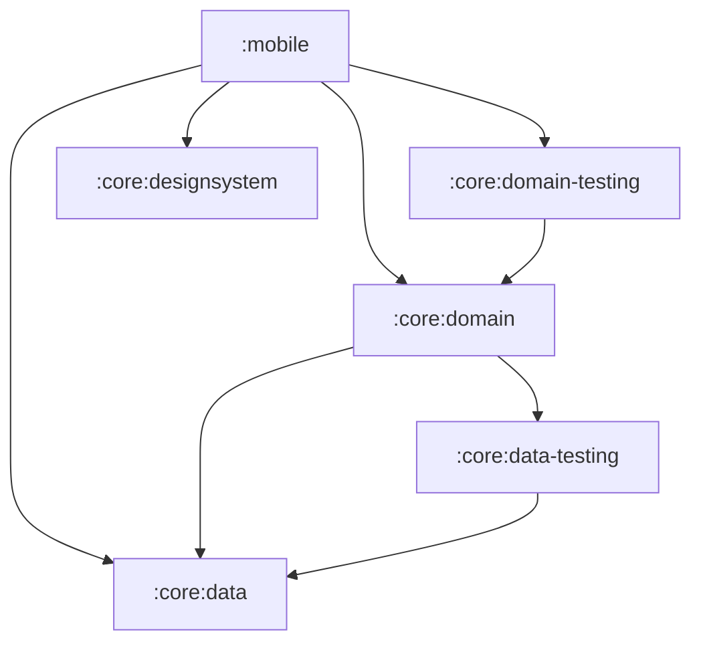
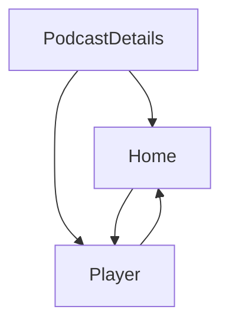

[//]: # (title: 将 Jetpack Compose 应用程序迁移到 Kotlin Multiplatform)

<secondary-label ref="IntelliJ IDEA"/>
<secondary-label ref="Android Studio"/>

<tldr>
<p>本教程使用 IntelliJ IDEA，但你也可以在 Android Studio 中进行操作。
   这两款 IDE 具有相同的核心功能和 Kotlin Multiplatform 支持。</p>
</tldr>

本指南介绍如何将一个纯 Android 应用程序进行全栈跨平台迁移，
涵盖从业务逻辑到 UI 的方方面面。
它借助一个高级 Compose 示例项目，展示了常见的挑战与解决方案。
你可以紧跟提交（commit）历史逐步操作，也可以先大致浏览通用的迁移步骤，然后深入探究你感兴趣的任何部分。

初始应用程序是 [Jetcaster](https://github.com/android/compose-samples/tree/main/Jetcaster)，
这是一个使用 Jetpack Compose 为 Android 构建的播客示例应用。
该示例功能完备，依赖于：
* 多个模块。
* Android 资源管理。
* 网络和数据库访问。
* Compose Navigation。
* 最新的 Material Expressive 组件。

所有这些特性都可以借助 Kotlin Multiplatform 和 Compose Multiplatform 框架调整为跨平台应用。

要为让 Android 应用程序运行在其他平台上做好准备，你可以：

1. 了解如何评估你的项目是否适合迁移到 Kotlin Multiplatform (KMP)。
2. 了解如何将 Gradle 模块划分为跨平台模块和特定于平台的模块。
   对于 Jetcaster，我们成功将大多数业务逻辑模块改造成了多平台模块，
   仅保留了一些需要针对各平台单独编写的底层系统调用。
3. 遵循逐步将业务逻辑模块改造为多平台模块的过程，
   逐步更新构建脚本和代码，以最小的变更在各个正常运行的状态之间平稳过渡。
4. 了解 UI 代码如何过渡到共享实现：
   使用 Compose Multiplatform，你可以共享 Jetcaster 中的大部分 UI 代码。
   更重要的是，你将了解如何按屏幕逐个渐进式地实现这种过渡。

最终生成的应用程序可以运行在 Android、iOS、桌面端以及浏览器中。
桌面端应用还可以用作 [Compose Hot Reload](compose-hot-reload.md) 的示例：
一种快速迭代 UI 行为的方式。

## 评估 Kotlin Multiplatform 潜在迁移的核对清单 {id="checklist-for-a-potential-kotlin-multiplatform-migration"}

潜在 KMP 迁移的主要障碍是 Java 和 Android View。
如果你的项目已经使用 Kotlin 编写，并且使用 Jetpack Compose 构建 UI，
迁移的复杂度将大大降低。

以下是在迁移项目或模块之前应考虑准备的一般核对清单：

1. [转换或隔离 Java 代码](#convert-or-isolate-java-code)
2. [检查仅限 Android/JVM 的依赖项](#check-your-android-jvm-only-dependencies)
3. [解决模块化方面的技术债务](#catch-up-with-modularization-technical-debt)
4. [迁移到 Compose](#migrate-from-views-to-jetpack-compose)

### 转换或隔离 Java 代码 {id="convert-or-isolate-java-code"}

在最初的 Android Jetcaster 示例中，存在类似 `Objects.hash()` 和 `Uri.encode()` 这样的仅限 Java 的调用，
并且大量使用了 `java.time` 包。

虽然你可以在 Kotlin 中调用 Java，反之亦然，
但包含 Kotlin Multiplatform 模块中共享代码的 `commonMain` 源集（source set）中不能包含 Java 代码。
因此，当你将 Android 应用程序改造为多平台时，需要选择以下任一方式：
* 将这部分代码隔离在 `androidMain` 中（并为其他平台重写），或者
* 使用兼容多平台的依赖项将 Java 代码转换为 Kotlin。

另一个特定于 Java 的库 RxJava 虽然未在 Jetcaster 中使用，但被广泛采纳。由于它是一个用于管理异步操作的 Java 框架，
建议在开始 KMP 迁移之前先迁移到 `kotlinx-coroutines`。

有相关的[从 Java 迁移到 Kotlin 指南](https://kotlinlang.org/docs/java-to-kotlin-idioms-strings.html)，
以及 [IntelliJ IDEA 中的辅助工具](https://www.jetbrains.com/help/idea/get-started-with-kotlin.html#convert-java-to-kotlin)，
它可以自动转换 Java 代码并简化该流程。

### 检查仅限 Android/JVM 的依赖项 {id="check-your-android-jvm-only-dependencies"}

虽然许多项目（尤其是较新的项目）可能不包含太多 Java 代码，但它们通常包含仅限 Android 的依赖项。
对于 Jetcaster 而言，找出替代方案并迁移至替代方案占据了大部分工作量。

重要的一步是为你计划共享的代码中所使用的依赖项整理出一份清单，并确保有可用的多平台替代方案。
虽然多平台生态系统不像 Java 生态系统那么庞大，但它正在迅速扩展。
可以将 [klibs.io](https://klibs.io) 作为评估潜在选项的切入点。

#### 库 {id="libraries"}

对于 Jetcaster，这些库的清单如下：

* **Dagger/Hilt**：一种流行的依赖注入解决方案（已替换为 [Koin](https://insert-koin.io/)）

  Koin 是一个可靠的多平台 DI 框架。如果它无法满足你的需求，或者所需的重写工作量过大，还有其他解决方案。
  [Metro](https://zacsweers.github.io/metro/latest/) 框架也是多平台的。
  它通过支持[与其他注解的互操作](https://zacsweers.github.io/metro/latest/interop/)（包括 Dagger 和 Kotlin Inject），有助于简化迁移过程。
* **Coil 2**：一个图像加载库（[在第 3 版中已成为多平台](https://coil-kt.github.io/coil/upgrading_to_coil3/)）。
* **ROME**：一个 RSS 框架（已替换为多平台的 [RSS Parser](https://github.com/prof18/RSS-Parser)）。
* **JUnit**：一个测试框架（已替换为 [kotlin-test](https://kotlinlang.org/api/core/kotlin-test/)）。
* **OkHttp**：一个 HTTP 客户端（不再需要直接使用：RSS Parser 和 Coil 3 会发起自己的调用，
  且 Coil 3 为不支持 OkHttp 的平台提供了[基于 Ktor 的](https://ktor.io/)网络层）。

#### API {id="api"}
随着迁移的推进，你可能会发现一些小代码段在多平台中无法运行，因为目前还没有跨平台的实现。
例如，在 Jetcaster 中，我们不得不使用第三方多平台库来替换两个仅限 Android 的 API：

* `AnnotatedString.fromHtml()`：它是 Compose UI 库的一部分，但仅针对 Android 进行了实现
  （已替换为 [htmlconverter](https://github.com/cbeyls/HtmlConverterCompose)）。
* `android.net.Uri`：用于对导航实参进行编码
  （已替换为 [uri-kmp](https://github.com/eygraber/uri-kmp)）。

很难提前发现所有此类情况，因此请做好在迁移过程中寻找替代方案或重写代码的准备。
这就是为什么我们要展示如何以尽可能最小的步骤从一个可用状态过渡到另一个可用状态。这样一来，
在多个部分同时发生变化时，单个问题就不会阻碍你的整体进度。

### 解决模块化方面的技术债务 {id="catch-up-with-modularization-technical-debt"}

KMP 允许你按模块、按屏幕有选择性地迁移到多平台状态。
但为了使该过程顺利进行，你的模块结构必须清晰且易于调整。
建议根据[高内聚、低耦合原则](https://developer.android.com/topic/modularization/patterns#cohesion-coupling)评估你的模块化结构，
并遵循其他推荐的模块构建实践。

一般性建议总结如下：

* 将应用程序功能的不同部分划分为特性（feature）模块，
  并将特性模块与处理及提供数据访问的数据模块分开。
* 将特定领域的数据和业务逻辑封装在一个模块内。
  将相关的数据类型分组在一起，避免跨无关领域混用逻辑或数据。
* 使用 Kotlin [可见性修饰符](https://kotlinlang.org/docs/visibility-modifiers.html)阻止外部访问模块的实现细节和数据源。

凭借清晰的结构，即使你的项目包含大量模块，
你也能逐个将它们迁移到 KMP。这种方法比尝试完全重写更加平稳。

### 从 View 迁移到 Jetpack Compose {id="migrate-from-views-to-jetpack-compose"}

Kotlin Multiplatform 提供了 Compose Multiplatform 作为创建跨平台 UI 代码的方式。
要平稳过渡到 Compose Multiplatform，你的 UI 代码应该已经使用 Compose 编写。如果你当前使用的是 View，
则需要采用新范式并使用新框架重写该代码。
显然，提前完成这项工作会更轻松。

Google 长期以来一直在推进和丰富 Compose。查看 [Jetpack Compose 迁移指南](https://developer.android.com/develop/ui/compose/migrate)
以获取最常见场景的帮助，或者尝试使用[通过 AI 进行迁移的 Agent 技能](https://github.com/android/skills/blob/main/jetpack-compose/migration/migrate-xml-views-to-jetpack-compose/SKILL.md)。
你也可以使用 View 与 Compose 的互操作性，但与 Java 代码一样，此类代码必须隔离在你的
`androidMain` 源集中。

## 将应用程序转变为多平台的步骤 {id="steps-to-make-an-app-multiplatform"}

完成初始准备和评估后，一般流程如下：

1. [迁移到多平台库](#migrate-to-multiplatform-libraries)

2. [将业务逻辑过渡到 KMP](#migrating-the-business-logic)。
   1. 从依赖它的其他模块最少的模块开始。
   2. 将其迁移到 KMP 模块结构，并迁移为使用多平台库。
   3. 在依赖树中选择下一个模块并重复此过程。
   
   {type="alpha-lower"}
3. [将 UI 代码过渡到 Compose Multiplatform](#migrating-to-multiplatform-ui)。
   当所有业务逻辑都已是多平台时，过渡到 Compose Multiplatform 会变得相对直接。
   对于 Jetcaster，我们通过逐屏迁移展示了增量迁移。我们还展示了在某些屏幕已迁移而某些屏幕尚未迁移时，
   如何调整导航图。
4. 为你想要支持的平台[添加入口点](#add-application-entry-points)。

为了简化示例，我们从一开始就移除了特定于 Android 的 Glance、TV 和穿戴设备目标，
因为它们无论如何都不会与多平台代码交互，也不需要迁移。
该精简操作，连同其余迁移步骤所依赖的 Gradle 和 AGP 版本，都汇总在一个[准备阶段的提交（commit）](https://github.com/kotlin-hands-on/jetcaster-kmp-migration/commit/0b55090eff4e36142d893c404e0d403e89a16b1c)中。

> 你可以阅读下文的步骤说明，也可以直接跳转到
> Jetcaster 示例仓库的 [step-by-step-migration 分支](https://github.com/kotlin-hands-on/jetcaster-kmp-migration/commits/step-by-step-migration/)，
> 本指南即基于该分支的历史记录展开。
> 每次提交都代表应用程序的一个可用状态，旨在展示从纯 Android 逐步迁移到完全支持 Kotlin Multiplatform 的潜力。
> 该仓库的 `main` 分支则包含处于最终状态的相同项目。
> 
{style="tip"}

### 准备环境 {collapsible="true" id="prepare-the-environment"}

如果你想跟随迁移步骤或在计算机上运行提供的示例，
请确保已准备好环境：

1. 按照快速入门指南中的说明[配置 Kotlin Multiplatform 环境](quickstart.md#set-up-the-environment)。

   > 根据 Apple 的要求，你需要一台装有 macOS 和 Xcode 的 Mac 才能构建和运行 iOS 应用程序。
   >
   {style="note"}

2. 在 IntelliJ IDEA 或 Android Studio 中，通过克隆示例仓库创建一个新项目：

   ```text
   git@github.com:kotlin-hands-on/jetcaster-kmp-migration.git
   ```

   若要按提交逐步跟随迁移过程，请检出 `step-by-step-migration` 分支。
   `main` 分支包含处于最终状态的相同项目并独立更新，
   不过两个分支的最终状态在功能上是相同的。

3. 该示例的模块使用 Java 17 工具链，因此除了 Gradle 本身运行所需的 JDK 之外，Gradle 还需要一个可用的 JDK 17。如果构建失败并显示 `Cannot find a Java installation … matching {languageVersion=17}`，
   请安装 JDK 17 或配置[工具链配置自动下载（toolchain provisioning）](https://docs.gradle.org/current/userguide/toolchains.html#sec:provisioning)。

## 迁移到多平台库 {id="migrate-to-multiplatform-libraries"}

应用程序的大部分功能都依赖于几个关键库。
在为模块配置多平台支持之前，我们可以先将其使用方式转变为与 KMP 兼容：

* 从 ROME tools 解析器迁移到多平台的 RSS Parser。
  这需要考虑 API 之间的差异：RSS Parser 会发起自己的网络调用，
  因此不再需要 OkHttp，
  但发布日期和单集时长现在必须手动解析。

  > 请参阅[对应的提交](https://github.com/kotlin-hands-on/jetcaster-kmp-migration/commit/2313082c6c350e06964786b9821b81e17e9b4dfb)。
* 在整个应用程序中（包括纯 Android 入口点模块 `mobile`）从 Dagger/Hilt 迁移到 Koin 4。
  这需要根据 Koin 的方式重写依赖注入逻辑，但 `*.di` 包之外的代码基本上不受影响。

  从 Hilt 迁移出去时，请务必清理 `/build` 目录，以避免先前生成的 Hilt 代码中出现编译错误。

  此步骤还从另一个角度说明了仅限 Android 依赖项的代价：Hilt 的注解处理器无法读取 Kotlin 2.4 元数据，因此在移除 Hilt 之前，项目无法升级到最新的 Kotlin 版本。
  一旦移除，Kotlin 版本便可在同一提交中进行升级。

  > 请参阅[对应的提交](https://github.com/kotlin-hands-on/jetcaster-kmp-migration/commit/713b5846e5be3233874af556d6ada52405723a69)。

* 从 Coil 2 升级到 Coil 3。同样，修改的代码相对较少：`coil.*` 包变更为 `coil3.*`，
  且图像加载针对 Coil 自己的 `PlatformContext` 进行，而不是 Android 的 `Context`。

  > 请参阅[对应的提交](https://github.com/kotlin-hands-on/jetcaster-kmp-migration/commit/e88ff3e62ec19e679c367e90deaef38e92f913b7)。

* 从 JUnit 迁移到 `kotlin-test`。这涉及所有包含测试的模块，但得益于 `kotlin-test` 的兼容性，
  实现迁移所需的更改非常少。

  > 请参阅[对应的提交](https://github.com/kotlin-hands-on/jetcaster-kmp-migration/commit/90678b99b2b00f09fefc2d787694d08a073c22e6)。

* 将用于在播客描述中渲染 HTML 的 `AnnotatedString.fromHtml()` 替换为多平台 `htmlconverter` 库。该函数属于 Compose UI 库的一部分，但仅针对 Android 进行了实现。

  > 请参阅[对应的提交](https://github.com/kotlin-hands-on/jetcaster-kmp-migration/commit/4e16a63029efae18f3bf14aa2faf6008caaf8ee9)。

### 将依赖 Java 的代码重写为 Kotlin {id="rewrite-java-dependent-code-into-kotlin"}

既然主要库都已经支持多平台，我们需要消除仅限 Java 的依赖项。

仅限 Java 调用的一个简单示例是 `Objects.hash()`，我们使用 Kotlin 重新实现了它。

> 请参阅[对应的提交](https://github.com/kotlin-hands-on/jetcaster-kmp-migration/commit/f904e28113f50e9d26e1199842253093b92abc58)。

但在 Jetcaster 示例中，阻碍我们直接将代码公共化的主要因素是 `java.time` 包。
时间计算在播客应用程序中几乎无处不在，因此我们需要将这些代码迁移到 `kotlin.time` 和 `kotlinx-datetime`，
从而真正从 KMP 代码共享中受益。
例如，`kotlinx-datetime` 中没有针对 RFC 1123 格式的内置解析器，
但你可以使用该库的格式构建器组合出一个解析器。

> 所有与时间相关的内容均在[此提交](https://github.com/kotlin-hands-on/jetcaster-kmp-migration/commit/75d5571621529972187b01537e8988fdf8b83d32)中进行了重写。

## 迁移业务逻辑 {id="migrating-the-business-logic"}

一旦主要依赖项都已支持多平台，我们就可以选择一个模块来开始迁移。
为项目中的模块构建依赖关系图会很有帮助。
类似 [Junie](https://www.jetbrains.com//junie/) 这样的 AI Agent 可以轻松提供协助。
对于 Jetcaster，简化的模块依赖关系图如下所示：



这给出了如下建议顺序示例：

1. `:core:data`
2. `:core:data-testing`
3. `:core:domain`
4. `:core:domain-testing`
5. `:core:designsystem` —— 虽然它没有模块依赖项，但这是一个 UI 辅助模块，
   因此我们只有在准备好将 UI 代码移入共享模块时才会处理它。

### 模块构建脚本中的变化 {id="what-changes-in-a-module-s-build-script"}

本节中的每个模块迁移都遵循相同的模式。
以下是一个库模块从 Android 迁移前以及作为 Kotlin Multiplatform 模块迁移后的示例：

<compare type="top-bottom">
<code-block lang="kotlin" code="plugins {&#10;    alias(libs.plugins.android.library)&#10;}&#10;&#10;android {&#10;    namespace = &quot;com.example.jetcaster.core.data&quot;&#10;    compileSdk = 37&#10;&#10;    defaultConfig {&#10;        minSdk = 23&#10;    }&#10;}&#10;&#10;dependencies {&#10;    // 依赖项示例&#10;    implementation(libs.koin.core)&#10;}"/>
<code-block lang="kotlin" code="plugins {&#10;    alias(libs.plugins.kotlin.multiplatform)&#10;    alias(libs.plugins.android.kotlin.multiplatform.library)&#10;}&#10;&#10;kotlin {&#10;    android {&#10;        namespace = &quot;com.example.jetcaster.core.data&quot;&#10;        compileSdk = 37&#10;        minSdk = 23&#10;    }&#10;&#10;    jvmToolchain(17)&#10;    iosArm64()&#10;    iosSimulatorArm64()&#10;    jvm()&#10;    wasmJs { browser() }&#10;&#10;    sourceSets {&#10;        commonMain.dependencies {&#10;            // 依赖项示例&#10;            implementation(libs.koin.core)&#10;        }&#10;    }&#10;}"/>
</compare>

源代码也相应移动：从 `src/main/java` 移至 `src/commonMain/kotlin`、
`src/androidMain/kotlin` 等，以匹配所声明的目标。

在下面的提交中，每个模块仅声明当时存在的目标。
`wasmJs` 是最后添加的，与 [Web 入口点](#add-a-web-entry-point)一起引入。

### 迁移 :core:data {id="migrate-core-data"}

#### 配置 :core:data 并迁移数据库代码 {id="configure-core-data-and-migrate-database-code"}

Jetcaster 使用 [Room](https://developer.android.com/training/data-storage/room) 作为数据库库。
Room 从 2.7.0 版本开始支持多平台，因此我们只需更新代码以使其跨平台运行即可。
此时我们还没有 iOS 或桌面端应用，但已经可以编写特定于平台的代码，这些代码将在我们设置其他入口点时被调用。
我们还为其他平台的目标添加了配置，以便平台代码从现在开始可以编译。

为了切换到多平台版本的 Room，我们遵循了 Android 的[通用设置指南](https://developer.android.com/kotlin/multiplatform/room)。

> 请参阅[对应的提交](https://github.com/kotlin-hands-on/jetcaster-kmp-migration/commit/c3a09588a8080d4caf38c564174888a34337da7d)。

* 注意新的代码结构，包含 `androidMain`、`commonMain`、`iosMain` 和 `jvmMain` 源集。
* 大多数代码更改都是关于为 Room 创建 expect/actual 结构以及相应的 DI 更改。
  创建数据库是特定于平台的，因此 `getDatabaseBuilder()` 是一对 expect/actual，通过
  `expect val platformDataModule` Koin 模块接入。
* `DateTimeTypeConverters` 被移除：使用 `kotlinx-datetime` 后，转换直接存在于实体本身中。
* 新的 `OnlineChecker` 接口用于处理我们此前仅在 Android 上检查网络连接的情况。在我们[添加 iOS 应用作为目标](#add-an-ios-entry-point)之前，联网检查器将是一个存根（stub）。

我们也可以立即将 `:core:data-testing` 模块重新配置为多平台。
请参阅[对应的提交](https://github.com/kotlin-hands-on/jetcaster-kmp-migration/commit/a58fea51d94300a184654e7c1a734b4f70fc2877)。
它只需要更新 Gradle 配置并移动到源集文件夹结构即可。

#### 配置并迁移 :core:domain {id="configure-and-migrate-core-domain"}

如果所有依赖项都已经处理好并迁移到多平台，我们唯一要做的就是移动代码并重新配置模块。测试将移至 `commonTest`，并开始在每个目标上运行，而不仅仅是在 JVM 上运行。

> 请参阅[对应的提交](https://github.com/kotlin-hands-on/jetcaster-kmp-migration/commit/ccebc4fc011ee6181dd120dcd27884f3b3ee9c54)。

与 `:core:data-testing` 类似，我们也可以轻松地将 `:core:domain-testing` 模块更新为多平台。

> 请参阅[对应的提交](https://github.com/kotlin-hands-on/jetcaster-kmp-migration/commit/33fd4d010331f3e66ab42eac148a2b1a7e529913)。

#### 配置并迁移 :core:designsystem {id="configure-and-migrate-core-designsystem"}

在只剩下 UI 代码需要迁移的情况下，我们开始过渡包含字体资源和排版的 `:core:designsystem` 模块。
这是第一个包含 Compose 代码的模块，因此也是第一个将 Jetpack Compose 构件（`androidx.compose.*`）替换为 Compose Multiplatform 构件（`org.jetbrains.compose.*`）的模块。

除了配置 KMP 模块和创建 `commonMain` 源集之外，我们还将 `MaterialExpressiveTheme` 的 `JetcasterTypography` 实参转变为可组合项（composable），封装了对多平台字体的调用。

> 请参阅[对应的提交](https://github.com/kotlin-hands-on/jetcaster-kmp-migration/commit/608c673db1732e0976bcaa0feb4c965078c06f13)。

## 迁移到多平台 UI {id="migrating-to-multiplatform-ui"}

当所有 `:core` 逻辑都已成为多平台后，你就可以开始将 UI 迁移到公共代码中了。
同样，因为我们的目标是完全迁移，所以暂时还不添加其他入口点，只是确保 Android 应用程序能够与放置在公共代码中的 Compose 部分协同工作。

为了直观展示我们将要遵循的逻辑，以下是表示 Jetcaster 屏幕之间关系的简化图表：

<!-- 为简洁起见，深层链接和支持窗格已注释掉，但可能会很有趣。 --> 



首先，我们为将要公共化的 UI 代码创建了一个共享 UI 模块。

> 请参阅[对应的提交](https://github.com/kotlin-hands-on/jetcaster-kmp-migration/commit/f2bef12555fa39038b50f151c602046ca80f494b)。

为了展示如何渐进式地迁移 UI，我们将逐个屏幕进行迁移。
每一步都将以一个包含处于正常运行状态的应用的提交结束，距完全共享的 UI 更近一步。

在上述屏幕图表的引导下，我们从播客详情（podcast details）屏幕开始：

1. 迁移后的屏幕将与仍留在 Android 模块中的 Compose 主题配合使用。
   我们需要做的是：
   1. 更新 ViewModel 和相应的 DI 代码。
   2. 更新资源和资源访问器。
      虽然多平台资源库与 Android 体验高度契合，但仍有一些显著差异需要处理：
      * 资源文件的处理方式略有不同。
        例如，资源目录必须命名为 `composeResources` 而不是 `res`，
        并且 Android XML 文件中使用的 `@android:color` 需要替换为十六进制颜色代码。
        更多信息请参阅[多平台资源](compose-multiplatform-resources.md)文档。
      * 生成的带有资源访问器的类名为 `Res`（而在 Android 上为 `R`）。
        移动并调整资源文件后，重新生成访问器并替换 UI 代码中每个资源的导入语句。
   3. 将 `koinViewModel()` 从特定于 Android 的 `org.koin.androidx.compose` 包切换到多平台的 `org.koin.compose.viewmodel` 包。
   4. 将该屏幕用于对导航播客 URI 进行编码的 `android.net.Uri` 替换为 `uri-kmp` 等效项。
      
   > 请参阅[对应的提交](https://github.com/kotlin-hands-on/jetcaster-kmp-migration/commit/cc045d7d9f01e1ef8d05a9f6568fac89ab2a852b)。

2. 迁移 Compose 主题。
   Android 的动态色彩需要 `LocalContext` 和 API 级别检查，因此配色方案变成了 expect/actual 函数，并在其他平台上提供存根。

   > 请参阅[对应的提交](https://github.com/kotlin-hands-on/jetcaster-kmp-migration/commit/5b0263faae912bce616487b71d17bcd4cb93c721).

3. 继续处理主屏幕（home screen）：
   1. 迁移 ViewModel。
   2. 将代码移动到共享 UI 模块中的 `commonMain`。
   3. 移动并调整对资源的引用。
   4. 替换仅限 Android 的预览工具。基于 `androidx.compose.ui.tooling.preview.Devices` 构建的 `@DevicePreviews` 已被替换为多平台的 `@Preview`。

   > 请参阅[对应的提交](https://github.com/kotlin-hands-on/jetcaster-kmp-migration/commit/9d6903620f12db52fb287f9f0746f5731f603066)。

4. 为了演示细化迁移的另一种方式，我们部分迁移了导航：
   我们可以将公共代码中的屏幕与 Android 原生屏幕结合起来。
   `PlayerScreen` 仍位于 `mobile` 模块中，且仅包含在 Android 入口点的导航中。
   它被注入到了总体的多平台导航中。

   > 请参阅[对应的提交](https://github.com/kotlin-hands-on/jetcaster-kmp-migration/commit/f5145cbd3a6b958b5947d4933f8db50aaef1be49)。
   
5. 最后移动所有剩余内容：
   * 将剩余的导航移动到公共代码（[对应的提交](https://github.com/kotlin-hands-on/jetcaster-kmp-migration/commit/54464f0d06bd2bdeffaca965ea2f6fcb9de077df)）。
   * 将最后一个屏幕 `PlayerScreen` 迁移到 Compose Multiplatform（[对应的提交](https://github.com/kotlin-hands-on/jetcaster-kmp-migration/commit/4d1be9975a4388f2db3315ebaf5965cf8201fe4f)）。

     该屏幕具有纯粹特定于 Android 的行为：它根据折叠和平铺状态在单窗格和双窗格布局之间切换。该逻辑被提取为一个 expect/actual 可组合项，因此 Android 保留了具有折叠感知（posture-aware）的版本，而其他平台仅查看窗口宽度。

现在所有 UI 代码都已公共化，我们可以使用它快速为其他平台创建应用程序。

此时，模块名称已经失去了原本的含义：`:core` 不再是一组核心 Android 库，
而 `:mobile` 也即将不再是唯一的入口点。
我们将它们分别重命名为 `:sharedLogic` 和 `:androidApp`。

> 请参阅[对应的提交](https://github.com/kotlin-hands-on/jetcaster-kmp-migration/commit/ac13e72b16a77276ca5fa46b6c71e903c57bf087)。

## 添加应用程序入口点 {id="add-application-entry-points"}

### 添加 JVM 入口点 {id="add-a-jvm-entry-point"}

此步骤有助于：
* 展示将完全多平台化的 Android 应用转变为桌面应用所需的工作量是多么少。
* 展示 [Compose Hot Reload](compose-hot-reload.md)（目前仅支持桌面目标）作为快速迭代 Compose UI 的工具。

在所有 UI 代码共享的情况下，为桌面端 JVM 应用添加新入口点只需创建一个 `main()` 函数并将其与 DI 框架集成即可。
共享模块所需的 JVM 实现已在模块迁移中准备就绪。

> 请参阅[对应的提交](https://github.com/kotlin-hands-on/jetcaster-kmp-migration/commit/32dc94085c5163e5b830a7e95e2b2b6baa6591a0)。

### 添加 iOS 入口点 {id="add-an-ios-entry-point"}

iOS 入口点需要一个与 KMP 代码链接的 iOS 项目。

[使应用程序成为多平台](https://kotlinlang.org/docs/multiplatform/multiplatform-integrate-in-existing-app.html#create-an-ios-project-in-xcode)教程中介绍了如何在 KMP 项目中创建并嵌入 iOS 应用。

> 我们在此处使用的直接集成方法是最直接的，但可能不是最适合你项目的方案。
> 请参阅 [iOS 集成方法概览](multiplatform-ios-integration-overview.md)以了解各种可选方案。
>
{style="note"}

在 iOS 应用中，我们需要将 Swift UI 代码与 Compose Multiplatform 代码连接起来。
我们的做法是向 iOS 应用添加一个函数，该函数返回嵌入了 `JetcasterApp` 可组合项的 `UIViewController`。

既然已经有了可运行的 iOS 应用，那么 `OnlineChecker` 存根就可以替换为基于多平台 [konnectivity](https://github.com/plusmobileapps/konnectivity) 库的真实实现了。

<!-- this probably needs more rigorous verification -->

> 请提交*共享*的 Xcode Scheme（`YourApp.xcodeproj/xcshareddata/xcschemes/`），而不要依赖 Xcode 为你生成的 Scheme。
> 生成的 Scheme 会保存在 `xcuserdata` 中，该目录通常被 Git 忽略，
> 在这种情况下，在 Xcode 生成了自身 Scheme 的任何机器上，`xcodebuild -scheme YourApp` 可能会失败并提示“does not contain a scheme named YourApp”。
>
{style="tip"}

> 请参阅[对应的提交](https://github.com/kotlin-hands-on/jetcaster-kmp-migration/commit/1da471dfba711a4386e5ba1a9db49892c8a7e255)中添加的 iOS 项目及相应的代码更新。

### 添加 Web 入口点 {id="add-a-web-entry-point"}

Web 目标需要处理的平台特定工作最多：它没有 JVM，没有文件系统，
并且强制执行同源策略。
这些限制都很好地展示了如何利用 `expect`/`actual` 机制来规避平台限制：

* **数据库。** SQLite 无法直接访问文件系统，因此它运行在由[源私有文件系统 (Origin Private File System)](https://developer.mozilla.org/en-US/docs/Web/API/File_System_API/Origin_private_file_system) 支持的 Web Worker 中。
  该模块新增了一个包含该 Worker 的 npm 软件包，使用 `androidx.sqlite:sqlite-web`，
  并且可以在 expect/actual 函数中创建驱动程序，而不是始终返回绑定的驱动程序。
  OPFS 还需要跨源隔离标头，这可以通过 webpack 配置添加。
* **分发器（Dispatcher）。** `Dispatchers.IO` 在 Kotlin/Wasm 上不存在，因此获取 IO 分发器也变成了一个 expect/actual 函数。
* **网络访问。** 浏览器强制执行 CORS，并非每个播客源都会发送正确的标头，
  因此即使是示例播客源列表也是一个 `expect val`，Web 构建使用了较短的列表。
  Coil 和 RSS Parser 在此目标上使用 Ktor JS 客户端。

> 请参阅[对应的提交](https://github.com/kotlin-hands-on/jetcaster-kmp-migration/commit/58dd68fa34f88c9f7a9c89fc654018cb3a9bded0)。

## 清理 Android 模块 {id="clean-up-the-android-module"}

既然 Android 模块现在只包含一个应用程序入口点，
我们就可以清理不必要的依赖项，只留下一些特定于 Compose 的导入用于处理 Activity 和 `@Preview` 注解。

> 请参阅[对应的提交](https://github.com/kotlin-hands-on/jetcaster-kmp-migration/commit/76fdba0f55c34eda7b325f3e836cc21a10a78e98)。

## 运行应用程序 {id="run-the-app"}

在迁移完成的应用的最终状态下，存在初始 Android 模块（`androidApp`）和新 iOS 应用的运行配置。
你可以从相应的 `main.kt` 文件运行桌面端应用，并通过
`:wasmApp:wasmJsBrowserDevelopmentRun` Gradle 任务运行 Web 应用。
运行所有这些应用，查看共享 UI 在每个平台上的表现吧！

## 最终总结 {id="final-summary"}

在本次迁移中，我们遵循了将纯 Android 应用转换为 Kotlin Multiplatform 应用的通用步骤：

* 过渡到多平台依赖项，在无法过渡的地方重写代码。
* 将可用于其他平台的 Android 模块逐个转换为多平台模块。
* 为 Compose Multiplatform 代码创建共享 UI 模块，并逐屏过渡到共享 UI 代码。
* 为其他平台创建入口点。

这个顺序并不是一成不变的。也可以先从其他平台的入口点开始，
逐步为其构建底层基础，直至它们正常工作。
在 Jetcaster 示例中，我们选择了一条更清晰的变更顺序，便于逐步跟随操作。

如果你对本指南或演示的解决方案有任何反馈，请在 [YouTrack](https://kotl.in/issue) 中创建问题。