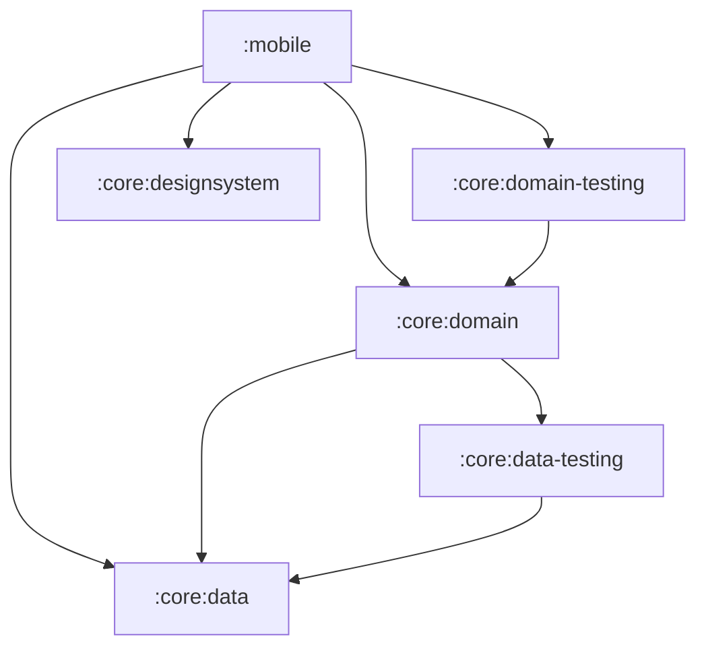
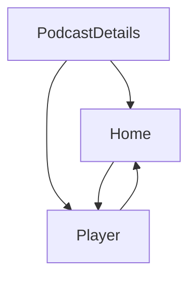

[//]: # (title: Jetpack Compose 앱을 Kotlin Multiplatform으로 마이그레이션하기)

<secondary-label ref="IntelliJ IDEA"/>
<secondary-label ref="Android Studio"/>

<tldr>
<p>이 튜토리얼은 IntelliJ IDEA를 사용하지만, Android Studio에서도 동일하게 진행할 수 있습니다.
   두 IDE 모두 동일한 핵심 기능과 Kotlin Multiplatform 지원을 공유합니다.</p>
</tldr>

이 가이드는 비즈니스 로직부터 UI까지 전체 스택에 걸쳐 Android 전용 앱을 멀티플랫폼으로 마이그레이션하는 방법을 다룹니다.
고급 Compose 샘플을 사용하여 일반적인 문제와 해결책을 설명합니다.
커밋 순서를 그대로 따라가거나, 전반적인 마이그레이션 단계를 훑어본 후 관심 있는 부분을 자세히 살펴볼 수 있습니다.

시작 앱은 Jetpack Compose로 빌드된 Android용 샘플 팟캐스트 앱인 [Jetcaster](https://github.com/android/compose-samples/tree/main/Jetcaster)입니다.
이 샘플은 다음과 같은 기능에 의존하는 완벽한 기능을 갖춘 앱입니다:
* 멀티 모듈 구조.
* Android 리소스 관리.
* 네트워크 및 데이터베이스 접근.
* Compose Navigation.
* 최신 Material Expressive 컴포넌트.

이 모든 기능은 Kotlin Multiplatform과 Compose Multiplatform 프레임워크를 사용하여 크로스 플랫폼 앱에 맞게 조정할 수 있습니다.

Android 앱을 다른 플랫폼에서 작동하도록 준비하려면 다음을 수행할 수 있습니다:

1. 프로젝트가 Kotlin Multiplatform(KMP) 마이그레이션 대상에 적합한지 평가하는 방법을 배웁니다.
2. Gradle 모듈을 크로스 플랫폼 모듈과 플랫폼 전용 모듈로 분리하는 방법을 확인합니다.
   Jetcaster의 경우, 각 플랫폼별로 별도 작성이 필요한 일부 저수준 시스템 호출을 제외하고 대부분의 비즈니스 로직 모듈을 멀티플랫폼으로 전환할 수 있었습니다.
3. 빌드 스크립트와 코드를 점진적으로 업데이트하여 최소한의 변경으로 작동 상태를 유지하면서 비즈니스 로직 모듈을 하나씩 멀티플랫폼으로 전환하는 과정을 따라갑니다.
4. UI 코드가 공통 구현으로 전환되는 방식을 확인합니다.
   Compose Multiplatform을 사용하면 Jetcaster UI 코드의 대부분을 공유할 수 있습니다.
   더 중요한 점은, 화면 단위로 점진적인 전환을 구현하는 방법을 확인할 수 있다는 것입니다.

결과물 앱은 Android, iOS, 데스크톱 및 브라우저에서 실행됩니다.
또한 데스크톱 앱은 UI 동작을 빠르게 반복 수정할 수 있는 방법인 [Compose Hot Reload](compose-hot-reload.md) 예제로도 활용됩니다.

## Kotlin Multiplatform 마이그레이션 사전 점검 체크리스트 {id="checklist-for-a-potential-kotlin-multiplatform-migration"}

KMP 마이그레이션의 주요 걸림돌은 Java와 Android View입니다.
프로젝트가 이미 Kotlin으로 작성되어 있고 UI에 Jetpack Compose를 사용하고 있다면, 마이그레이션의 복잡도가 상당히 낮아집니다.

프로젝트나 모듈을 마이그레이션하기 전에 고려해야 할 일반적인 준비 사항 체크리스트는 다음과 같습니다:

1. [Java 코드 변환 또는 격리](#convert-or-isolate-java-code)
2. [Android/JVM 전용 의존성 확인](#check-your-android-jvm-only-dependencies)
3. [모듈화 기술 부채 해결](#catch-up-with-modularization-technical-debt)
4. [Compose로 마이그레이션](#migrate-from-views-to-jetpack-compose)

### Java 코드 변환 또는 격리 {id="convert-or-isolate-java-code"}

기존 Android Jetcaster 예제에는 `java.time` 패키지의 광범위한 사용과 함께 `Objects.hash()` 및 `Uri.encode()`와 같은 Java 전용 호출이 포함되어 있습니다.

Kotlin에서 Java를 호출하거나 그 반대로 호출할 수 있지만, Kotlin Multiplatform 모듈에서 공통 코드를 포함하는 `commonMain` 소스 세트에는 Java 코드가 포함될 수 없습니다.
따라서 Android 앱을 멀티플랫폼으로 만들 때는 다음 중 하나를 수행해야 합니다:
* 이 코드를 `androidMain`에 격리(하고 다른 플랫폼용으로 재작성)하거나,
* 멀티플랫폼 호환 의존성을 사용하여 Java 코드를 Kotlin으로 변환합니다.

또 다른 Java 전용 라이브러리인 RxJava는 Jetcaster에서는 사용되지 않지만 널리 채택되어 있습니다.
비동기 작업을 관리하기 위한 Java 프레임워크이므로, KMP 마이그레이션을 시작하기 전에 `kotlinx-coroutines`로 마이그레이션하는 것이 좋습니다.

Java 코드를 자동으로 변환하여 프로세스를 간소화할 수 있는 [IntelliJ IDEA의 도우미](https://www.jetbrains.com/help/idea/get-started-with-kotlin.html#convert-java-to-kotlin)뿐만 아니라 [Java에서 Kotlin으로의 마이그레이션 가이드](https://kotlinlang.org/docs/java-to-kotlin-idioms-strings.html)도 제공됩니다.

### Android/JVM 전용 의존성 확인 {id="check-your-android-jvm-only-dependencies"}

많은 프로젝트, 특히 최신 프로젝트는 Java 코드를 많이 포함하지 않을 수 있지만, Android 전용 의존성을 사용하는 경우가 많습니다.
Jetcaster의 경우, 대체 라이브러리를 식별하고 이들로 마이그레이션하는 작업이 대부분을 차지했습니다.

중요한 단계는 공유하려는 코드에서 사용되는 의존성 목록을 작성하고 멀티플랫폼 대안이 있는지 확인하는 것입니다.
멀티플랫폼 생태계가 Java 생태계만큼 방대하지는 않지만 빠르게 확장되고 있습니다.
[klibs.io](https://klibs.io)를 시작점으로 활용하여 잠재적인 대안을 평가해 보세요.

#### 라이브러리 {id="libraries"}

Jetcaster의 경우 이러한 라이브러리 목록은 다음과 같았습니다:

* **Dagger/Hilt**: 널리 사용되는 의존성 주입 솔루션 ([Koin](https://insert-koin.io/)으로 대체)

  Koin은 안정적인 멀티플랫폼 DI 프레임워크입니다. 요구 사항을 충족하지 못하거나 필요한 재작성 범위가 너무 큰 경우 다른 솔루션도 있습니다.
  [Metro](https://zacsweers.github.io/metro/latest/) 프레임워크 역시 멀티플랫폼을 지원합니다.
  Dagger 및 Kotlin Inject를 포함한 [다른 어노테이션과의 상호 운용성](https://zacsweers.github.io/metro/latest/interop/)을 지원하여 마이그레이션을 수월하게 진행할 수 있습니다.
* **Coil 2**: 이미지 로딩 라이브러리 ([버전 3에서 멀티플랫폼 지원](https://coil-kt.github.io/coil/upgrading_to_coil3/)).
* **ROME**: RSS 프레임워크 (멀티플랫폼 [RSS Parser](https://github.com/prof18/RSS-Parser)로 대체).
* **JUnit**: 테스트 프레임워크 ([kotlin-test](https://kotlinlang.org/api/core/kotlin-test/)로 대체).
* **OkHttp**: HTTP 클라이언트 (직접 필요하지 않음: RSS Parser 및 Coil 3가 자체적으로 호출을 수행하며, Coil 3에는 OkHttp를 사용할 수 없는 플랫폼을 위한 [Ktor 기반](https://ktor.io/) 네트워크 계층이 있음).

#### API {id="api"}
작업을 진행하다 보면 크로스 플랫폼 구현이 아직 존재하지 않아 멀티플랫폼에서 작동을 멈추는 작은 코드 조각들을 발견할 수 있습니다.
예를 들어, Jetcaster에서는 두 가지 Android 전용 API를 서드파티 멀티플랫폼 라이브러리로 교체해야 했습니다:

* `AnnotatedString.fromHtml()`: Compose UI 라이브러리의 일부이지만 Android용으로만 구현되어 있음
  ([htmlconverter](https://github.com/cbeyls/HtmlConverterCompose)로 대체).
* `android.net.Uri`: 네비게이션 인수를 인코딩하는 데 사용됨
  ([uri-kmp](https://github.com/eygraber/uri-kmp)로 대체).

이러한 모든 사례를 사전에 파악하기는 어려우므로 마이그레이션 과정에서 대체재를 찾거나 코드를 재작성할 준비를 해야 합니다.
이것이 바로 가능한 한 가장 작은 단위로 작동 가능한 상태 사이를 이동하는 방법을 보여주는 이유입니다. 이렇게 하면 여러 부분이 한 번에 변경될 때 단일 문제로 인해 진행이 중단되는 것을 방지할 수 있습니다.

### 모듈화 기술 부채 해결 {id="catch-up-with-modularization-technical-debt"}

KMP를 사용하면 모듈별로, 화면별로 선택적으로 멀티플랫폼 상태로 마이그레이션할 수 있습니다.
그러나 이것이 원활하게 작동하려면 모듈 구조가 명확하고 조작하기 쉬워야 합니다.
모듈 구조화에 대한 기타 권장 사례와 함께 [높은 응집도, 낮은 결합도 원칙 (high cohesion, low coupling principle)](https://developer.android.com/topic/modularization/patterns#cohesion-coupling)에 따라 모듈화를 평가해 보세요.

일반적인 권장 사항은 다음과 같이 요약할 수 있습니다:

* 앱 기능의 개별적인 부분을 피처 모듈로 분리하고, 데이터를 처리하고 접근을 제공하는 데이터 모듈과 피처 모듈을 분리하여 유지합니다.
* 특정 도메인의 데이터와 비즈니스 로직을 모듈 내에 캡슐화합니다.
  관련된 데이터 유형을 함께 그룹화하고, 관련 없는 도메인 간에 로직이나 데이터를 혼합하지 마세요.
* Kotlin [가시성 제한자 (visibility modifiers)](https://kotlinlang.org/docs/visibility-modifiers.html)를 사용하여 모듈의 구현 세부 정보 및 데이터 소스에 대한 외부 접근을 방지합니다.

구조가 명확하다면 프로젝트에 모듈이 많더라도 개별적으로 KMP로 마이그레이션할 수 있습니다. 이 접근 방식은 전체를 한 번에 재작성하는 것보다 훨씬 원활합니다.

### Migrate from Views to Jetpack Compose {id="migrate-from-views-to-jetpack-compose"}

Kotlin Multiplatform은 크로스 플랫폼 UI 코드를 작성하는 방법으로 Compose Multiplatform을 제공합니다.
Compose Multiplatform으로 원활하게 전환하려면 UI 코드가 이미 Compose를 사용하여 작성되어 있어야 합니다. 현재 View를 사용 중이라면 새 패러다임과 새 프레임워크를 사용하여 해당 코드를 다시 작성해야 합니다.
이는 사전에 완료해 두는 것이 훨씬 수월합니다.

Google은 오랫동안 Compose를 발전시키고 확장해 왔습니다. 가장 일반적인 시나리오에 대한 도움말은 [Jetpack Compose 마이그레이션 가이드](https://developer.android.com/develop/ui/compose/migrate)를 확인하거나 [AI를 활용한 마이그레이션 에이전트 스킬](https://github.com/android/skills/blob/main/jetpack-compose/migration/migrate-xml-views-to-jetpack-compose/SKILL.md)을 사용해 보세요.
View-Compose 상호 운용성을 사용할 수도 있지만, Java 코드와 마찬가지로 이 코드는 `androidMain` 소스 세트에 격리되어야 합니다.

## 앱을 멀티플랫폼으로 만들기 위한 단계 {id="steps-to-make-an-app-multiplatform"}

초기 준비와 평가가 완료된 후의 일반적인 프로세스는 다음과 같습니다:

1. [멀티플랫폼 라이브러리로 마이그레이션](#migrate-to-multiplatform-libraries)

2. [비즈니스 로직을 KMP로 전환](#migrating-the-business-logic).
   1. 다른 모듈이 의존하는 모듈 수가 가장 적은 모듈부터 시작합니다.
   2. 이를 KMP 모듈 구조로 마이그레이션하고 멀티플랫폼 라이브러리를 사용하도록 전환합니다.
   3. 의존성 트리에서 다음 모듈을 선택하고 이 프로세스를 반복합니다.
   
   {type="alpha-lower"}
3. [UI 코드를 Compose Multiplatform으로 전환](#migrating-to-multiplatform-ui).
   모든 비즈니스 로직이 이미 멀티플랫폼화되어 있다면 Compose Multiplatform으로 전환하는 작업은 비교적 간단해집니다.
   Jetcaster의 경우, 화면 단위로 마이그레이션하여 점진적으로 전환하는 과정을 보여줍니다. 또한 일부 화면만 마이그레이션되고 일부는 마이그레이션되지 않았을 때 네비게이션 그래프를 조정하는 방법도 보여줍니다.
4. 지원하려는 플랫폼을 위한 [진입점(Entry point) 추가](#add-application-entry-points).

예제를 단순화하기 위해, 어차피 멀티플랫폼 코드와 상호 작용하지 않고 마이그레이션할 필요도 없는 Android 전용 Glance, TV 및 Wearable 타깃을 처음부터 제거했습니다.
이러한 정리 작업과 나머지 마이그레이션이 의존하는 Gradle 및 AGP 버전은 단일 [준비 커밋](https://github.com/kotlin-hands-on/jetcaster-kmp-migration/commit/0b55090eff4e36142d893c404e0d403e89a16b1c)에 모여 있습니다.

> 아래 단계 설명을 따르거나, 이 가이드가 안내하는 히스토리인 Jetcaster 샘플 저장소의 [step-by-step-migration 브랜치](https://github.com/kotlin-hands-on/jetcaster-kmp-migration/commits/step-by-step-migration/)로 바로 이동할 수 있습니다.
> 각 커밋은 Android 전용에서 완전한 Kotlin Multiplatform으로의 점진적 마이그레이션 가능성을 보여주기 위해 앱의 작동 가능한 상태를 나타냅니다. 저장소의 `main` 브랜치에는 최종 상태의 동일한 프로젝트가 포함되어 있습니다.
> 
{style="tip"}

### 환경 준비 {collapsible="true" id="prepare-the-environment"}

마이그레이션 단계를 따르거나 로컬 머신에서 제공된 샘플을 실행하려면 환경이 준비되어 있는지 확인하세요:

1. 퀵스타트에서 [Kotlin Multiplatform 환경 설정](quickstart.md#set-up-the-environment) 안내를 완료합니다.

   > Apple 요구 사항에 따라 iOS 애플리케이션을 빌드하고 실행하려면 macOS와 Xcode가 설치된 Mac이 필요합니다.
   >
   {style="note"}

2. IntelliJ IDEA 또는 Android Studio에서 샘플 저장소를 복제하여 새 프로젝트를 생성합니다:

   ```text
   git@github.com:kotlin-hands-on/jetcaster-kmp-migration.git
   ```

   커밋별로 마이그레이션을 따라가려면 `step-by-step-migration` 브랜치를 체크아웃하세요.
   `main` 브랜치는 최종 상태의 동일한 프로젝트를 담고 있으며 독립적으로 업데이트되지만, 두 브랜치의 최종 상태는 기능적으로 동일합니다.

3. 샘플 모듈은 Java 17 툴체인을 사용하므로 Gradle 자체를 실행하는 JDK 외에 사용 가능한 JDK 17이 필요합니다. `Cannot find a Java installation … matching {languageVersion=17}` 오류와 함께 빌드가 실패하는 경우, JDK 17을 설치하거나 [툴체인 프로비저닝 (toolchain provisioning)](https://docs.gradle.org/current/userguide/toolchains.html#sec:provisioning)을 구성하세요.

## 멀티플랫폼 라이브러리로 마이그레이션 {id="migrate-to-multiplatform-libraries"}

앱 기능의 대부분이 의존하는 몇 가지 라이브러리가 있습니다.
멀티플랫폼 지원을 위해 모듈을 구성하기 전에 해당 라이브러리들의 사용 방식을 KMP 호환으로 전환할 수 있습니다:

* ROME tools 파서에서 멀티플랫폼 RSS Parser로 마이그레이션합니다.
  이를 위해서는 API 간의 차이점을 고려해야 합니다. RSS Parser는 자체적으로 네트워크 호출을 수행하므로 OkHttp가 더 이상 필요하지 않지만, 발행일과 에피소드 재생 시간은 직접 파싱해야 합니다.

  > [결과 커밋](https://github.com/kotlin-hands-on/jetcaster-kmp-migration/commit/2313082c6c350e06964786b9821b81e17e9b4dfb)을 참조하세요.
* Android 전용 진입점 모듈인 `mobile`을 포함하여 전체 앱에서 Dagger/Hilt에서 Koin 4로 마이그레이션합니다.
  Koin 접근 방식에 따라 의존성 주입 로직을 다시 작성해야 하지만, `*.di` 패키지 외부의 코드는 거의 영향을 받지 않습니다.

  Hilt에서 마이그레이션할 때는 이전에 생성된 Hilt 코드에서 컴파일 오류가 발생하지 않도록 `/build` 디렉터리를 삭제해야 합니다.

  이 단계는 또한 Android 전용 의존성의 비용을 다른 방식으로 보여줍니다. Hilt의 어노테이션 프로세서는 Kotlin 2.4 메타데이터를 읽을 수 없으므로 Hilt가 제거될 때까지 프로젝트를 최신 Kotlin으로 업그레이드할 수 없습니다.
  Hilt가 제거되면 동일한 커밋에서 Kotlin 버전이 올라갑니다.

  > [결과 커밋](https://github.com/kotlin-hands-on/jetcaster-kmp-migration/commit/713b5846e5be3233874af556d6ada52405723a69)을 참조하세요.

* Coil 2에서 Coil 3으로 업그레이드합니다. 이번에도 수정된 코드는 비교적 적습니다. `coil.*` 패키지는 `coil3.*`가 되고, 이미지 로딩은 Android `Context` 대신 Coil 자체의 `PlatformContext`를 대상으로 작동합니다.

  > [결과 커밋](https://github.com/kotlin-hands-on/jetcaster-kmp-migration/commit/e88ff3e62ec19e679c367e90deaef38e92f913b7)을 참조하세요.

* JUnit에서 `kotlin-test`로 마이그레이션합니다. 이는 테스트가 포함된 모든 모듈에 해당하지만, `kotlin-test` 호환성 덕분에 마이그레이션을 구현하는 데 필요한 변경 사항은 거의 없습니다.

  > [결과 커밋](https://github.com/kotlin-hands-on/jetcaster-kmp-migration/commit/90678b99b2b00f09fefc2d787694d08a073c22e6)을 참조하세요.

* 팟캐스트 설명의 HTML을 렌더링하는 `AnnotatedString.fromHtml()`을 멀티플랫폼 `htmlconverter` 라이브러리로 대체합니다. 이 함수는 Compose UI 라이브러리의 일부이지만 Android용으로만 구현되어 있습니다.

  > [결과 커밋](https://github.com/kotlin-hands-on/jetcaster-kmp-migration/commit/4e16a63029efae18f3bf14aa2faf6008caaf8ee9)을 참조하세요.

### Java 종속 코드를 Kotlin으로 재작성 {id="rewrite-java-dependent-code-into-kotlin"}

이제 주요 라이브러리가 모두 멀티플랫폼화되었으므로 Java 전용 의존성을 제거해야 합니다.

Java 전용 호출의 간단한 예는 `Objects.hash()`이며, 이를 Kotlin으로 다시 구현했습니다.

> [결과 커밋](https://github.com/kotlin-hands-on/jetcaster-kmp-migration/commit/f904e28113f50e9d26e1199842253093b92abc58)을 참조하세요.

그러나 Jetcaster 예제에서 코드를 직접 공통화하는 것을 가장 크게 가로막는 것은 `java.time` 패키지입니다.
시간 계산은 팟캐스트 앱의 거의 모든 곳에서 사용되므로, KMP 코드 공유의 이점을 온전히 누리기 위해서는 해당 코드를 `kotlin.time` 및 `kotlinx-datetime`으로 마이그레이션해야 합니다.
예를 들어 `kotlinx-datetime`에는 RFC 1123 형식에 대한 내장 파서가 없지만, 라이브러리의 포맷 빌더를 사용하여 직접 구성할 수 있습니다.

> 시간과 관련된 모든 내용은 [이 커밋](https://github.com/kotlin-hands-on/jetcaster-kmp-migration/commit/75d5571621529972187b01537e8988fdf8b83d32)에서 재작성되었습니다.

## 비즈니스 로직 마이그레이션 {id="migrating-the-business-logic"}

기본 의존성이 멀티플랫폼화되면 마이그레이션을 시작할 모듈을 선택할 수 있습니다.
프로젝트 모듈의 의존성 그래프를 작성해 두는 것이 유용할 수 있습니다.
[Junie](https://www.jetbrains.com//junie/)와 같은 AI 에이전트를 활용하면 쉽게 작성할 수 있습니다.
Jetcaster의 경우 모듈 의존성의 간소화된 그래프는 다음과 같습니다:



이는 예를 들어 다음과 같은 순서를 제안합니다:

1. `:core:data`
2. `:core:data-testing`
3. `:core:domain`
4. `:core:domain-testing`
5. `:core:designsystem` — 모듈 의존성은 없지만 UI 헬퍼 모듈이므로 UI 코드를 공유 모듈로 옮길 준비가 되었을 때 다룹니다.

### 모듈 빌드 스크립트의 변경 사항 {id="what-changes-in-a-module-s-build-script"}

이 섹션의 모든 모듈 마이그레이션은 동일한 패턴을 따릅니다.
다음은 Android 라이브러리 모듈 마이그레이션 전과 Kotlin Multiplatform 모듈 마이그레이션 후의 예시입니다:

<compare type="top-bottom">
<code-block lang="kotlin" code="plugins {&#10;    alias(libs.plugins.android.library)&#10;}&#10;&#10;android {&#10;    namespace = &quot;com.example.jetcaster.core.data&quot;&#10;    compileSdk = 37&#10;&#10;    defaultConfig {&#10;        minSdk = 23&#10;    }&#10;}&#10;&#10;dependencies {&#10;    // Dependency example&#10;    implementation(libs.koin.core)&#10;}"/>
<code-block lang="kotlin" code="plugins {&#10;    alias(libs.plugins.kotlin.multiplatform)&#10;    alias(libs.plugins.android.kotlin.multiplatform.library)&#10;}&#10;&#10;kotlin {&#10;    android {&#10;        namespace = &quot;com.example.jetcaster.core.data&quot;&#10;        compileSdk = 37&#10;        minSdk = 23&#10;    }&#10;&#10;    jvmToolchain(17)&#10;    iosArm64()&#10;    iosSimulatorArm64()&#10;    jvm()&#10;    wasmJs { browser() }&#10;&#10;    sourceSets {&#10;        commonMain.dependencies {&#10;            // Dependency example&#10;            implementation(libs.koin.core)&#10;        }&#10;    }&#10;}"/>
</compare>

소스 코드는 선언된 타깃에 맞게 `src/main/java`에서 `src/commonMain/kotlin`, `src/androidMain/kotlin` 등으로 이동합니다.

아래 커밋에서 각 모듈은 해당 시점에 존재하는 타깃만 선언합니다.
`wasmJs`는 [웹 진입점](#add-a-web-entry-point)과 함께 마지막에 추가됩니다.

### :core:data 마이그레이션 {id="migrate-core-data"}

#### :core:data 구성 및 데이터베이스 코드 마이그레이션 {id="configure-core-data-and-migrate-database-code"}

Jetcaster는 데이터베이스 라이브러리로 [Room](https://developer.android.com/training/data-storage/room)을 사용합니다.
Room은 버전 2.7.0부터 멀티플랫폼을 지원하므로, 여러 플랫폼에서 작동하도록 코드만 업데이트하면 됩니다.
이 시점에서는 아직 iOS나 데스크톱 앱이 없지만, 다른 진입점을 설정할 때 호출될 플랫폼 전용 코드를 미리 작성할 수 있습니다.
또한 다른 플랫폼용 타깃 구성을 추가하여 이제부터 플랫폼 코드가 컴파일되도록 합니다.

Room의 멀티플랫폼 버전으로 전환하기 위해 Android의 [일반 설정 가이드](https://developer.android.com/kotlin/multiplatform/room)를 따랐습니다.

> [결과 커밋](https://github.com/kotlin-hands-on/jetcaster-kmp-migration/commit/c3a09588a8080d4caf38c564174888a34337da7d)을 참조하세요.

* `androidMain`, `commonMain`, `iosMain`, `jvmMain` 소스 세트로 구성된 새로운 코드 구조를 확인하세요.
* 대부분의 코드 변경 사항은 Room을 위한 expect/actual 구조 생성 및 이에 상응하는 DI 변경과 관련이 있습니다.
  데이터베이스 생성은 플랫폼별로 다르므로 `getDatabaseBuilder()`는 `expect val platformDataModule` Koin 모듈을 통해 연결되는 expect/actual 쌍입니다.
* `DateTimeTypeConverters`는 사라집니다. `kotlinx-datetime`을 사용하면 변환 작업이 엔티티 자체 내에서 이루어집니다.
* 새로운 `OnlineChecker` 인터페이스는 Android에서만 인터넷 연결을 확인한다는 점을 보완합니다. [iOS 앱 타깃을 추가](#add-an-ios-entry-point)할 때까지 온라인 체커는 스텁(stub)으로 유지됩니다.

`:core:data-testing` 모듈도 즉시 멀티플랫폼으로 재구성할 수 있습니다.
[결과 커밋](https://github.com/kotlin-hands-on/jetcaster-kmp-migration/commit/a58fea51d94300a184654e7c1a734b4f70fc2877)을 참조하세요.
Gradle 구성을 업데이트하고 소스 세트 폴더 구조로 이동하기만 하면 됩니다.

#### :core:domain 구성 및 마이그레이션 {id="configure-and-migrate-core-domain"}

모든 의존성이 이미 해결되고 멀티플랫폼으로 마이그레이션된 경우, 코드를 이동하고 모듈을 재구성하기만 하면 됩니다. 테스트는 `commonTest`로 이동하여 JVM뿐만 아니라 모든 타깃에서 실행되기 시작합니다.

> [결과 커밋](https://github.com/kotlin-hands-on/jetcaster-kmp-migration/commit/ccebc4fc011ee6181dd120dcd27884f3b3ee9c54)을 참조하세요.

`:core:data-testing`과 마찬가지로 `:core:domain-testing` 모듈도 쉽게 멀티플랫폼으로 업데이트할 수 있습니다.

> [결과 커밋](https://github.com/kotlin-hands-on/jetcaster-kmp-migration/commit/33fd4d010331f3e66ab42eac148a2b1a7e529913)을 참조하세요.

#### :core:designsystem 구성 및 마이그레이션 {id="configure-and-migrate-core-designsystem"}

UI 코드만 남은 상태에서 폰트 리소스 및 타이포그래피가 포함된 `:core:designsystem` 모듈의 전환을 시작합니다.
이 모듈은 Compose 코드가 포함된 첫 번째 모듈이므로 Jetpack Compose 아티팩트(`androidx.compose.*`)가 Compose Multiplatform 아티팩트(`org.jetbrains.compose.*`)로 대체되는 첫 번째 모듈이기도 합니다.

KMP 모듈 구성 및 `commonMain` 소스 세트 생성 외에도, `MaterialExpressiveTheme`의 `JetcasterTypography` 인수를 컴포저블로 만들어 멀티플랫폼 폰트 호출을 캡슐화했습니다.

> [결과 커밋](https://github.com/kotlin-hands-on/jetcaster-kmp-migration/commit/608c673db1732e0976bcaa0feb4c965078c06f13)을 참조하세요.

## 멀티플랫폼 UI로 마이그레이션 {id="migrating-to-multiplatform-ui"}

모든 `:core` 로직이 멀티플랫폼화되면 UI도 공통 코드로 옮기기 시작할 수 있습니다.
다시 한번 말씀드리지만, 완전한 마이그레이션을 목표로 하고 있으므로 아직 다른 진입점을 추가하지 않고 Android 앱이 공통 코드에 배치된 Compose 부분과 함께 잘 작동하는지 확인합니다.

따라갈 로직을 시각화하기 위해 Jetcaster 화면 간의 관계를 나타내는 간소화된 다이어그램은 다음과 같습니다:

<!-- The deep link connections and the supporting pane are commented out for the sake of brevity but may be interesting. --> 



먼저 공통으로 사용할 UI 코드를 위해 공유 UI 모듈을 생성했습니다.

> [결과 커밋](https://github.com/kotlin-hands-on/jetcaster-kmp-migration/commit/f2bef12555fa39038b50f151c602046ca80f494b)을 참조하세요.

UI를 점진적으로 마이그레이션하는 방법을 보여주기 위해 화면별로 이동합니다.
각 단계는 완전히 공유된 UI에 한 걸음 더 다가선 작동 가능한 상태의 앱을 포함하는 커밋으로 끝납니다.

위의 화면 다이어그램에 따라 팟캐스트 상세 화면부터 시작했습니다:

1. 마이그레이션된 화면은 Android 모듈에 여전히 남아 있는 Compose 테마와 함께 작동합니다.
   수행해야 할 작업:
   1. ViewModel 및 해당 DI 코드를 업데이트합니다.
   2. 리소스 및 리소스 접근자(accessor)를 업데이트합니다.
      멀티플랫폼 리소스 라이브러리는 Android 환경과 매우 유사하지만, 해결해야 할 몇 가지 눈에 띄는 차이점이 있습니다:
      * 리소스 파일 처리 방식에 약간의 차이가 있습니다.
        예를 들어 리소스 디렉터리 이름은 `res` 대신 `composeResources`여야 하며, Android XML 파일의 `@android:color` 사용은 색상 16진수 코드로 대체되어야 합니다.
        자세한 내용은 [멀티플랫폼 리소스](compose-multiplatform-resources.md) 문서를 참조하세요.
      * 생성된 리소스 접근자 클래스 이름은 `Res`입니다(Android의 `R`과 대조적임).
        리소스 파일을 이동하고 조정한 후 접근자를 다시 생성하고 UI 코드의 각 리소스에 대한 import 문을 교체합니다.
   3. `koinViewModel()`을 Android 전용인 `org.koin.androidx.compose` 패키지에서 멀티플랫폼인 `org.koin.compose.viewmodel` 패키지로 전환합니다.
   4. 화면에서 네비게이션 시 팟캐스트 URI를 인코딩하는 데 사용하는 `android.net.Uri`를 `uri-kmp`의 상응 클래스로 교체합니다.
      
   > [결과 커밋](https://github.com/kotlin-hands-on/jetcaster-kmp-migration/commit/cc045d7d9f01e1ef8d05a9f6568fac89ab2a852b)을 참조하세요.

2. Compose 테마를 마이그레이션합니다.
   Android의 동적 색상(Dynamic color)에는 `LocalContext`와 API 레벨 검사가 필요하므로, 색상 구성표는 다른 플랫폼에서의 스텁을 포함하는 expect/actual 함수가 됩니다.

   > [결과 커밋](https://github.com/kotlin-hands-on/jetcaster-kmp-migration/commit/5b0263faae912bce616487b71d17bcd4cb93c721)을 참조하세요.

3. 홈 화면 작업을 계속 진행합니다:
   1. ViewModel을 마이그레이션합니다.
   2. 코드를 공유 UI 모듈의 `commonMain`으로 이동합니다.
   3. 리소스에 대한 참조를 이동하고 조정합니다.
   4. Android 전용 미리보기 도구를 교체합니다. `androidx.compose.ui.tooling.preview.Devices`를 기반으로 빌드된 `@DevicePreviews`를 멀티플랫폼 `@Preview`로 교체합니다.

   > [결과 커밋](https://github.com/kotlin-hands-on/jetcaster-kmp-migration/commit/9d6903620f12db52fb287f9f0746f5731f603066)을 참조하세요.

4. 마이그레이션을 세분화하는 또 다른 방법을 보여주기 위해 네비게이션을 부분적으로 마이그레이션합니다:
   공통 코드의 화면과 Android 네이티브 화면을 결합할 수 있습니다.
   `PlayerScreen`은 여전히 `mobile` 모듈에 위치하며 Android 진입점의 네비게이션에만 포함됩니다.
   이는 상위 멀티플랫폼 네비게이션에 주입됩니다.

   > [결과 커밋](https://github.com/kotlin-hands-on/jetcaster-kmp-migration/commit/f5145cbd3a6b958b5947d4933f8db50aaef1be49)을 참조하세요.
   
5. 남아 있는 모든 것을 이동하여 마무리합니다:
   * 네비게이션의 나머지 부분을 공통 코드로 이동합니다([결과 커밋](https://github.com/kotlin-hands-on/jetcaster-kmp-migration/commit/54464f0d06bd2bdeffaca965ea2f6fcb9de077df)).
   * 마지막 화면인 `PlayerScreen`을 Compose Multiplatform으로 마이그레이션합니다([결과 커밋](https://github.com/kotlin-hands-on/jetcaster-kmp-migration/commit/4d1be9975a4388f2db3315ebaf5965cf8201fe4f)).

     이 화면은 진정한 Android 전용 동작을 포함하고 있습니다. 접힘(fold) 및 힌지(hinge) 상태에 따라 1개 창(one-pane)과 2개 창(two-pane) 레이아웃 사이를 전환합니다. 이 결정 로직은 expect/actual 컴포저블로 추출되어 Android는 자세 인식(posture-aware) 버전을 유지하는 반면, 다른 플랫폼은 창 너비만 확인합니다.

이제 모든 UI 코드가 공통화되었으므로 이를 사용하여 다른 플랫폼용 앱을 빠르게 만들 수 있습니다.

이 시점에서 기존 모듈 이름은 의미를 잃었습니다. `:core`는 더 이상 핵심 Android 라이브러리 세트가 아니며, `:mobile`도 유일한 진입점이 아니게 됩니다.
따라서 각각 `:sharedLogic` 및 `:androidApp`으로 이름을 변경했습니다.

> [결과 커밋](https://github.com/kotlin-hands-on/jetcaster-kmp-migration/commit/ac13e72b16a77276ca5fa46b6c71e903c57bf087)을 참조하세요.

## 애플리케이션 진입점 추가 {id="add-application-entry-points"}

### JVM 진입점 추가 {id="add-a-jvm-entry-point"}

이 단계는 다음을 수행하는 데 도움이 됩니다:
* 완전히 멀티플랫폼화된 Android 앱에서 데스크톱 앱을 만드는 데 얼마나 적은 노력이 드는지 보여줍니다.
* Compose UI를 신속하게 반복 수정할 수 있는 도구로서, 현재 데스크톱 타깃에 대해서만 지원되는 [Compose Hot Reload](compose-hot-reload.md)를 선보입니다.

모든 UI 코드가 공유되므로 데스크톱 JVM 앱을 위한 새 진입점을 추가하는 것은 `main()` 함수를 만들고 DI 프레임워크와 통합하기만 하면 됩니다.
공유 모듈에 필요한 JVM 구현은 모듈 마이그레이션을 통해 이미 마련되어 있습니다.

> [결과 커밋](https://github.com/kotlin-hands-on/jetcaster-kmp-migration/commit/32dc94085c5163e5b830a7e95e2b2b6baa6591a0)을 참조하세요.

### iOS 진입점 추가 {id="add-an-ios-entry-point"}

iOS 진입점에는 KMP 코드와 연결된 iOS 프로젝트가 필요합니다.

KMP 프로젝트에서 iOS 앱을 생성하고 임베드하는 방법은 [앱을 멀티플랫폼으로 만들기](https://kotlinlang.org/docs/multiplatform/multiplatform-integrate-in-existing-app.html#create-an-ios-project-in-xcode) 튜토리얼에서 다룹니다.

> 여기서 사용하는 직접 통합 방식이 가장 간단하지만 프로젝트에 가장 적합한 방식이 아닐 수도 있습니다.
> 다양한 대안을 이해하려면 [iOS 통합 방식 개요](multiplatform-ios-integration-overview.md)를 참조하세요.
>
{style="note"}

iOS 앱에서는 SwiftUI 코드와 Compose Multiplatform 코드를 연결해야 합니다.
이를 위해 iOS 앱에 `JetcasterApp` 컴포저블이 임베드된 `UIViewController`를 반환하는 함수를 추가합니다.

이제 실행할 iOS 앱이 생겼으므로 `OnlineChecker` 스텁은 멀티플랫폼 [konnectivity](https://github.com/plusmobileapps/konnectivity) 라이브러리를 기반으로 하는 실제 구현으로 대체됩니다.

<!-- this probably needs more rigorous verification -->

> Xcode가 자동 생성하는 체계에 의존하기보다는 *공유(shared)* Xcode 체계(`YourApp.xcodeproj/xcshareddata/xcschemes/`)를 커밋하세요.
> 생성된 체계는 `xcuserdata`에 저장되며, 이는 일반적으로 Git에서 무시되도록 설정되어 있습니다. 이 경우 Xcode가 자체적으로 체계를 생성한 모든 머신에서 `xcodebuild -scheme YourApp` 실행 시 "does not contain a scheme named YourApp" 오류가 발생하며 실패할 수 있습니다.
>
{style="tip"}

> [결과 커밋](https://github.com/kotlin-hands-on/jetcaster-kmp-migration/commit/1da471dfba711a4386e5ba1a9db49892c8a7e255)에서 추가된 iOS 프로젝트 및 해당 코드 업데이트를 확인하세요.

### 웹 진입점 추가 {id="add-a-web-entry-point"}

웹 타깃은 가장 많은 플랫폼 전용 작업을 요구합니다. JVM도 없고 파일 시스템도 없으며 동일 출처 정책(SOP)을 강제합니다.
이러한 각 제약 사항은 `expect`/`actual` 메커니즘이 플랫폼 한계를 어떻게 우회할 수 있는지 잘 보여줍니다:

* **데이터베이스.** SQLite는 파일 시스템에 직접 접근할 수 없으므로 [Origin Private File System](https://developer.mozilla.org/en-US/docs/Web/API/File_System_API/Origin_private_file_system)을 기반으로 하는 웹 워커 내에서 실행됩니다.
  모듈에 워커가 포함된 npm 패키지가 추가되고, `androidx.sqlite:sqlite-web`을 사용하며, 항상 번들 드라이버를 반환하는 대신 expect/actual 함수에서 드라이버를 생성할 수 있습니다.
  또한 OPFS에는 웹팩 구성에서 추가하는 교차 출처 격리(cross-origin isolation) 헤더가 필요합니다.
* **디스패처.** `Dispatchers.IO`는 Kotlin/Wasm에 존재하지 않으므로 IO 디스패처를 가져오는 작업 또한 expect/actual 함수가 됩니다.
* **네트워크 접근.** 브라우저는 CORS를 강제하며 모든 팟캐스트 피드가 올바른 헤더를 전송하는 것은 아니므로, 샘플 피드 목록조차 `expect val`이며 웹 빌드는 더 짧은 목록을 사용합니다.
  Coil과 RSS Parser는 이 타깃에서 Ktor JS 클라이언트를 사용합니다.

> [결과 커밋](https://github.com/kotlin-hands-on/jetcaster-kmp-migration/commit/58dd68fa34f88c9f7a9c89fc654018cb3a9bded0)을 참조하세요.

## Android 모듈 정리 {id="clean-up-the-android-module"}

이제 Android 모듈에는 애플리케이션 진입점만 포함되어 있으므로 액티비티 처리 및 `@Preview` 어노테이션을 위한 일부 Compose 전용 import만 남기고 불필요한 의존성을 정리할 수 있습니다.

> [결과 커밋](https://github.com/kotlin-hands-on/jetcaster-kmp-migration/commit/76fdba0f55c34eda7b325f3e836cc21a10a78e98)을 참조하세요.

## 앱 실행 {id="run-the-app"}

마이그레이션된 앱의 최종 상태에는 초기 Android 모듈(`androidApp`)과 새 iOS 앱을 위한 실행 구성이 있습니다.
데스크톱 앱은 해당 `main.kt` 파일에서 실행할 수 있으며, 웹 앱은 `:wasmApp:wasmJsBrowserDevelopmentRun` Gradle 태스크로 실행할 수 있습니다.
모두 실행하여 모든 플랫폼에서 공유 UI가 작동하는 방식을 확인해 보세요!

## 최종 요약 {id="final-summary"}

이번 마이그레이션에서는 순수 Android 앱을 Kotlin Multiplatform 앱으로 전환하기 위한 일반적인 단계를 따랐습니다:

* 멀티플랫폼 의존성으로 전환하거나, 불가능한 경우 코드를 재작성합니다.
* 다른 플랫폼에서 사용할 수 있는 Android 모듈을 하나씩 멀티플랫폼 모듈로 변환합니다.
* Compose Multiplatform 코드를 위한 공유 UI 모듈을 생성하고, 화면 단위로 공유 UI 코드로 전환합니다.
* 다른 플랫폼을 위한 진입점을 생성합니다.

이 순서가 절대적인 것은 아닙니다. 다른 플랫폼을 위한 진입점부터 시작하여 작동할 때까지 그 아래의 기반을 점진적으로 구축하는 것도 가능합니다.
Jetcaster 예제에서는 단계별로 쉽게 따라갈 수 있는 보다 명확한 변경 순서를 선택했습니다.

가이드나 설명된 솔루션에 대한 피드백이 있다면 [YouTrack](https://kotl.in/issue)에 이슈를 생성해 주세요.