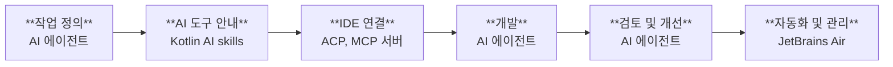

[//]: # (title: Kotlin 개발을 위한 AI 도구)
[//]: # (description: AI로 Kotlin 개발 역량을 강화하고 AI Assistant, Junie, JetBrains Air, Kotlin AI skills, 코딩 에이전트, IDE 연동을 활용하여 코드를 작성, 테스트, 검토, 리팩터링하는 방법을 알아보세요.)

AI 기반 도구는 다양한 Kotlin 개발 작업을 지원할 수 있습니다. 코드 생성 및 설명, 기능 구현, 테스트 작성, 변경 사항 검토, 기존 코드 리팩터링, 반복적인 개발 작업 자동화 등을 수행할 수 있습니다.

Kotlin 생태계에는 대화형 개발, AI 에이전트, 대규모 에이전트 오케스트레이션을 위한 도구들이 포함되어 있습니다. 워크플로에 따라 다음과 같은 작업을 수행할 수 있습니다.

* [IDE에서 개발](#develop-in-the-ide): IntelliJ IDEA 및 Android Studio와 같은 IDE에서 AI 기능을 직접 사용합니다.
* [AI 에이전트 활용](#use-ai-agents): Junie나 서드파티 에이전트 등의 AI 에이전트를 선택하고, Kotlin AI skills를 통해 해당 에이전트의 Kotlin 전문성을 향상합니다.
* [AI 개발 관리 및 확장](#manage-ai-agents): 대화형 및 자동화된 에이전트 워크플로를 조율합니다.

이 페이지에서는 도구 간의 차이점과 워크플로의 각 단계에서 이러한 도구들이 어떤 도움을 줄 수 있는지 설명합니다.

## IDE에서 개발 {id="develop-in-the-ide"}

IDE는 개발 환경 내에서 AI 기반 기능을 직접 제공할 수 있습니다. IDE를 벗어나지 않고도 Kotlin 코드를 작성, 수정, 검토할 수 있습니다.

### AI Assistant {id="ai-assistant"}

[AI Assistant](https://plugins.jetbrains.com/plugin/22282-jetbrains-ai-assistant)는 [IntelliJ IDEA](https://www.jetbrains.com/idea/download/)와 같은 JetBrains IDE 및 [Android Studio](https://developer.android.com/studio) 내에서 직접 AI 기반 지원을 제공합니다. 각 변경 사항을 직접 제어하고 관리하고자 하는 대화형 개발 작업에 사용할 수 있습니다.

AI Assistant는 다음과 같은 기능을 제공합니다.

* [Junie](https://www.jetbrains.com/junie/), Claude Code, OpenAI Codex 및 Agent Client Protocol을 지원하는 모든 서드파티 에이전트를 포함한 AI 에이전트 접근 기능.
* Gemini, GPT, Claude와 같은 클라우드 호스팅 모델 및 로컬 모델을 활용한 컨텍스트 인식 AI 채팅.
* AI 기반 코드 완성 및 다음 편집 제안.

[JetBrains IDE의 AI Assistant 연동](https://www.jetbrains.com/help/ai-assistant/about-ai-assistant.html)에 대해 자세히 알아보세요.

### Air in IDEs {id="air-in-ides"}

[Air in IDEs](https://www.jetbrains.com/air/ides/)는 JetBrains IDE에서 코딩 에이전트로 작업할 수 있는 환경을 제공하는 플러그인입니다. 이를 사용하여 여러 프로젝트에서 에이전트 세션을 시작하고, 진행 상황을 확인하며, 코드 탐색 및 인스펙션(inspection)과 같은 IDE 기능을 통해 변경 사항을 검토할 수 있습니다. diff에 코멘트를 남겨 에이전트에게 작업을 수정하도록 요청할 수도 있습니다.

Air를 사용하면 로컬 머신에 설치된 호환 에이전트를 연결하거나 [ACP 레지스트리](https://agentclientprotocol.com/get-started/registry)에서 에이전트를 선택할 수 있습니다. 또한 작업을 로컬에서 실행하거나 [Air Teams](https://air.jetbrains.cloud/)를 통해 시간이 더 오래 걸리는 작업을 클라우드 에이전트에 위임할 수도 있습니다.

[Air in JetBrains IDEs](https://www.jetbrains.com/air/ides/)에 대해 자세히 알아보세요.

## AI 에이전트 활용 {id="use-ai-agents"}

AI 에이전트는 대화형 AI 어시스턴트보다 직접적인 안내를 덜 받고도 개발 작업을 수행할 수 있습니다. 예를 들어 프로젝트를 탐색하고, 구현 단계를 계획하며, 여러 파일을 수정하거나 명령어와 테스트를 실행할 수 있습니다.

> 어떤 AI 에이전트를 사용해야 할지 잘 모르겠다면 [Kotlin Benchmark](https://kotlinlang.org/benchmark/)를 확인하여 다양한 에이전트가 Kotlin 개발 작업에서 어떤 성능을 보이는지 비교해 보세요.
> 
{style="tip"}

### Air Gateway {id="air-gateway"}

[Air Gateway](https://www.jetbrains.com/air/gateway/)는 JetBrains 계정과 JetBrains AI 크레딧을 사용하여 Claude Code, Codex, Junie CLI와 같은 터미널 에이전트를 실행할 수 있는 커맨드 라인 도구입니다. 에이전트는 기존 터미널 워크플로를 그대로 유지하며, 에이전트 및 모델에 대한 접근은 JetBrains Console을 통해 중앙에서 관리할 수 있습니다.

[Air Gateway](https://www.jetbrains.com/air/gateway/)에 대해 자세히 알아보세요.

### Air Context {id="air-context"}

[Air Context](https://www.jetbrains.com/air/context/)는 커맨드 라인 인터페이스를 갖춘 코드베이스 인덱싱 서비스로, 코딩 에이전트가 관련 코드, API, 종속성, 테스트 및 구현 패턴을 찾을 수 있도록 저장소의 시맨틱 인덱스를 구축합니다.

에이전트가 대규모 코드베이스를 탐색해야 하거나 기존 구현 및 프로젝트 규칙을 찾아야 할 때 Air Context를 사용하세요. Claude Code, Codex CLI, Junie CLI를 포함한 지원 에이전트와 연동되며, IDE 및 기타 지원되는 에디터에서도 사용할 수 있습니다.

[Air Context](https://www.jetbrains.com/air/context/)에 대해 자세히 알아보세요.

### Junie {id="junie"}

[Junie](https://junie.jetbrains.com/)는 JetBrains의 AI 에이전트입니다. Junie는 [JetBrains IDE 및 Android Studio](https://plugins.jetbrains.com/plugin/26104-junie-the-ai-coding-agent-by-jetbrains), [터미널](https://junie.jetbrains.com/docs/junie-cli.html), 또는 CI/CD 파이프라인의 [헤드리스 모드(headless mode)](https://junie.jetbrains.com/docs/junie-headless.html)에서 사용할 수 있습니다. 또한 Junie를 [GitHub 워크플로](https://junie.jetbrains.com/docs/junie-on-github.html)에 연동할 수도 있습니다.

Junie는 단순한 단일 코드 제안이나 채팅 응답 이상의 작업이 필요할 때를 위해 설계되었습니다. 여러 파일이 관련되어 있거나 계획 및 실행이 필요한 개발 작업에 Junie를 활용하세요. 기능 구현, 여러 파일에 걸친 코드 업데이트, 테스트 추가 또는 유지보수 작업 수행을 요청할 수 있습니다.

Junie가 IDE에서 실행될 때는 프로젝트 인덱싱, 코드 탐색, 인스펙션, 리팩터링, 디버깅, 프레임워크 인식 프로젝트 분석과 같은 IDE 기능도 활용할 수 있습니다.

[Junie](https://junie.jetbrains.com/docs/get-started-with-junie.html)에 대해 자세히 알아보세요.

### 서드파티 AI 에이전트 {id="third-party-ai-agents"}

많은 서드파티 AI 개발 도구가 Kotlin을 지원합니다. 이러한 도구는 IDE 확장 프로그램, 독립형 에디터, 커맨드 라인 도구, 클라우드 기반 개발 환경 형태로 제공됩니다. 예:

* GitHub Copilot
* Google Gemini
* Claude Code
* OpenAI Codex

선호하는 개발 환경과 일치하거나 워크플로에 맞는 기능을 제공하는 서드파티 도구를 선택하세요. 이러한 도구 중 상당수가 Kotlin 코드 생성, 설명, 테스트 작성, 리팩터링을 지원합니다.

서드파티 도구를 독립적으로 사용할 수도 있고, 호환되는 에이전트를 ACP를 통해 JetBrains IDE에 연결할 수도 있습니다.

### MCP 서버 {id="mcp-servers"}

Model Context Protocol(MCP)은 AI 모델을 외부 데이터 소스, 도구, 시스템에 연결합니다. JetBrains는 Kotlin 개발 경험의 생산성을 높일 수 있는 여러 MCP 서버를 유지 관리하고 있습니다.

* [JetBrains IDE MCP 서버](https://plugins.jetbrains.com/plugin/26071-mcp-server)는 IDE 기능을 외부로 노출합니다. AI 에이전트는 이 서버를 통해 프로젝트 인덱싱, 코드 탐색, 리팩터링, 인스펙션, 빌드 실행과 같은 IDE 기능을 사용할 수 있습니다. 이를 통해 에이전트는 Kotlin 프로젝트를 더 잘 이해하고 코드를 더욱 효율적으로 생성 및 평가할 수 있습니다.
* [MCP Kotlin SDK](kotlin-ai-apps-development-overview.md#model-context-protocol-mcp-kotlin-sdk)는 Kotlin Multiplatform 구현체입니다. Kotlin으로 AI 기반 애플리케이션을 구축하고 JVM, WebAssembly, iOS 전반의 LLM 영역과 연동할 수 있도록 돕습니다.
* Kotlin Multiplatform 프로젝트의 경우, [klibs.io MCP 서버](https://github.com/JetBrains/klibs-io/blob/master/integrations/mcp/README.md)를 통해 에이전트가 사용 가능한 멀티플랫폼 라이브러리 카탈로그에 접근하여 기존 솔루션을 더 효율적으로 탐색할 수 있습니다.
* Compose Multiplatform 프로젝트의 경우, [Compose Hot Reload MCP 서버](https://kotlinlang.org/docs/multiplatform/compose-hot-reload.html#mcp-server-for-ai-agents)를 통해 에이전트가 리로드 가능한 앱과 직접 상호작용할 수 있습니다. 즉, 리로드를 트리거하고 스크린샷을 찍으며 시맨틱 트리를 읽는 등의 작업이 가능합니다.

### Kotlin AI skills {id="kotlin-ai-skills"}

Kotlin AI skills는 AI 에이전트가 Kotlin 개발 작업을 수행하도록 안내하는 재사용 가능한 지침입니다. 에이전트가 이러한 작업을 더욱 일관되게 수행할 수 있도록 돕습니다.

에이전트가 관용적인 Kotlin 패턴, Kotlin 코딩 컨벤션, 프로젝트별 요구사항을 따르도록 안내하고 싶을 때 Kotlin AI skills를 사용하세요. Skills는 AI 에이전트가 Kotlin 코드 작성, 언어 기능 설명, 문서 생성, 테스트 작성, 코드 검토, 마이그레이션 지침 적용 등의 작업을 수행하는 데 도움을 줍니다.

Kotlin AI skills는 IDE 기반 에이전트, 커맨드 라인 에이전트, 재사용 가능한 지침을 지원하는 외부 AI 도구 등 다양한 에이전트 및 워크플로에서 사용할 수 있습니다.

[Kotlin AI skills](kotlin-ai-skills.md)에 대해 자세히 알아보세요.

### Kotlin 전용 수락 기준(Acceptance Criteria) {id="kotlin-specific-acceptance-criteria"}

특히 Kotlin Multiplatform 프로젝트는 에이전트가 전체 프로젝트 구조와 특정 변경 사항이 미치는 영향을 놓치기 쉬울 정도로 복잡합니다.

에이전트를 돕기 위해 일반적인 성공 기준([AGENTS.md](https://agents.md/)) 또는 작업별 성공 기준으로 다음과 같은 예시를 포함할 수 있습니다.

* 사용 가능한 타깃별 테스트가 있는 경우 변경 사항을 적용한 후 항상 실행합니다.
* 작업을 완료된 것으로 간주하기 전에 구성된 모든 KMP 타깃이 성공적으로 빌드되는지 확인합니다.
* 에이전트(또는 개발자)가 나중에 공통 코드에서 실수로 플랫폼 전용 API를 사용하는 일이 없도록, 공통 코드에 플랫폼 전용 API가 유출되었는지 구현 내용을 검토합니다.

## AI 에이전트 관리 {id="manage-ai-agents"}

개발 팀은 반복적인 작업을 자동화하거나 에이전트 활동을 모니터링하고, 도입을 결정하기 전에 다양한 도구를 평가하기 위해 여러 AI 에이전트가 필요할 수 있습니다. 다음 도구들은 개별 코딩 세션을 넘어 AI 기반 개발을 지원합니다.

### Air Teams {id="air-teams"}

[Air Teams](https://www.jetbrains.com/air/)를 사용하면 팀이 공유 프로젝트와 전용 클라우드 환경에서 에이전트 작업을 협업할 수 있습니다. 팀은 각 프로젝트에 대한 머신 리소스, 네트워크 접근 권한, 변수, 시크릿(secret)을 구성할 수 있으며, 팀원과 에이전트가 동일한 외부 도구를 사용할 수 있도록 MCP 서버를 연결할 수 있습니다.

프로젝트에서 협업 및 검토를 위해 공유 에이전트 환경과 세션이 필요할 때 Air Teams를 사용하세요.

[Air Teams](https://www.jetbrains.com/air/)에 대해 자세히 알아보거나 [Air Teams에 접속](https://air.jetbrains.cloud/)해 보세요.

### Air Governance {id="air-governance"}

[Air Governance](https://www.jetbrains.com/air/governance/)는 AI 지원 및 에이전트 기반 개발을 위한 조직 수준의 제어 기능을 제공합니다. 관리자는 개발자가 사용할 수 있는 에이전트, 모델, MCP 서버를 제어하고 AI 크레딧 한도를 설정할 수 있습니다. 정책은 조직 전체에 적용하거나 특정 팀 또는 개인에 맞게 조정할 수 있습니다. 사용 현황 분석을 통해 팀이 어떤 도구를 사용하는지, 어디에 투자해야 하는지 파악할 수 있습니다.

조직에서 다양한 AI 도구와 제공업체 전반의 접근 권한 및 비용을 관리해야 할 때 Air Governance를 사용하세요. JetBrains AI를 사용하거나 조직의 제공업체 API 키를 제공하면서 사용량을 중앙에서 관리할 수 있습니다.

[Air Governance](https://www.jetbrains.com/air/governance/)에 대해 자세히 알아보세요.