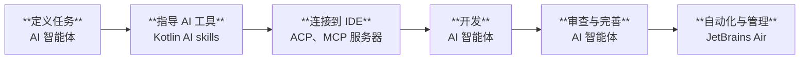

[//]: # (title: 用于 Kotlin 开发的 AI 工具)
[//]: # (description: 利用 AI 助力您的 Kotlin 开发，并了解如何使用 AI Assistant、Junie、JetBrains Air、Kotlin AI skills、编码智能体以及 IDE 集成来编写、测试、审查和重构代码。)

AI 驱动的工具可以协助完成诸多 Kotlin 开发任务。它们可以生成和解释代码、实现功能、创建测试、审查更改、重构现有代码，以及自动化重复出现的开发任务。

Kotlin 生态系统包含用于交互式开发、AI 智能体以及大规模智能体编排的工具。
根据您的工作流程，您可以：

* ：直接在 IntelliJ IDEA 和 Android Studio 等 IDE 中使用 AI 功能。
* [使用 AI 智能体](#use-ai-agents)：选择类似 Junie 或第三方的 AI 智能体，并通过 Kotlin AI skills 提升其 Kotlin 专业技能。
* [管理和扩展 AI 开发](#manage-ai-agents)：协调交互式和自动化的智能体工作流程。

本页介绍了各工具之间的差异，以及它们如何在工作流程的不同阶段为您提供帮助。

## 在 IDE 中开发 {id="develop-in-the-ide"}

IDE 可以直接在您的开发环境中提供 AI 驱动的功能。您无需离开 IDE 即可编写、修改和审查 Kotlin 代码。

### AI Assistant {id="ai-assistant"}

[AI Assistant](https://plugins.jetbrains.com/plugin/22282-jetbrains-ai-assistant) 在 [IntelliJ IDEA](https://www.jetbrains.com/idea/download/) 等 JetBrains IDE 以及 [Android Studio](https://developer.android.com/studio) 中直接提供 AI 辅助。
您可以在希望掌控每项更改的交互式开发任务中使用它。

AI Assistant 提供：

* 访问 AI 智能体，包括 [Junie](https://www.jetbrains.com/junie/)、Claude Code、OpenAI Codex，以及任何支持 Agent Client Protocol 的第三方智能体。
* 使用云端托管模型（例如 Gemini、GPT 和 Claude）以及您自己的本地模型进行上下文感知型 AI 对话。
* AI 辅助的代码补全和下一次编辑建议。

详细了解 [JetBrains IDE 的 AI Assistant 集成](https://www.jetbrains.com/help/ai-assistant/about-ai-assistant.html)。

### IDE 中的 Air {id="air-in-ides"}

[IDE 中的 Air](https://www.jetbrains.com/air/ides/) 是一款插件，在 JetBrains IDE 中为使用编码智能体提供了运行环境。使用它可以跨项目启动智能体会话、跟踪其进度，并借助代码导航和检查等 IDE 功能审查更改。您可以对差异添加评论，并要求智能体修订其工作。

Air 允许您连接安装在本地计算机上的兼容智能体，或从 [ACP 注册表](https://agentclientprotocol.com/get-started/registry)中选择智能体。
您还可以在本地运行任务，或者通过 [Air Teams](https://air.jetbrains.cloud/) 将耗时更长的任务委托给云端智能体。

详细了解 [JetBrains IDE 中的 Air](https://www.jetbrains.com/air/ides/)。

## 使用 AI 智能体 {id="use-ai-agents"}

与交互式 AI 助手相比，AI 智能体可以在更少的直接指导下执行开发任务。例如，它们可以探索项目、规划实现步骤、修改多个文件，或者运行命令和测试。

> 如果您不确定该使用哪款 AI 智能体，请查看 [Kotlin 基准测试](https://kotlinlang.org/benchmark/)，比较不同智能体在 Kotlin 开发任务中的表现。
> 
{style="tip"}

### Air Gateway {id="air-gateway"}

[Air Gateway](https://www.jetbrains.com/air/gateway/) 是一款命令行工具，用于通过 JetBrains 帐户并使用 JetBrains AI 点数来运行终端智能体（例如 Claude Code、Codex 和 Junie CLI）。您的智能体会保留其原有的终端工作流程，同时可以通过 JetBrains 控制台集中管理对智能体和模型的访问权限。

详细了解 [Air Gateway](https://www.jetbrains.com/air/gateway/)。

### Air Context {id="air-context"}

[Air Context](https://www.jetbrains.com/air/context/) 是一项带有命令行界面的代码库索引服务，用于构建仓库的语义索引，以便编码智能体能够查找相关代码、API、依赖项、测试和实现模式。

当智能体需要探索大型代码库或查找现有实现和项目约定时，可以使用 Air Context。它与受支持的智能体（包括 Claude Code、Codex CLI 和 Junie CLI）集成，并且可以在 IDE 和其他受支持的编辑器中使用。

详细了解 [Air Context](https://www.jetbrains.com/air/context/)。

### Junie {id="junie"}

[Junie](https://junie.jetbrains.com/) 是一款 JetBrains AI 智能体。您可以[在 JetBrains IDE 和 Android Studio 中](https://plugins.jetbrains.com/plugin/26104-junie-the-ai-coding-agent-by-jetbrains)、[从终端](https://junie.jetbrains.com/docs/junie-cli.html)或在 CI/CD 流水线中[以无外设模式](https://junie.jetbrains.com/docs/junie-headless.html)使用 Junie。
您还可以将 Junie 集成到您的 [GitHub 工作流程](https://junie.jetbrains.com/docs/junie-on-github.html)中。

Junie 专为需要多条代码建议或多轮对话回复的复杂任务而设计。在涉及多个文件或需要规划与执行的开发任务中可以使用 Junie。您可以让它实现某项功能、跨多个文件更新代码、添加测试或执行维护工作。

当 Junie 在 IDE 中运行时，它还可以利用 IDE 功能，例如项目索引、代码导航、检查、重构操作、调试和可感知框架的项目分析。

详细了解 [Junie](https://junie.jetbrains.com/docs/get-started-with-junie.html)。

### 第三方 AI 智能体 {id="third-party-ai-agents"}

许多第三方 AI 开发工具都支持 Kotlin。它们以 IDE 扩展程序、独立编辑器、命令行工具和基于云的开发环境等形式提供。例如：

* GitHub Copilot
* Google Gemini
* Claude Code
* OpenAI Codex

如果某款第三方工具契合您偏好的开发环境，或者提供了适合您工作流程的功能，请选择使用它。
这些工具中的大多数都支持 Kotlin 代码生成、解释、测试创建和重构。

您可以独立使用第三方工具，也可以通过 ACP 将兼容的智能体连接到 JetBrains IDE。

### MCP 服务器 {id="mcp-servers"}

Model Context Protocol (MCP) 将 AI 模型连接到外部数据源、工具和系统。
JetBrains 维护着多个 MCP 服务器，能够让您的 Kotlin 开发体验更加高效：

* [JetBrains IDE MCP 服务器](https://plugins.jetbrains.com/plugin/26071-mcp-server)公开了 IDE 功能。
  通过该服务器，AI 智能体可以使用项目索引、代码导航、重构、检查和构建执行等 IDE 功能。
  这使智能体能够更好地理解您的 Kotlin 项目，并以更高效的方式生成和评估代码。
* [MCP Kotlin SDK](kotlin-ai-apps-development-overview.md#model-context-protocol-mcp-kotlin-sdk) 是一个 Kotlin Multiplatform 实现。它可帮助您在 Kotlin 中构建 AI 驱动的应用程序，并在 JVM、WebAssembly 和 iOS 之间与 LLM 交互界面集成。
* 对于 Kotlin Multiplatform 项目，[klibs.io MCP 服务器](https://github.com/JetBrains/klibs-io/blob/master/integrations/mcp/README.md)可帮助智能体访问可用多平台库的目录，从而更高效地寻找现有解决方案。
* 对于 Compose Multiplatform 项目，[Compose Hot Reload MCP 服务器](https://kotlinlang.org/docs/multiplatform/compose-hot-reload.html#mcp-server-for-ai-agents)允许智能体直接与可热重载的应用进行交互：触发重载、截取屏幕截图、读取语义树等。

### Kotlin AI skills {id="kotlin-ai-skills"}

Kotlin AI skills 是可复用的指令集，用于引导 AI 智能体完成 Kotlin 开发任务。它们有助于智能体更加一致地执行这些任务。

当您希望引导智能体采用惯用的 Kotlin 模式、Kotlin 编码规范以及项目特定的规范要求时，可以使用 Kotlin AI skills。Skills 可帮助 AI 智能体执行编写 Kotlin 代码、解释语言功能、生成文档、创建测试、审查代码或应用迁移指南等任务。

Kotlin AI skills 可用于不同的智能体和工作流程，包括基于 IDE 的智能体、命令行智能体以及支持可复用指令的外部 AI 工具。

详细了解 。

### Kotlin 特定的验收标准 {id="kotlin-specific-acceptance-criteria"}

特别是 Kotlin Multiplatform 项目足够复杂，智能体可能会忽略整个项目结构以及特定更改所带来的影响。

为了协助智能体，您可以将以下示例作为通用 ([AGENTS.md](https://agents.md/)) 或针对特定任务的成功标准：

* 在引入更改后，只要存在特定于目标的测试，就运行这些测试。
* 在认定任务完成之前，验证所有已配置的 KMP 目标均能成功构建。
* 审查实现中是否存在泄漏到通用代码中的平台专属 API，以避免智能体（或开发者）日后不慎在通用代码中使用这些 API。

## 管理 AI 智能体 {id="manage-ai-agents"}

开发团队可能需要多个 AI 智能体来自动化日常重复任务、监控智能体活动，或者在决定采用之前对不同工具进行评估。以下工具为个体编码会话之外的 AI 辅助开发提供支持。

### Air Teams {id="air-teams"}

[Air Teams](https://www.jetbrains.com/air/) 允许团队在共享项目和专用云环境中协作处理智能体任务。
团队可以为每个项目配置机器资源、网络访问权限、变量和密钥，并连接 MCP 服务器，以便团队成员和智能体可以使用相同的外部工具。

当您的项目需要共享智能体环境和会话以进行协作与审查时，可以使用 Air Teams。

详细了解 [Air Teams](https://www.jetbrains.com/air/) 或[访问 Air Teams](https://air.jetbrains.cloud/)。

### Air Governance {id="air-governance"}

[Air Governance](https://www.jetbrains.com/air/governance/) 为 AI 辅助和智能体驱动的开发提供组织级别的管控能力。
管理员可以控制开发者可以使用哪些智能体、模型和 MCP 服务器，并设置 AI 点数上限。策略可以应用于整个组织，也可以针对特定团队或个人量身定制。使用情况分析有助于您了解团队使用的工具以及应当投资的方向。

当您的组织需要管理不同 AI 工具和提供商的访问权限与成本时，可以使用 Air Governance。您可以使用 JetBrains AI，也可以提供贵组织的提供商 API 密钥，同时对使用情况进行集中管理。

详细了解 [Air Governance](https://www.jetbrains.com/air/governance/)。