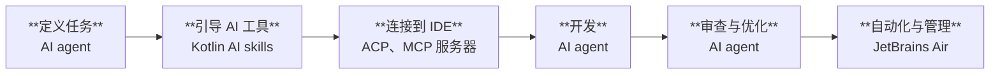

[//]: # (title: 适用于 Kotlin 开发的 AI 工具)
<web-summary>借助 AI 提升您的 Kotlin 开发效率，并了解如何使用 AI Assistant、Junie、JetBrains Air、Kotlin AI skills、编码智能体以及 IDE 集成来编写、测试、审查和重构代码。</web-summary>

AI 驱动的工具可以协助完成诸多 Kotlin 开发任务。它们能够生成并解释代码、实现功能、创建测试、审查更改、重构既有代码，并自动化执行重复性开发任务。

Kotlin 生态系统包含用于交互式开发、AI 智能体（agent）以及大规模智能体编排的工具。根据您的工作流，您可以：

* [在 IDE 中开发](#develop-in-the-ide)：直接在 IntelliJ IDEA 和 Android Studio 等 IDE 中使用 AI 功能。
* [使用 AI 智能体](#use-ai-agents)：选择 Junie 或第三方智能体等 AI 智能体，并通过 Kotlin AI skills 增强其 Kotlin 专业能力。
* [管理并扩展 AI 开发规模](#manage-ai-agents)：协调交互式与自动化的智能体工作流。

本页面将介绍这些工具之间的差异，以及它们如何在工作流的不同阶段为您提供帮助。

## 在 IDE 中开发 {id="develop-in-the-ide"}

IDE 可以直接在开发环境中提供由 AI 驱动的功能。您无需离开 IDE 即可编写、修改和审查 Kotlin 代码。

### AI Assistant {id="ai-assistant"}

[AI Assistant](https://plugins.jetbrains.com/plugin/22282-jetbrains-ai-assistant) 直接在 JetBrains IDE（例如 [IntelliJ IDEA](https://www.jetbrains.com/idea/download/)）以及 [Android Studio](https://developer.android.com/studio) 中提供基于 AI 的辅助功能。您可以将其用于交互式开发任务，以便掌控每一次更改。

AI Assistant 提供：

* 访问 AI 智能体的能力，包括 [Junie](https://www.jetbrains.com/junie/)、Claude Code、OpenAI Codex，以及任何支持 Agent Client Protocol 的第三方智能体。
* 上下文感知的 AI 对话，支持使用云端托管的模型（如 Gemini、GPT 和 Claude）以及您自己的本地模型。
* AI 辅助的代码补全和下一步编辑建议。

详细了解 [AI Assistant 与 JetBrains IDE 的集成](https://www.jetbrains.com/help/ai-assistant/about-ai-assistant.html)。

### IDE 中的 Air {id="air-in-ides"}

[IDE 中的 Air](https://www.jetbrains.com/air/ides/) 是一个插件，可在 JetBrains IDE 中为使用编码智能体提供运行环境。使用它可以跨项目启动智能体会话、跟踪其进度，并借助代码导航和检查等 IDE 功能审查更改。您可以对差异添加评论，并要求智能体修改其工作。

Air 允许您连接安装在本地计算机上的兼容智能体，或从 [ACP 注册表](https://agentclientprotocol.com/get-started/registry) 中选择智能体。您还可以在本地运行任务，或者通过 [Air Teams](https://air.jetbrains.cloud/) 将耗时较长的任务委派给云端智能体。

详细了解 [JetBrains IDE 中的 Air](https://www.jetbrains.com/air/ides/)。

## 使用 AI 智能体 {id="use-ai-agents"}

与交互式 AI 助手相比，AI 智能体可以在较少的人工直接指导下执行开发任务。例如，它们可以探索项目、规划实现步骤、修改多个文件，或者运行命令和测试。

> 如果您不确定该使用哪种 AI 智能体，请查看 [Kotlin Benchmark](https://kotlinlang.org/benchmark/)，比较不同智能体在 Kotlin 开发任务中的表现。
> 
{style="tip"}

### Air Gateway {id="air-gateway"}

[Air Gateway](https://www.jetbrains.com/air/gateway/) 是一款命令行工具，用于通过 JetBrains 账户并使用 JetBrains AI 点数运行终端智能体（例如 Claude Code、Codex 和 Junie CLI）。您的智能体可以保持其现有的终端工作流，同时可以通过 JetBrains 控制台对智能体和模型的访问进行集中管理。

详细了解 [Air Gateway](https://www.jetbrains.com/air/gateway/)。

### Air Context {id="air-context"}

[Air Context](https://www.jetbrains.com/air/context/) 是一项具有命令行接口的代码库索引服务，它可以构建仓库的语义索引，以便编码智能体能够找到相关的代码、API、依赖项、测试以及实现模式。

当智能体需要探索大型代码库或查找现有实现和项目规范时，可以使用 Air Context。它集成了支持的智能体（包括 Claude Code、Codex CLI 和 Junie CLI），并且可以在 IDE 及其他受支持的编辑器中使用。

详细了解 [Air Context](https://www.jetbrains.com/air/context/)。

### Junie {id="junie"}

[Junie](https://junie.jetbrains.com/) 是由 JetBrains 开发的 AI 智能体。您可以在 [JetBrains IDE 和 Android Studio 中](https://plugins.jetbrains.com/plugin/26104-junie-the-ai-coding-agent-by-jetbrains)、[从终端中](https://junie.jetbrains.com/docs/junie-cli.html)，或者在 CI/CD 流水线中以[无前端（headless）模式](https://junie.jetbrains.com/docs/junie-headless.html)使用 Junie。您还可以将 Junie 集成到您的 [GitHub 工作流](https://junie.jetbrains.com/docs/junie-on-github.html)中。

Junie 专为需要超越单次代码建议或对话响应的任务而设计。对于涉及多个文件或需要规划与执行的开发任务，均可使用 Junie。您可以要求它实现某项功能、跨多个文件更新代码、添加测试或执行维护工作。

当 Junie 在 IDE 中运行时，它还可以利用 IDE 的各项功能，例如项目索引、代码导航、检查、重构操作、调试以及具备框架感知能力的项目分析。

详细了解 [Junie](https://junie.jetbrains.com/docs/get-started-with-junie.html)。

### 第三方 AI 智能体 {id="third-party-ai-agents"}

许多第三方 AI 开发工具都支持 Kotlin。它们以 IDE 扩展程序、独立编辑器、命令行工具以及基于云的开发环境等形式提供。例如：

* GitHub Copilot
* Google Gemini
* Claude Code
* OpenAI Codex

如果某种第三方工具符合您偏好的开发环境，或者提供了适合您工作流的功能，您可以选择使用它。这些工具大多支持 Kotlin 代码生成、代码解释、测试创建以及重构。

您可以独立使用第三方工具，也可以通过 ACP 将兼容的智能体连接到 JetBrains IDE。

### MCP 服务器 {id="mcp-servers"}

模型上下文协议（Model Context Protocol，简称 MCP）用于将 AI 模型连接到外部数据源、工具和系统。JetBrains 维护了多个 MCP 服务器，能够让您的 Kotlin 开发更加高效：

* [JetBrains IDE MCP 服务器](https://plugins.jetbrains.com/plugin/26071-mcp-server) 导出了 IDE 的各项能力。AI 智能体通过该服务器可以使用项目索引、代码导航、重构、检查和构建执行等 IDE 功能。这使智能体能够更好地理解您的 Kotlin 项目，并以更高效的方式生成和评估代码。
* [MCP Kotlin SDK](kotlin-ai-apps-development-overview.md#model-context-protocol-mcp-kotlin-sdk) 是一个 Kotlin Multiplatform 实现。它可协助您使用 Kotlin 构建 AI 驱动的应用程序，并与 JVM、WebAssembly 及 iOS 等平台的 LLM 接口进行集成。
* 针对 Kotlin Multiplatform 项目，[klibs.io MCP 服务器](https://github.com/JetBrains/klibs-io/blob/master/integrations/mcp/README.md) 可帮助智能体访问可用多平台库的目录，从而更高效地寻找现有解决方案。
* 针对 Compose Multiplatform 项目，[Compose Hot Reload MCP 服务器](https://kotlinlang.org/docs/multiplatform/compose-hot-reload.html#mcp-server-for-ai-agents) 允许智能体直接与支持热重载的应用进行交互：触发重载、获取屏幕截图、读取语义树等。

### Kotlin AI skills {id="kotlin-ai-skills"}

Kotlin AI skills 是一套可复用的指令集，用于引导 AI 智能体完成 Kotlin 开发任务。它们有助于智能体更加一致地执行这些任务。

当您希望引导智能体遵循符合习惯的 Kotlin 惯用模式、Kotlin 编码规范以及特定项目的预期要求时，可以使用 Kotlin AI skills。这些技能可以帮助 AI 智能体执行诸如编写 Kotlin 代码、解释语言功能、生成文档、创建测试、审查代码或应用迁移指导等任务。

Kotlin AI skills 可用于各种智能体和工作流，包括基于 IDE 的智能体、命令行智能体以及支持可复用指令的外部 AI 工具。

详细了解 。

### Kotlin 特定的验收标准 {id="kotlin-specific-acceptance-criteria"}

尤其是 Kotlin Multiplatform 项目，其复杂度足以让智能体忽略整个项目结构以及特定更改所带来的影响。

为了向智能体提供帮助，您可以将以下示例作为通用的（[AGENTS.md](https://agents.md/)）或特定于任务的验收标准：

* 引入更改后，只要有针对特定目标的测试可用，就运行这些测试。
* 在认定任务完成之前，验证所有已配置的 KMP 目标均能成功构建。
* 审查代码实现中是否存在平台特定 API 泄漏到公共代码的情况，以避免智能体（或开发者）后续在公共代码中误用这些 API。

## 管理 AI 智能体 {id="manage-ai-agents"}

开发团队可能需要多个 AI 智能体来自动化执行重复任务、监控智能体活动，或者在决定采用之前对不同工具进行评估。以下工具可支持超越单个编码会话的 AI 辅助开发。

### Air Teams {id="air-teams"}

[Air Teams](https://www.jetbrains.com/air/) 允许团队在共享项目和专用云环境中就智能体任务展开协作。团队可以为每个项目配置机器资源、网络访问权限、变量和密钥，并连接 MCP 服务器，以便团队成员和智能体能够使用相同的外部工具。

当您的项目需要共享的智能体环境和会话以进行协作与审查时，可以使用 Air Teams。

详细了解 [Air Teams](https://www.jetbrains.com/air/) 或 [访问 Air Teams](https://air.jetbrains.cloud/)。

### Air Governance {id="air-governance"}

[Air Governance](https://www.jetbrains.com/air/governance/) 为 AI 辅助和智能体驱动的开发提供组织级别的管控能力。管理员可以控制开发者能够使用的智能体、模型和 MCP 服务器，并设置 AI 点数限额。策略可以应用于整个组织，也可以针对特定团队或个人进行定制。使用情况分析有助于您了解团队正在使用哪些工具，以及应该在何处进行投入。

当您的组织需要跨不同的 AI 工具和提供商管理访问权限及成本时，可以使用 Air Governance。您可以集中管理使用情况，同时使用 JetBrains AI 或提供您组织的供应商 API 密钥。

详细了解 [Air Governance](https://www.jetbrains.com/air/governance/)。