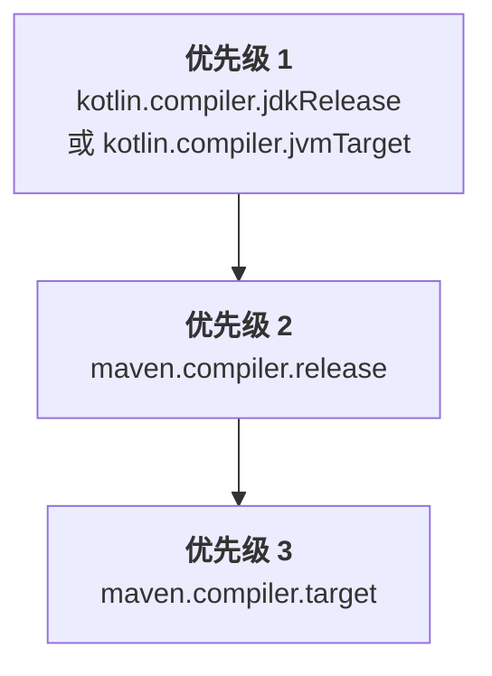

[//]: # (title: 配置 Maven 项目)

当你在现有的 Java Maven 项目中引入 Kotlin，或者创建新的 Kotlin Maven 项目时，你需要添加用于编译 Kotlin 源代码和模块的 Kotlin Maven 插件。

目前仅支持 Maven v3。

> 如果你计划将项目迁移到 Maven 4，请使用 [`mvnup`](https://maven.apache.org/tools/mvnup.html) Maven 升级工具来自动迁移你的构建。有关迁移的更多信息，请参阅[从 Maven 4 开始](https://maven.apache.org/guides/mini/guide-migration-to-mvn4.html)指南。
>
{style="note"}

## 自动配置 {id="automatic-configuration"}

你可以在 Java 与 Kotlin 混合项目以及纯 Kotlin 项目中使用 `<extensions>` 选项来简化 Maven 配置。该方法可以节省你的时间，因为你无需再配置 Maven 编译器插件。

要应用带有 `<extensions>` 的 Kotlin Maven 插件，请按如下方式更新 `pom.xml` 构建文件：

1. 在 `<properties>` 部分中，定义 Kotlin 和 JVM 的目标版本：

   ```xml
   <properties>
       <maven.compiler.release>17</maven.compiler.release>
       <kotlin.version>%kotlinVersion%</kotlin.version>
   </properties>
   ```

2. 在 `<build><plugins>` 部分中，添加启用了 `<extensions>` 选项的 Kotlin Maven 插件：

   ```xml
   <build>
       <plugins>
           <!-- Kotlin 编译器插件配置 -->
           <plugin>
               <groupId>org.jetbrains.kotlin</groupId>
               <artifactId>kotlin-maven-plugin</artifactId>
               <version>${kotlin.version}</version>
               <extensions>true</extensions> <!-- 启用扩展 -->
           </plugin>
           <!-- 使用扩展后无需配置 Maven 编译器插件 -->
       </plugins>
   </build>
   ```

`<extensions>` 选项具有以下作用：

* 如果 `src/main/kotlin` 和 `src/test/kotlin` 目录已经存在但未在插件配置中指定，则将其注册为源根。
* 如果项目中尚未定义，则添加 [`kotlin-stdlib` 依赖项](maven-set-dependencies.md#dependency-on-the-standard-library)。
* 将 `compile`、`test-compile`、`kapt` 和 `test-kapt` 执行添加到你的构建中，并绑定到它们各自合适的[生命周期阶段](https://maven.apache.org/guides/introduction/introduction-to-the-lifecycle.html)。因此，你无需为了确保按正确顺序运行，而手动在 `<executions>` 部分为 `kapt`、Kotlin 的 `compile` 以及 Java 的 `compile` 执行配置 `<id>` 和 `<goals>`。
* [自动将 JVM 目标版本与项目中配置的 Java 编译器版本对齐。](#jvm-target-version)
   
如果你拥有 Java 和 Kotlin 混合项目，该配置可确保：

* 先编译 Kotlin 代码。
* Java 代码在 Kotlin 之后编译，并且可以引用 Kotlin 类。
* Maven 的默认行为不会覆盖插件顺序。

扩展配置替代了整个 `<executions>` 部分。如果需要配置具体的执行，请参阅[编译 Kotlin 和 Java 源代码](#compile-kotlin-and-java-sources)中的示例。

> 如果有多个构建插件重写了默认生命周期，并且你也启用了 `<extensions>` 选项，则 `<build>` 部分中的最后一个插件在生命周期设置上拥有最高优先级。所有更早针对生命周期设置的更改都将被忽略。
>
{style="note"}

<anchor name="maven-compiler-extensions-version"/>

目前，配合 `<extensions>` 使用的 Maven 编译器插件的默认版本为 **%mavenExtensionsVersion%**。你可以单独设置其他版本：

```xml
<build>
    <plugins>
        <!-- Kotlin 编译器插件配置 -->
        <plugin>
            <groupId>org.jetbrains.kotlin</groupId>
            <artifactId>kotlin-maven-plugin</artifactId>
            <version>${kotlin.version}</version>
            <extensions>true</extensions>
        </plugin>
        <!-- 用于 Java 类的 Maven 编译器插件配置 -->
        <plugin>
            <groupId>org.apache.maven.plugins</groupId>
            <artifactId>maven-compiler-plugin</artifactId>
            <version>%mavenPluginVersion%</version>
        </plugin>
    </plugins>
</build>
```

### JVM 目标版本 {id="jvm-target-version"}

`<extensions>` 选项可确保 Kotlin 和 Maven 编译器以相同的字节码版本为目标。

Kotlin Maven 插件按照以下优先级顺序自动解析 JVM 目标版本：



#### Kotlin 编译器版本 {id="kotlin-compiler-versions"}

如果项目中定义了 `kotlin.compiler.jdkRelease` 或 `kotlin.compiler.jvmTarget` 属性，则其中设置的版本优先。

请注意，这些 Kotlin 编译器选项的行为有所不同：

| Kotlin 编译器选项       | 控制输出的字节码版本 | 将 API 限制为指定 JDK                                                                   |
|------------------------------|-----------------------------------------|-----------------------------------------------------------------------------------------------|
| `kotlin.compiler.jvmTarget`  | 是                                     | 代码中的 JDK API 不受限制                                                      |
| `kotlin.compiler.jdkRelease` | 是                                     | 是 − 仅允许特定的 API 版本（等同于 Java 的 `--release` 编译器选项） |

> 不要同时为 `kotlin.compiler.jdkRelease` 和 `kotlin.compiler.jvmTarget` 设置不同的 JDK 选项，否则会出现错误。
>
{style="note"}

#### Maven 编译器版本 {id="maven-compiler-versions"}

* 如果既未设置 `kotlin.compiler.jdkRelease` 也未设置 `kotlin.compiler.jvmTarget` 选项，则插件将采用 `maven.compiler.release` 版本。

  `maven.compiler.release` 版本既可以定义为项目属性，也可以在 `maven-compiler-plugin` 配置中定义。
* 如果未设置 Maven release 版本，则插件将采用 `maven.compiler.target` 版本。

  该版本既可以定义为项目属性，也可以在 `maven-compiler-plugin` 配置中定义。

请注意，Maven 编译器的 `target` 和 `release` 选项行为有所不同：

| Maven 编译器选项    | 设置 Kotlin 的 `jvmTarget` | 设置 Kotlin 的 `jdkRelease` | 将 API 限制为指定 JDK                  |
|--------------------------|---------------------------|----------------------------|----------------------------------------------|
| `maven.compiler.target`  | 是                       | 否                         | 否 − 构建的 JDK 类路径保持可见 |
| `maven.compiler.release` | 是                       | 是                        | 是 − 仅限特定的 API 版本       |

> `<extensions>` 选项仅检查项目级属性和全局 `maven-compiler-plugin` 配置。它不会检查在插件 `<executions>` 部分中定义的配置。
>
{style="note"}

## 手动配置 {id="manual-configuration"}

如果未在 Kotlin Maven 插件中启用 `<extensions>`，你需要手动配置项目以确保源代码正确编译。

你可以将 Maven 项目设置为编译 [Java 与 Kotlin 混合源代码](#compile-kotlin-and-java-sources)或[纯 Kotlin 源代码](#compile-kotlin-only-sources)。

### 编译 Kotlin 和 Java 源代码 {id="compile-kotlin-and-java-sources"}

要编译同时包含 Kotlin 和 Java 源文件的项目，请确保 Kotlin 编译器在 Java 编译器之前运行。

在编译成 `.class` 文件之前，Java 编译器无法看到 Kotlin 声明。如果你的 Java 代码使用了 Kotlin 类，则必须先编译这些类以避免出现 `cannot find symbol` 错误。

Maven 根据两个主要因素决定插件的执行顺序：

* `pom.xml` 文件中插件声明的顺序。
* 内置的默认执行（例如 `default-compile` 和 `default-testCompile`），无论它们在 `pom.xml` 文件中的位置如何，它们始终在用户定义的执行之前运行。

要控制执行顺序：

* 在 `maven-compiler-plugin` 之前声明 `kotlin-maven-plugin`。
* 禁用 Java 编译器插件的默认执行。
* 添加自定义执行以显式控制编译阶段。

> 可以在 Maven 中使用特殊的 `none` 阶段来禁用默认执行。
>
{style="note"}

要应用 Kotlin Maven 插件，请按如下方式更新 `pom.xml` 构建文件：

```xml
<build>
    <plugins>
        <!-- Kotlin 编译器插件配置 -->
        <plugin>
            <groupId>org.jetbrains.kotlin</groupId>
            <artifactId>kotlin-maven-plugin</artifactId>
            <version>${kotlin.version}</version>
            <executions>
                <execution>
                    <id>kotlin-compile</id>
                    <phase>compile</phase>
                    <goals>
                        <goal>compile</goal>
                    </goals>
                    <configuration>
                        <sourceDirs>
                            <sourceDir>${project.basedir}/src/main/kotlin</sourceDir>
                            <!-- 确保 Kotlin 代码可以引用 Java 代码 -->
                            <sourceDir>${project.basedir}/src/main/java</sourceDir>
                        </sourceDirs>
                    </configuration>
                </execution>
                <execution>
                    <id>kotlin-test-compile</id>
                    <phase>test-compile</phase>
                    <goals>
                        <goal>test-compile</goal>
                    </goals>
                    <configuration>
                        <sourceDirs>
                            <sourceDir>${project.basedir}/src/test/kotlin</sourceDir>
                            <sourceDir>${project.basedir}/src/test/java</sourceDir>
                        </sourceDirs>
                    </configuration>
                </execution>
            </executions>
        </plugin>

        <!-- Maven 编译器插件配置 -->
        <plugin>
            <groupId>org.apache.maven.plugins</groupId>
            <artifactId>maven-compiler-plugin</artifactId>
            <version>3.15.0</version>
            <executions>
                <!-- 禁用默认执行 -->
                <execution>
                    <id>default-compile</id>
                    <phase>none</phase>
                </execution>
                <execution>
                    <id>default-testCompile</id>
                    <phase>none</phase>
                </execution>

                <!-- 定义自定义执行 -->
                <execution>
                    <id>java-compile</id>
                    <phase>compile</phase>
                    <goals>
                        <goal>compile</goal>
                    </goals>
                </execution>
                <execution>
                    <id>java-test-compile</id>
                    <phase>test-compile</phase>
                    <goals>
                        <goal>testCompile</goal>
                    </goals>
                </execution>
            </executions>
        </plugin>
    </plugins>
</build>
```

该配置可确保：

* 先编译 Kotlin 代码。
* Java 代码在 Kotlin 之后编译，并且可以引用 Kotlin 类。
* Maven 的默认行为不会覆盖插件顺序。

有关 Maven 如何处理插件执行的更多详细信息，请参阅 Maven 官方文档中的[默认插件执行 ID 指南](https://maven.apache.org/guides/mini/guide-default-execution-ids.html)。

### 编译纯 Kotlin 源代码 {id="compile-kotlin-only-sources"}

要编译仅包含 Kotlin 源文件的项目，请声明源根并配置 Kotlin Maven 插件：

1. 在 `<build>` 部分中指定源目录：

    ```xml
    <build>
        <sourceDirectory>src/main/kotlin</sourceDirectory>
        <testSourceDirectory>src/test/kotlin</testSourceDirectory>
    </build>
    ```

2. 确保已应用 Kotlin Maven 插件：

    ```xml
    <build>
        <plugins>
            <plugin>
                <groupId>org.jetbrains.kotlin</groupId>
                <artifactId>kotlin-maven-plugin</artifactId>
                <version>${kotlin.version}</version>
                <executions>
                    <execution>
                        <id>compile</id>
                        <goals>
                            <goal>compile</goal>
                        </goals>
                    </execution>
                    <execution>
                        <id>test-compile</id>
                        <goals>
                            <goal>test-compile</goal>
                        </goals>
                    </execution>
                </executions>
            </plugin>
        </plugins>
    </build>
    ```

### 设置 JDK 版本 {id="set-jdk-version"}

Kotlin 支持 [Maven 工具链](https://maven.apache.org/guides/mini/guide-using-toolchains.html)，可帮助你在构建中管理 JDK 版本。

如果你在构建中配置了 `maven-toolchains-plugin`，则可以指定用于 Kotlin 编译的 JDK，而不受运行 Maven 的 JVM 版本（在 `JAVA_HOME` 环境变量中设置）的影响。随后，Kotlin Maven 插件会自动选用所选的 JDK 工具链，并使用 [`-jdk-home` 选项](compiler-reference.md#jdk-home-path)将 JDK 主目录传递给编译器。

这样你就可以配置单个工具链来统一控制构建中所有插件使用的 JDK，包括 Kotlin 编译。例如：

```xml
<plugin>
    <groupId>org.apache.maven.plugins</groupId>
    <artifactId>maven-toolchains-plugin</artifactId>
    <version>3.2.0</version>
    <executions>
        <execution>
            <goals>
                <goal>toolchain</goal>
            </goals>
        </execution>
    </executions>
    <configuration>
        <toolchains>
            <jdk>
                <version>21</version>
            </jdk>
        </toolchains>
    </configuration>
</plugin>
```

你可以通过多种方式配置用于 Kotlin 编译的 JDK。JDK 版本按照以下优先级顺序解析：

```Mermaid
graph TD
    A["<b>优先级 1</b><br/>kotlin-maven-plugin 的 jdkHome 选项"]
    B["<b>优先级 2</b><br/>maven-toolchains-plugin 中<br/>设置的 JDK 版本"]
    C["<b>优先级 3</b><br/>JAVA_HOME 的版本"]

    A --> B
    B --> C
```

* 在 `kotlin-maven-plugin` 配置中的 `jdkHome` 选项中设置的 JDK 版本始终优先于工具链版本。
* `maven-toolchains-plugin` 中的 JDK 版本会覆盖 `JAVA_HOME` 环境变量中设置的 JDK 版本。

你还可以使用特定于插件的 `<jdkToolchain>` 选项在 `kotlin-maven-plugin` 的工具链中直接设置 JDK 版本。与使用 `maven-toolchains-plugin` 相比，该参数仅影响 Kotlin 编译，对构建中的其他插件没有影响。

工具链的 JDK 版本（在 `maven-toolchains-plugin` 或 `<jdkToolchain>` 选项中设置）仅影响 Kotlin 编译器所使用的 JDK。它不会更改生成的字节码版本。

要控制字节码版本，请显式设置 [`jvmTarget`](maven-kotlin-compiler.md#attributes-specific-to-jvm) 选项。如果未设置，Kotlin Maven 插件将采用 [`jdkRelease`](maven-kotlin-compiler.md#attributes-specific-to-jvm) 选项的值；如果 `jdkRelease` 也未设置，则回退到默认的 `%defaultJvmTargetVersion%`。

> 目前，设置 `maven-toolchains-plugin` 使用特定 JDK 版本[不会影响 `kotlin-maven-plugin` 的 `kapt` 和 `test-kapt` 目标](https://youtrack.jetbrains.com/issue/KT-79897)。如需指定，请在 `JAVA_HOME` 环境变量中设置所需版本。
>
{style="note"}

## 配置 Java 模块 (JPMS) {id="configure-java-modules-jpms"}

Kotlin Maven 插件支持 [Java 平台模块系统 (JPMS)](https://dev.java/learn/modules/)，因此你可以将 Kotlin 代码与 `module-info.java` 描述符一起编译，并像使用其他 Java 模块一样使用生成的模块。

你不需要在构建文件中配置任何额外的 JPMS 专用选项。只需在 Maven 之前配置 Kotlin 编译器即可。

当存在 `module-info.java` 描述符时，Kotlin 编译器会将其作为源文件，并根据其模块路径而不是类路径进行编译。Kotlin 编译器读取该描述符以解析模块图，然后 Maven 编译器将其编译为 `module-info.class` 文件。

要配置 Java 模块，请在 `${project.basedir}/src/main/java` 目录中创建 `module-info.java` 文件。在模块描述符中，声明模块所需的所有依赖项以及它导出的包。例如：

```java
module org.example.myapp {
    requires transitive kotlin.stdlib;
    requires java.net.http;
    
    exports org.example.myapp;
}
```

请注意：

* 你的 Java 模块只能使用你声明的内容。由于编译使用的是模块路径而非类路径，因此该描述符应包含你的 Kotlin 代码所使用的所有依赖项：标准库、JDK 模块（`java.base` 除外）以及其他库。否则可能会出现 `Unresolved reference` 错误。
* 对于模块而言，Kotlin 文件中的包名必须与 `module-info.java` 中的包名匹配，以避免出现 `Package is empty or does not exist` 构建失败。
* 应配置 `pom.xml` 构建文件，确保 [Kotlin 在 Java 之前编译](#compile-kotlin-and-java-sources)。如果你使用[自动配置](#automatic-configuration)，`<extensions>` 选项已默认确保这一点。 

## 下一步做什么？ {id="what-s-next"}

[在 Kotlin Maven 项目中设置依赖项](maven-set-dependencies.md)