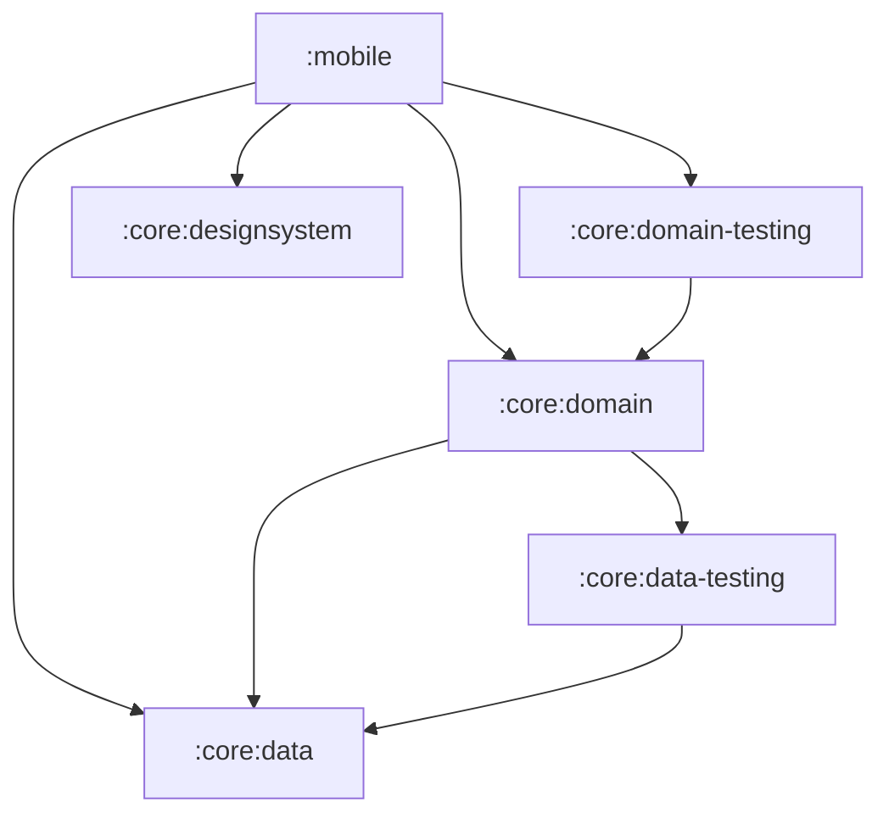
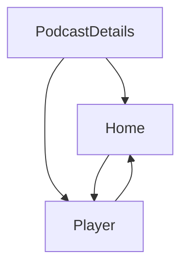

[//]: # (title: 將 Jetpack Compose 應用程式遷移至 Kotlin Multiplatform)

<secondary-label ref="IntelliJ IDEA"/>
<secondary-label ref="Android Studio"/>

<tldr>
<p>本教學使用 IntelliJ IDEA，但你也可以在 Android Studio 中跟隨操作。
   這兩款 IDE 具有相同的核心功能以及對 Kotlin Multiplatform 的支援。</p>
</tldr>

本指南介紹如何將純 Android 應用程式跨整個技術堆疊遷移為多平台應用程式，
從商業邏輯到 UI。
它透過一個進階的 Compose 範例說明了常見的挑戰和解決方案。
你可以緊跟提交順序，或瀏覽大致的遷移步驟，並深入探討你感興趣的任何部分。

起始應用程式是 [Jetcaster](https://github.com/android/compose-samples/tree/main/Jetcaster)，
這是一個使用 Jetpack Compose 為 Android 建置的播客範例應用程式。
該範例是一個功能齊全的應用程式，依賴於：
* 多個模組。
* Android 資源管理。
* 網路和資料庫存取。
* Compose Navigation。
* 最新的 Material Expressive 元件。

所有這些功能都可以使用 Kotlin Multiplatform 和
Compose Multiplatform 架構改編為跨平台應用程式。

為了準備讓你的 Android 應用程式在其他平台上執行，你可以：

1. 了解如何評估專案是否適合遷移至 Kotlin Multiplatform (KMP)。
2. 了解如何將 Gradle 模組分離為跨平台模組和平台專屬模組。
   在 Jetcaster 中，除了某些需要針對各平台單獨編寫程式碼的底層系統呼叫之外，
   我們成功將大部分商業邏輯模組轉換為多平台模組。
3. 遵循逐步將商業邏輯模組轉換為多平台的流程：
   透過逐步更新建置指令碼和程式碼，以最小的變更在各個可運作狀態之間移動。
4. 了解 UI 程式碼如何轉換為共用實作：
   使用 Compose Multiplatform，你可以共用 Jetcaster 中的大部分 UI 程式碼。
   更重要的是，你將看到如何逐步、逐個螢幕畫面地實作這種轉換。

最終產生的應用程式可在 Android、iOS、桌面以及瀏覽器中執行。
桌面應用程式還可作為 [Compose Hot Reload](compose-hot-reload.md) 範例：
一種快速疊代 UI 行為的方法。

## 潛在 Kotlin Multiplatform 遷移檢查清單 {id="checklist-for-a-potential-kotlin-multiplatform-migration"}

潛在 KMP 遷移的主要障礙是 Java 和 Android Views。
如果你的專案已經使用 Kotlin 編寫並使用 Jetpack Compose 開發 UI，
這將大大降低遷移的複雜度。

以下是遷移專案或模組前應考慮的一般準備工作檢查清單：

1. [轉換或隔離 Java 程式碼](#convert-or-isolate-java-code)
2. [檢查僅適用於 Android/JVM 的相依性](#check-your-android-jvm-only-dependencies)
3. [補足模組化技術債務](#catch-up-with-modularization-technical-debt)
4. [遷移至 Compose](#migrate-from-views-to-jetpack-compose)

### 轉換或隔離 Java 程式碼 {id="convert-or-isolate-java-code"}

在最初的 Android Jetcaster 範例中，存在一些僅限 Java 的呼叫，例如 `Objects.hash()` 和 `Uri.encode()`，
並廣泛使用了 `java.time` 套件。

雖然你可以從 Kotlin 呼叫 Java，反之亦然，
但包含 Kotlin Multiplatform 模組中共用程式碼的 `commonMain` 原始碼集不能包含 Java 程式碼。
因此，當你將 Android 應用程式轉換為多平台時，你需要：
* 將這些程式碼隔離在 `androidMain` 中（並為其他平台重寫），或
* 使用相容多平台的相依項將 Java 程式碼轉換為 Kotlin。

另一個僅限 Java 的程式庫 RxJava 雖然未在 Jetcaster 中使用，但被廣泛採用。由於它是
用於管理非同步操作的 Java 架構，
建議在開始 KMP 遷移之前遷移至 `kotlinx-coroutines`。

有[從 Java 遷移至 Kotlin 的指南](https://kotlinlang.org/docs/java-to-kotlin-idioms-strings.html)，
以及 [IntelliJ IDEA 中的輔助工具](https://www.jetbrains.com/help/idea/get-started-with-kotlin.html#convert-java-to-kotlin)，
可以自動轉換 Java 程式碼並簡化該流程。

### 檢查僅適用於 Android/JVM 的相依性 {id="check-your-android-jvm-only-dependencies"}

雖然許多專案（尤其是較新的專案）可能不包含太多 Java 程式碼，但它們通常具有僅適用於 Android 的相依性。
對於 Jetcaster 而言，尋找替代方案並遷移到這些方案佔據了大部分工作。

重要的一步是列出計劃共用的程式碼中所使用的相依性清單，並確保有可用的多平台替代方案。
雖然多平台生態系統不如 Java 生態系統龐大，但它正在迅速擴展。
可以使用 [klibs.io](https://klibs.io) 作為起點來評估潛在的選擇。

#### 程式庫 {id="libraries"}

對於 Jetcaster，這些程式庫的清單如下：

* **Dagger/Hilt**，一種流行的相依注入解決方案（替換為 [Koin](https://insert-koin.io/)）

  Koin 是一個可靠的多平台 DI 架構。如果它不能滿足你的需求或所需的重寫過於龐大，
  還有其他解決方案。[Metro](https://zacsweers.github.io/metro/latest/) 架構也是多平台的。
  它可以透過支援[與其他註解的互通性](https://zacsweers.github.io/metro/latest/interop/)
  （包括 Dagger 和 Kotlin Inject）來幫助簡化遷移。
* **Coil 2**，一個圖片載入程式庫（[在第 3 版中成為多平台程式庫](https://coil-kt.github.io/coil/upgrading_to_coil3/)）。
* **ROME**，一個 RSS 架構（替換為多平台的 [RSS Parser](https://github.com/prof18/RSS-Parser)）。
* **JUnit**，一個測試架構（替換為 [kotlin-test](https://kotlinlang.org/api/core/kotlin-test/)）。
* **OkHttp**，一個 HTTP 用戶端（不再需要直接依賴：RSS Parser 和 Coil 3 會自行發出呼叫，
  且 Coil 3 具有[基於 Ktor 的](https://ktor.io/)網路層，適用於無法使用 OkHttp 的平台）。

#### API {id="api"}
隨著遷移的進行，你可能會發現一些小片段程式碼在多平台中無法運作，因為目前還沒有跨平台實作。
例如，在 Jetcaster 中，我們必須用第三方多平台程式庫替換兩個僅限 Android 的 API：

* `AnnotatedString.fromHtml()`：屬於 Compose UI 程式庫的一部分，但僅針對 Android 實作
  （替換為 [htmlconverter](https://github.com/cbeyls/HtmlConverterCompose)）。
* `android.net.Uri`：用於對導覽引數進行編碼
  （替換為 [uri-kmp](https://github.com/eygraber/uri-kmp)）。

很難提前識別所有此類情況，因此請準備好在遷移過程中尋找替代品或重寫程式碼。
這就是為什麼我們展示如何以最小的步驟從一個可運作狀態轉換到另一個狀態。這樣一來，當多個部分同時變更時，
單一問題就不會阻礙整體進度。

### 補足模組化技術債務 {id="catch-up-with-modularization-technical-debt"}

KMP 允許你按模組、按螢幕畫面有選擇性地遷移到多平台狀態。
但為了使其順暢運作，你的模組結構需要清晰且易於操作。
建議根據[高內聚、低耦合原則](https://developer.android.com/topic/modularization/patterns#cohesion-coupling)，
並結合其他推薦的模組建構實務來評估你的模組化程度。

一般建議可總結如下：

* 將應用程式功能的不同部分分離到特性模組（feature modules）中，
  並將特性模組與處理及提供資料存取的資料模組分開。
* 將特定領域的資料和商業邏輯封裝在模組內。
  將相關的資料型別分組在一起，避免跨不相關的領域混合邏輯或資料。
* 使用 Kotlin [可見性修飾詞](https://kotlinlang.org/docs/visibility-modifiers.html)來防止外部存取模組的實作細節和資料來源。

有了清晰的結構，即使你的專案有很多模組，
你也應該能夠將它們逐一遷移到 KMP。這種方法比嘗試完全重寫更平穩。

### 從 Views 遷移至 Jetpack Compose {id="migrate-from-views-to-jetpack-compose"}

Kotlin Multiplatform 提供 Compose Multiplatform 作為建立跨平台 UI 程式碼的方式。
為了平穩過渡到 Compose Multiplatform，你的 UI 程式碼應該已經使用 Compose 編寫。如果你目前使用的是 Views，
你將需要在新範式中並使用新架構來重寫該程式碼。
顯然，提前完成這項工作會更容易。

Google 長期以來一直在推進和豐富 Compose。請查看 [Jetpack Compose 遷移指南](https://developer.android.com/develop/ui/compose/migrate)
以取得最常見場景的協助，或嘗試使用 [透過 AI 遷移的代理技能](https://github.com/android/skills/blob/main/jetpack-compose/migration/migrate-xml-views-to-jetpack-compose/SKILL.md)。
你也可以使用 Views 與 Compose 的互通性，但就像 Java 程式碼一樣，這些程式碼必須隔離在
`androidMain` 原始碼集中。

## 將應用程式轉換為多平台的步驟 {id="steps-to-make-an-app-multiplatform"}

完成初始準備和評估後，大致流程如下：

1. [遷移至多平台程式庫](#migrate-to-multiplatform-libraries)

2. [將商業邏輯轉換至 KMP](#migrating-the-business-logic)。
   1. 從依賴它的其他模組最少的模組開始。
   2. 將其遷移至 KMP 模組結構，並遷移至使用多平台程式庫。
   3. 在相依樹中選取下一個模組並重複該過程。
   
   {type="alpha-lower"}
3. [將 UI 程式碼轉換至 Compose Multiplatform](#migrating-to-multiplatform-ui)。
   當所有商業邏輯都已是多平台時，轉換至 Compose Multiplatform 就會變得相對簡單直接。
   對於 Jetcaster，我們透過逐個螢幕畫面進行遷移來展示漸進式遷移。我們還展示了當某些畫面已遷移而某些畫面尚未遷移時，
   如何調整導覽圖。
4. 為要支援的平台[新增進入點](#add-application-entry-points)。

為了簡化範例，我們從一開始就移除了 Android 專屬的 Glance、TV 和穿戴式裝置目標，
因為它們本來就不會與多平台程式碼互動，也不需要遷移。
這些精簡以及後續遷移所依賴的 Gradle 和 AGP 版本，全部收錄在單一[準備提交](https://github.com/kotlin-hands-on/jetcaster-kmp-migration/commit/0b55090eff4e36142d893c404e0d403e89a16b1c)中。

> 你可以閱讀下方步驟說明，也可以直接跳轉到 Jetcaster 範例存儲庫的
> [step-by-step-migration 分支](https://github.com/kotlin-hands-on/jetcaster-kmp-migration/commits/step-by-step-migration/)，
> 這正是本指南所引導的歷程記錄。
> 每次提交都代表應用程式的一個可運作狀態，展示了從純 Android 逐步遷移到完全
> Kotlin Multiplatform 的潛力。該存儲庫的 `main` 分支則儲存了最終狀態的相同專案。
> 
{style="tip"}

### 準備環境 {collapsible="true" id="prepare-the-environment"}

如果你想遵循遷移步驟或在你的電腦上執行所提供的範例，
請確保準備好環境：

1. 根據快速入門指南，完成[為 Kotlin Multiplatform 設定環境](quickstart.md#set-up-the-environment)的說明。

   > 根據 Apple 的要求，你需要一台配備 macOS 和 Xcode 的 Mac 才能建置和執行 iOS 應用程式。
   >
   {style="note"}

2. 在 IntelliJ IDEA 或 Android Studio 中，透過複製範例存儲庫來建立新專案：

   ```text
   git@github.com:kotlin-hands-on/jetcaster-kmp-migration.git
   ```

   若要逐個提交跟隨遷移，請簽出 `step-by-step-migration` 分支。
   `main` 分支儲存了最終狀態的相同專案並獨立更新，
   不過兩個分支的最終狀態在功能上是相同的。

3. 範例的模組使用 Java 17 工具鏈，因此 Gradle 除了自身執行所需的 JDK 之外，還需要可用的 JDK 17。
   如果組建失敗並顯示 `Cannot find a Java installation … matching {languageVersion=17}`，
   請安裝 JDK 17 或設定 [toolchain provisioning](https://docs.gradle.org/current/userguide/toolchains.html#sec:provisioning)。

## 遷移至多平台程式庫 {id="migrate-to-multiplatform-libraries"}

應用程式的大部分功能依賴於幾個程式庫。
在為模組設定多平台支援之前，我們可以先將它們的用法轉換為與 KMP 相容：

* 從 ROME 工具剖析器遷移至多平台 RSS Parser。
  這需要處理 API 之間的差異：RSS Parser 會自行發出網路呼叫，
  因此不再需要 OkHttp，
  但發布日期和單集時長現在必須手動剖析。

  > 請參閱[產生的提交](https://github.com/kotlin-hands-on/jetcaster-kmp-migration/commit/2313082c6c350e06964786b9821b81e17e9b4dfb)。
* 在整個應用程式中（包括僅適用於 Android 的進入點模組 `mobile`）從 Dagger/Hilt 遷移至 Koin 4。
  這需要根據 Koin 方法重寫相依注入邏輯，但 `*.di` 套件之外的程式碼
  基本上不受影響。

  從 Hilt 遷移時，請確保清除 `/build` 目錄，以避免先前產生的 Hilt 程式碼中出現編譯錯誤。

  這一步也以另一種方式說明了純 Android 相依性的代價：Hilt 的註解處理器無法讀取 Kotlin 2.4 元資料，
  因此在移除 Hilt 之前，專案無法升級到最新的 Kotlin。
  移除之後，Kotlin 版本在同一個提交中進行了升級。

  > 請參閱[產生的提交](https://github.com/kotlin-hands-on/jetcaster-kmp-migration/commit/713b5846e5be3233874af556d6ada52405723a69)。

* 從 Coil 2 升級至 Coil 3。同樣地，修改的程式碼相對較少：`coil.*` 套件變為 `coil3.*`，
  且圖片載入針對 Coil 自身的 `PlatformContext` 運作，而不是 Android `Context`。

  > 請參閱[產生的提交](https://github.com/kotlin-hands-on/jetcaster-kmp-migration/commit/e88ff3e62ec19e679c367e90deaef38e92f913b7)。

* 從 JUnit 遷移至 `kotlin-test`。這涉及所有包含測試的模組，但由於 `kotlin-test` 的相容性，
  實作遷移所需的變更非常少。

  > 請參閱[產生的提交](https://github.com/kotlin-hands-on/jetcaster-kmp-migration/commit/90678b99b2b00f09fefc2d787694d08a073c22e6)。

* 將用於呈現播客描述中 HTML 的 `AnnotatedString.fromHtml()` 替換為多平台
  `htmlconverter` 程式庫。此函式是 Compose UI 程式庫的一部分，但僅針對 Android 實作。

  > 請參閱[產生的提交](https://github.com/kotlin-hands-on/jetcaster-kmp-migration/commit/4e16a63029efae18f3bf14aa2faf6008caaf8ee9)。

### 將依賴 Java 的程式碼重寫為 Kotlin {id="rewrite-java-dependent-code-into-kotlin"}

現在主要程式庫都已是多平台，我們需要消除純 Java 相依項。

純 Java 呼叫的一個簡單範例是 `Objects.hash()`，我們在 Kotlin 中重新實作了它。

> 請參閱[產生的提交](https://github.com/kotlin-hands-on/jetcaster-kmp-migration/commit/f904e28113f50e9d26e1199842253093b92abc58)。

但阻礙我們直接在 Jetcaster 範例中將程式碼共用化的主要是 `java.time` 套件。
時間計算在播客應用程式中幾乎無處不在，因此我們需要將該程式碼遷移至 `kotlin.time` 和 `kotlinx-datetime`，
才能真正從 KMP 程式碼共用中獲益。
例如，`kotlinx-datetime` 中沒有針對 RFC 1123 格式的內建剖析器，
但你可以使用該程式庫的格式建構器組合出一個。

> 與時間相關的所有內容都在[此提交](https://github.com/kotlin-hands-on/jetcaster-kmp-migration/commit/75d5571621529972187b01537e8988fdf8b83d32)中進行了重寫。

## 遷移商業邏輯 {id="migrating-the-business-logic"}

一旦主要相依性均為多平台，我們就可以選擇一個模組開始遷移。
為專案中的模組建立相依圖可能會很有用。
像 [Junie](https://www.jetbrains.com//junie/) 這樣的 AI 代理可以輕鬆提供協助。
對於 Jetcaster，簡化後的模組相依圖如下所示：



例如，這建議採用以下順序：

1. `:core:data`
2. `:core:data-testing`
3. `:core:domain`
4. `:core:domain-testing`
5. `:core:designsystem` — 雖然它沒有模組相依性，但這是一個 UI 幫助程式模組，
   因此我們只在準備將 UI 程式碼移至共用模組時才處理它。

### 模組建置指令碼中的變更 {id="what-changes-in-a-module-s-build-script"}

本節中的每個模組遷移都遵循相同的模式。
以下是從 Android 遷移前以及遷移後作為 Kotlin Multiplatform
模組的程式庫模組範例：

<compare type="top-bottom">
<code-block lang="kotlin" code="plugins {&#10;    alias(libs.plugins.android.library)&#10;}&#10;&#10;android {&#10;    namespace = &quot;com.example.jetcaster.core.data&quot;&#10;    compileSdk = 37&#10;&#10;    defaultConfig {&#10;        minSdk = 23&#10;    }&#10;}&#10;&#10;dependencies {&#10;    // 相依性範例&#10;    implementation(libs.koin.core)&#10;}"/>
<code-block lang="kotlin" code="plugins {&#10;    alias(libs.plugins.kotlin.multiplatform)&#10;    alias(libs.plugins.android.kotlin.multiplatform.library)&#10;}&#10;&#10;kotlin {&#10;    android {&#10;        namespace = &quot;com.example.jetcaster.core.data&quot;&#10;        compileSdk = 37&#10;        minSdk = 23&#10;    }&#10;&#10;    jvmToolchain(17)&#10;    iosArm64()&#10;    iosSimulatorArm64()&#10;    jvm()&#10;    wasmJs { browser() }&#10;&#10;    sourceSets {&#10;        commonMain.dependencies {&#10;            // 相依性範例&#10;            implementation(libs.koin.core)&#10;        }&#10;    }&#10;}"/>
</compare>

原始碼會相應移動：從 `src/main/java` 移動到 `src/commonMain/kotlin`、
`src/androidMain/kotlin` 等，以符合宣告的目標平台。

在下面的提交中，每個模組僅宣告當時存在的目標。
`wasmJs` 是最後新增的，與 [Web 進入點](#add-a-web-entry-point)一起提供。

### 遷移 :core:data {id="migrate-core-data"}

#### 設定 :core:data 並遷移資料庫程式碼 {id="configure-core-data-and-migrate-database-code"}

Jetcaster 使用 [Room](https://developer.android.com/training/data-storage/room) 作為資料庫程式庫。
Room 自 2.7.0 版起就已支援多平台，因此我們只需要更新程式碼以使其跨平台運作。
此時我們還沒有 iOS 或桌面應用程式，但我們已經可以編寫平台專屬程式碼，這些程式碼將在我們設定其他進入點時被呼叫。
我們還為其他平台新增了目標組態，以便從現在開始可以編譯平台程式碼。

若要切換到 Room 的多平台版本，我們遵循了 Android 的[通用設定指南](https://developer.android.com/kotlin/multiplatform/room)。

> 請參閱[產生的提交](https://github.com/kotlin-hands-on/jetcaster-kmp-migration/commit/c3a09588a8080d4caf38c564174888a34337da7d)。

* 請注意新的程式碼結構，包含 `androidMain`、`commonMain`、`iosMain` 和 `jvmMain` 原始碼集。
* 大部分程式碼變更都是關於為 Room 建立 expect/actual 結構以及相應的 DI 變更。
  建立資料庫是平台專屬的，因此 `getDatabaseBuilder()` 是一個 expect/actual 配對，透過
  `expect val platformDataModule` Koin 模組串接。
* `DateTimeTypeConverters` 消失了：使用 `kotlinx-datetime`，轉換直接存在於實體本身。
* 新的 `OnlineChecker` 介面彌補了我們僅在 Android 上檢查網際網路連線的事實。
  在我們[新增 iOS 應用程式作為目標](#add-an-ios-entry-point)之前，線上檢查器將是一個虛設常式。

我們也可以立即將 `:core:data-testing` 模組重新設定為多平台。
請參閱[產生的提交](https://github.com/kotlin-hands-on/jetcaster-kmp-migration/commit/a58fea51d94300a184654e7c1a734b4f70fc2877)。
它只需要更新 Gradle 配置並遷移到原始碼集資料夾結構。

#### 設定並遷移 :core:domain {id="configure-and-migrate-core-domain"}

如果所有相依性都已處理完畢並遷移到多平台，我們唯一要做的就是移動程式碼並重新設定模組。
測試會移至 `commonTest`，並開始在每個目標上執行，而不僅僅是在 JVM 上執行。

> 請參閱[產生的提交](https://github.com/kotlin-hands-on/jetcaster-kmp-migration/commit/ccebc4fc011ee6181dd120dcd27884f3b3ee9c54)。

與 `:core:data-testing` 類似，我們也可以輕鬆地將 `:core:domain-testing` 模組更新為多平台。

> 請參閱[產生的提交](https://github.com/kotlin-hands-on/jetcaster-kmp-migration/commit/33fd4d010331f3e66ab42eac148a2b1a7e529913)。

#### 設定並遷移 :core:designsystem {id="configure-and-migrate-core-designsystem"}

在只剩下 UI 程式碼需要遷移的情況下，我們開始轉換具有字體資源和排版的 `:core:designsystem` 模組。
這是第一個包含 Compose 程式碼的模組，因此也是第一個將 Jetpack Compose 構件
(`androidx.compose.*`) 替換為 Compose Multiplatform 構件 (`org.jetbrains.compose.*`) 的模組。

除了設定 KMP 模組和建立 `commonMain` 原始碼集之外，我們還將 `MaterialExpressiveTheme` 的 `JetcasterTypography` 引數轉換為可組合項 (composable)，封裝了對多平台字型的呼叫。

> 請參閱[產生的提交](https://github.com/kotlin-hands-on/jetcaster-kmp-migration/commit/608c673db1732e0976bcaa0feb4c965078c06f13)。

## 遷移至多平台 UI {id="migrating-to-multiplatform-ui"}

當所有 `:core` 邏輯都成為多平台後，你也可以開始將 UI 移至通用程式碼。
同樣地，由於我們的目標是完全遷移，因此我們尚未新增其他進入點，只是確保 Android 應用程式可以搭配放在通用程式碼中的 Compose 部分正常運作。

為了直觀展示我們將遵循的邏輯，以下是表示 Jetcaster 畫面之間關係的簡化圖：

<!-- The deep link connections and the supporting pane are commented out for the sake of brevity but may be interesting. --> 



首先，我們建立了一個共用 UI 模組，用於放置我們將共用化的 UI 程式碼。

> 請參閱[產生的提交](https://github.com/kotlin-hands-on/jetcaster-kmp-migration/commit/f2bef12555fa39038b50f151c602046ca80f494b)。

為了展示漸進式遷移 UI，我們將逐個畫面進行移動。
每個步驟都將以一個包含可運作應用程式狀態的提交結束，離完全共用的 UI 更進一步。

在上述畫面圖的指導下，我們從播客詳細資料畫面開始：

1. 遷移後的畫面將在 Compose 主題仍保留在 Android 模組中的情況下運作。
   我們需要做的是：
   1. 更新 ViewModel 和相應的 DI 程式碼。
   2. 更新資源和資源存取子。
      雖然多平台資源程式庫與 Android 的體驗緊密契合，但仍有一些顯著差異需要處理：
      * 處理資源檔案的方式略有不同。
        例如，資源目錄需要命名為 `composeResources` 而不是 `res`，
        並且 Android XML 檔案中的 `@android:color` 用法需要替換為十六進位顏色代碼。
        請參閱[多平台資源](compose-multiplatform-resources.md)相關文件以了解更多。
      * 包含資源存取子的產生類別名為 `Res`（與 Android 上的 `R` 相對）。
        移動並調整資源檔案後，重新產生存取子並替換 UI 程式碼中每個資源的匯入。
   3. 將 `koinViewModel()` 從 Android 專屬的 `org.koin.androidx.compose` 套件切換至
      多平台的 `org.koin.compose.viewmodel` 套件。
   4. 將該畫面用來對其導覽播客 URI 進行編碼的 `android.net.Uri`
      替換為 `uri-kmp` 對等項。
      
   > 請參閱[產生的提交](https://github.com/kotlin-hands-on/jetcaster-kmp-migration/commit/cc045d7d9f01e1ef8d05a9f6568fac89ab2a852b)。

2. 遷移 Compose 主題。
   Android 的動態顏色需要 `LocalContext` 和 API 層級檢查，因此色彩配置
   變成了一個 expect/actual 函式，並在其他平台上提供虛設常式。

   > 請參閱[產生的提交](https://github.com/kotlin-hands-on/jetcaster-kmp-migration/commit/5b0263faae912bce616487b71d17bcd4cb93c721)。

3. 繼續處理主畫面：
   1. 遷移 ViewModel。
   2. 將程式碼移至共用 UI 模組中的 `commonMain`。
   3. 移動並調整資源參照。
   4. 替換僅限 Android 的預覽工具。基於 `androidx.compose.ui.tooling.preview.Devices` 建構的 `@DevicePreviews`
      被替換為多平台的 `@Preview`。

   > 請參閱[產生的提交](https://github.com/kotlin-hands-on/jetcaster-kmp-migration/commit/9d6903620f12db52fb287f9f0746f5731f603066)。

4. 為了展示細化遷移的另一種方式，我們進行了部分導覽遷移：
   我們可以將通用程式碼中的畫面與 Android 原生畫面相結合。
   `PlayerScreen` 仍位於 `mobile` 模組中，且僅針對 Android 進入點包含在導覽中。
   它被注入到整體的多平台導覽中。

   > 請參閱[產生的提交](https://github.com/kotlin-hands-on/jetcaster-kmp-migration/commit/f5145cbd3a6b958b5947d4933f8db50aaef1be49)。
   
5. 最後移動所有剩餘的內容：
   * 將其餘導覽移至通用程式碼（[產生的提交](https://github.com/kotlin-hands-on/jetcaster-kmp-migration/commit/54464f0d06bd2bdeffaca965ea2f6fcb9de077df)）。
   * 將最後一個畫面 `PlayerScreen` 遷移至 Compose Multiplatform（[產生的提交](https://github.com/kotlin-hands-on/jetcaster-kmp-migration/commit/4d1be9975a4388f2db3315ebaf5965cf8201fe4f)）。

     這是具有真正 Android 專屬行為的畫面：它會根據折疊和鉸鏈在單窗格和雙窗格版面配置之間切換。
     該邏輯被提取到 expect/actual 可組合項中，因此 Android 保留了姿勢感知版本，
     而其他平台僅查看視窗寬度。

現在所有 UI 程式碼都已共用化，我們可以使用它快速為其他平台建立應用程式。

此時，模組名稱已不再符合其原本的意義：`:core` 不再是一組核心 Android 程式庫，
且 `:mobile` 即將不再是唯一的進入點。
我們將它們重新命名為 `:sharedLogic` 和 `:androidApp`。

> 請參閱[產生的提交](https://github.com/kotlin-hands-on/jetcaster-kmp-migration/commit/ac13e72b16a77276ca5fa46b6c71e903c57bf087)。

## 新增應用程式進入點 {id="add-application-entry-points"}

### 新增 JVM 進入點 {id="add-a-jvm-entry-point"}

此步驟有助於：
* 展示從完全轉換為多平台的 Android 應用程式建立桌面應用程式只需付出很少的努力。
* 展示 [Compose Hot Reload](compose-hot-reload.md)（目前僅支援桌面目標），
  作為快速疊代 Compose UI 的工具。

在所有 UI 程式碼均已共用的情況下，為桌面 JVM 應用程式新增進入點只需要建立一個 `main()` 函式並將其與 DI 架構整合。
共用模組所需的 JVM 實作已在模組遷移時準備就緒。

> 請參閱[產生的提交](https://github.com/kotlin-hands-on/jetcaster-kmp-migration/commit/32dc94085c5163e5b830a7e95e2b2b6baa6591a0)。

### 新增 iOS 進入點 {id="add-an-ios-entry-point"}

iOS 進入點需要一個與 KMP 程式碼連結的 iOS 專案。

[讓您的應用程式實現多平台](https://kotlinlang.org/docs/multiplatform/multiplatform-integrate-in-existing-app.html#create-an-ios-project-in-xcode)教學涵蓋了在 KMP 專案中建立和內嵌 iOS 應用程式的內容。

> 我們在此使用的直接整合方法最為直接，但可能不是適合你專案的最佳方法。
> 請參閱 [iOS 整合方法概觀](multiplatform-ios-integration-overview.md)以了解各種替代方案。
>
{style="note"}

在 iOS 應用程式中，我們需要將 Swift UI 程式碼與 Compose Multiplatform 程式碼連線起來。
我們透過在 iOS 應用程式中新增一個傳回帶有內嵌 `JetcasterApp` 可組合項的 `UIViewController` 的函式來實現此目的。

現在有了可執行的 iOS 應用程式，`OnlineChecker` 虛設常式被替換為基於多平台 [konnectivity](https://github.com/plusmobileapps/konnectivity) 程式庫的真實實作。

<!-- this probably needs more rigorous verification -->

> 建議提交*共用的* Xcode 配置配置（`YourApp.xcodeproj/xcshareddata/xcschemes/`），而不是依賴
> Xcode 為你產生的配置配置。
> 產生的配置配置會放在 `xcuserdata` 中，通常被設定為由 Git 忽略，
> 在這種情況下，在任何由 Xcode 自行產生配置的電腦上，`xcodebuild -scheme YourApp` 可能會因 "does not contain a scheme named YourApp" 而失敗。
>
{style="tip"}

> 請在[產生的提交](https://github.com/kotlin-hands-on/jetcaster-kmp-migration/commit/1da471dfba711a4386e5ba1a9db49892c8a7e255)中查看新增的 iOS 專案和相應的程式碼更新。

### 新增 Web 進入點 {id="add-a-web-entry-point"}

Web 目標需要處理最多平台專屬的工作：它沒有 JVM，沒有檔案系統，
並且強制執行同源政策。
這些約束條件都很好地說明了 `expect`/`actual` 機制如何規避平台限制：

* **資料庫。** SQLite 無法直接存取檔案系統，因此它在由[來源專用檔案系統 (Origin Private File System)](https://developer.mozilla.org/en-US/docs/Web/API/File_System_API/Origin_private_file_system) 支援的 Web worker 內部執行。
  該模組獲得了一個包含 worker 的 npm 套件，使用 `androidx.sqlite:sqlite-web`，
  且你可以在 expect/actual 函式中建立驅動程式，而不是始終傳回隨附的驅動程式。
  OPFS 還需要跨來源隔離標頭，webpack 配置會新增這些標頭。
* **分派器 (Dispatchers)。** Kotlin/Wasm 上不存在 `Dispatchers.IO`，因此取得 IO 分派器也變成了
  一個 expect/actual 函式。
* **網路存取。** 瀏覽器強制執行 CORS，且並非每個播客來源都會傳送正確的標頭，
  因此即使是範例摘要清單也是一個 `expect val`，並且 Web 組建使用的是較短的清單。
  Coil 和 RSS Parser 在此目標上使用 Ktor JS 用戶端。

> 請參閱[產生的提交](https://github.com/kotlin-hands-on/jetcaster-kmp-migration/commit/58dd68fa34f88c9f7a9c89fc654018cb3a9bded0)。

## 清理 Android 模組 {id="clean-up-the-android-module"}

現在 Android 模組僅包含應用程式進入點，
我們可以清理不必要的相依性，僅留下一些用於處理 activity 和 `@Preview` 註解的 Compose 專屬匯入。

> 請參閱[產生的提交](https://github.com/kotlin-hands-on/jetcaster-kmp-migration/commit/76fdba0f55c34eda7b325f3e836cc21a10a78e98)。

## 執行應用程式 {id="run-the-app"}

在遷移應用程式的最終狀態下，存在初始 Android 模組 (`androidApp`) 和新 iOS 應用程式的執行配置。
你可以從相應的 `main.kt` 檔案執行桌面應用程式，並使用
`:wasmApp:wasmJsBrowserDevelopmentRun` Gradle 任務執行 Web 應用程式。
全部執行一次，看看共用 UI 在每個平台上的運作情況！

## 總結 {id="final-summary"}

在本次遷移中，我們遵循了將純 Android 應用程式轉換為 Kotlin Multiplatform 應用程式的一般步驟：

* 轉換為多平台相依性，或者在無法轉換的地方重寫程式碼。
* 將可在其他平台上使用的 Android 模組逐一轉換為多平台模組。
* 為 Compose Multiplatform 程式碼建立共用 UI 模組，並逐個螢幕畫面轉換為共用 UI 程式碼。
* 為其他平台建立進入點。

此順序並非一成不變。也可以從其他平台的進入點開始，
並逐步在其下方建構基礎設施，直到它們能夠運作。
在 Jetcaster 範例中，我們選擇了一種更清晰的變更順序，方便按部就班地跟隨操作。

如果你對本指南或示範的解決方案有任何回饋，請在 [YouTrack](https://kotl.in/issue) 中建立問題。