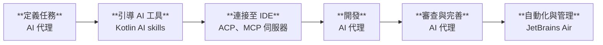

[//]: # (title: 用於 Kotlin 開發的 AI 工具)
<web-summary>透過 AI 提升您的 Kotlin 開發效率，並了解如何使用 AI Assistant、Junie、JetBrains Air、Kotlin AI skills、編碼代理以及 IDE 整合來撰寫、測試、審查與重構程式碼。</web-summary>

AI 支援的工具可以協助處理許多 Kotlin 開發任務。它們能夠產生並解釋程式碼、實作功能、建立測試、審查變更、重構現有程式碼，以及自動化重複的開發任務。

Kotlin 生態系統包含用於互動式開發、AI 代理（AI agents）以及大規模代理協調整合的工具。
根據您的工作流程，您可以：

* ：直接在 IntelliJ IDEA 和 Android Studio 等 IDE 中使用 AI 功能。
* [使用 AI 代理](#use-ai-agents)：選擇 Junie 或第三方代理等 AI 代理，並透過 Kotlin AI skills 提升其 Kotlin 專業能力。
* [管理與擴展 AI 開發](#manage-ai-agents)：協調互動式與自動化代理工作流程。

本頁說明各工具之間的差異，以及它們如何在工作流程的不同階段為您提供協助。

## 在 IDE 中開發 {id="develop-in-the-ide"}

IDE 可以直接在您的開發環境中提供 AI 賦能的功能。您無需離開 IDE 即可撰寫、修改與審查 Kotlin 程式碼。

### AI Assistant {id="ai-assistant"}

[AI Assistant](https://plugins.jetbrains.com/plugin/22282-jetbrains-ai-assistant) 在 JetBrains IDE（例如 [IntelliJ IDEA](https://www.jetbrains.com/idea/download/)）以及 [Android Studio](https://developer.android.com/studio) 中直接提供 AI 支援的協助。
您可以在希望掌控每項變更的互動式開發任務中使用它。

AI Assistant 提供：

* 存取 AI 代理的功能，包含 [Junie](https://www.jetbrains.com/junie/)、Claude Code、OpenAI Codex，以及任何支援 Agent Client Protocol 的第三方代理。
* 使用雲端託管模型（如 Gemini、GPT 和 Claude）以及您自己的本機模型進行具備情境感知能力的 AI 對話。
* AI 輔助的程式碼補全與下一步編輯建議。

進一步了解 [AI Assistant 與 JetBrains IDE 的整合](https://www.jetbrains.com/help/ai-assistant/about-ai-assistant.html)。

### Air in IDEs {id="air-in-ides"}

[Air in IDEs](https://www.jetbrains.com/air/ides/) 是一款外掛程式，可在 JetBrains IDE 中為使用編碼代理提供專屬環境。使用它可以在多個專案中啟動代理工作階段、追蹤其進度，並運用程式碼導覽與檢查等 IDE 功能來審查變更。您可以在 diff 上留下評論，並要求代理修改其產出的內容。

Air 允許您連接安裝在本機電腦上的相容代理，或從 [ACP 登錄檔 (registry)](https://agentclientprotocol.com/get-started/registry) 中選取代理。
您也可以在本機執行任務，或透過 [Air Teams](https://air.jetbrains.cloud/) 將耗時較長的任務委託給雲端代理。

進一步了解 [JetBrains IDE 中的 Air](https://www.jetbrains.com/air/ides/)。

## 使用 AI 代理 {id="use-ai-agents"}

AI 代理能夠在較少直接指導的情況下執行開發任務，相較於互動式 AI 助手更具自主性。例如，它們可以探索專案、規劃實作步驟、修改多個檔案，或執行指令與測試。

> 如果您不確定該使用哪款 AI 代理，請查看 [Kotlin Benchmark](https://kotlinlang.org/benchmark/)，比較不同代理在 Kotlin 開發任務上的表現。
> 
{style="tip"}

### Air Gateway {id="air-gateway"}

[Air Gateway](https://www.jetbrains.com/air/gateway/) 是一個命令列工具，可透過 JetBrains 帳戶使用 JetBrains AI 點數執行 Claude Code、Codex 和 Junie CLI 等終端代理。您的代理能保持原有的終端工作流程，同時可透過 JetBrains Console 集中管理對代理與模型的存取。

進一步了解 [Air Gateway](https://www.jetbrains.com/air/gateway/)。

### Air Context {id="air-context"}

[Air Context](https://www.jetbrains.com/air/context/) 是一個具備命令列介面的程式碼庫索引服務，可建立存儲庫的語意索引，讓編碼代理能找到相關的程式碼、API、相依性、測試以及實作模式。

當代理需要探索大型程式碼庫或尋找現有實作與專案慣例時，請使用 Air Context。它整合了受支援的代理，包括 Claude Code、Codex CLI 和 Junie CLI，並可在 IDE 與其他受支援的編輯器中使用。

進一步了解 [Air Context](https://www.jetbrains.com/air/context/)。

### Junie {id="junie"}

[Junie](https://junie.jetbrains.com/) 是 JetBrains 推出的 AI 代理。您可以在 [JetBrains IDE 和 Android Studio 中](https://plugins.jetbrains.com/plugin/26104-junie-the-ai-coding-agent-by-jetbrains)、[從終端](https://junie.jetbrains.com/docs/junie-cli.html)或在 CI/CD 管線的 [headless 模式下](https://junie.jetbrains.com/docs/junie-headless.html)使用 Junie。
您也可以將 Junie 整合到您的 [GitHub 工作流程](https://junie.jetbrains.com/docs/junie-on-github.html)中。

Junie 專為需要超出單一程式碼建議或對話回覆的任務而設計。適合處理涉及多個檔案或需要規劃與執行的開發任務。您可以要求它實作功能、跨多個檔案更新程式碼、新增測試或執行維護工作。

當 Junie 在 IDE 中執行時，它還能利用專案索引、程式碼導覽、檢查、重構作業、偵錯以及具備框架感知能力的專案分析等 IDE 功能。

進一步了解 [Junie](https://junie.jetbrains.com/docs/get-started-with-junie.html)。

### 第三方 AI 代理 {id="third-party-ai-agents"}

許多第三方 AI 開發工具均支援 Kotlin。它們以 IDE 擴充套件、獨立編輯器、命令列工具和雲端開發環境的形式提供。例如：

* GitHub Copilot
* Google Gemini
* Claude Code
* OpenAI Codex

如果第三方工具符合您偏好的開發環境，或提供的功能契合您的工作流程，您可以選擇使用它。
這些工具大多支援 Kotlin 程式碼產生、解釋、測試建立與重構。

您可以單獨使用第三方工具，也可以透過 ACP 將相容的代理連接到 JetBrains IDE。

### MCP 伺服器 {id="mcp-servers"}

Model Context Protocol (MCP) 可將 AI 模型連接至外部資料來源、工具和系統。
JetBrains 維護了多個可提升 Kotlin 開發效率的 MCP 伺服器：

* [JetBrains IDE MCP 伺服器](https://plugins.jetbrains.com/plugin/26071-mcp-server)公開了 IDE 的功能。
  AI 代理透過此伺服器可以使用專案索引、程式碼導覽、重構、檢查和建置執行等 IDE 功能。
  這能讓代理更深入地理解您的 Kotlin 專案，並提供更有效率的方式來產生與評估程式碼。
* [MCP Kotlin SDK](kotlin-ai-apps-development-overview.md#model-context-protocol-mcp-kotlin-sdk) 是一個 Kotlin Multiplatform 實作。它能協助您使用 Kotlin 建置 AI 驅動的應用程式，並與橫跨 JVM、WebAssembly 和 iOS 的 LLM 介面進行整合。
* 對於 Kotlin Multiplatform 專案，[klibs.io MCP 伺服器](https://github.com/JetBrains/klibs-io/blob/master/integrations/mcp/README.md)
  可協助代理存取可用的多平台程式庫目錄，從而更有效率地尋找現有解決方案。
* 對於 Compose Multiplatform 專案，[Compose Hot Reload MCP 伺服器](https://kotlinlang.org/docs/multiplatform/compose-hot-reload.html#mcp-server-for-ai-agents)
  允許代理直接與支援熱重載的應用程式互動：觸發重新載入、擷取螢幕截圖、讀取語意樹等。

### Kotlin AI skills {id="kotlin-ai-skills"}

Kotlin AI skills 是可重複使用的指令集，用於引導 AI 代理完成 Kotlin 開發任務。它們能協助代理更一致地執行這些任務。

當您希望引導代理遵循符合慣用法的 Kotlin 模式、Kotlin 程式碼風格慣例以及專案特定規範時，請使用 Kotlin AI skills。Skills 可協助 AI 代理執行諸如撰寫 Kotlin 程式碼、解釋語言特性、產生文件、建立測試、審查程式碼或套用遷移指引等任務。

Kotlin AI skills 可搭配不同的代理與工作流程使用，包含基於 IDE 的代理、命令列代理，以及支援可重複使用指令的外部 AI 工具。

進一步了解 。

### Kotlin 特定的驗收條件 {id="kotlin-specific-acceptance-criteria"}

特別是 Kotlin Multiplatform 專案，其複雜度足以使代理失去對整體專案結構以及特定變更所造成影響的掌控。

為了協助代理，您可以將下列範例納入一般通用的（[AGENTS.md](https://agents.md/)）或任務特定的成功條件中：

* 在引入變更後，只要有針對特定目標的測試可用，就必須執行該測試。
* 在確認任務完成之前，驗證所有已設定的 KMP 目標均可成功建置。
* 審查實作中是否有平台專屬的 API 外洩至共用程式碼中，以避免代理（或開發人員）日後在共用程式碼中誤用這些 API。

## 管理 AI 代理 {id="manage-ai-agents"}

開發團隊可能需要多個 AI 代理來自動化重複任務、監控代理活動，或在決定採用之前評估不同的工具。以下工具支援超越個別編碼工作階段的 AI 輔助開發。

### Air Teams {id="air-teams"}

[Air Teams](https://www.jetbrains.com/air/) 讓團隊能在共用專案與專屬雲端環境中針對代理任務進行協作。
團隊可以為每個專案設定機器資源、網路存取、變數和機密資訊，並連接 MCP 伺服器，讓團隊成員與代理能夠使用相同的外部工具。

當您的專案需要共用的代理環境與工作階段來進行協作與審查時，請使用 Air Teams。

進一步了解 [Air Teams](https://www.jetbrains.com/air/) 或[存取 Air Teams](https://air.jetbrains.cloud/)。

### Air Governance {id="air-governance"}

[Air Governance](https://www.jetbrains.com/air/governance/) 為 AI 輔助與代理驅動的開發提供組織層級的管控機制。
管理員可以控制開發人員能夠使用哪些代理、模型和 MCP 伺服器，並設定 AI 點數上限。政策可以套用至整個組織，也可以針對特定團隊或個人進行量身定制。用量分析有助於您了解團隊使用的工具以及應投資的重點方向。

當您的組織需要跨不同的 AI 工具與提供商管理存取權限與成本時，請使用 Air Governance。您可以使用 JetBrains AI，也可以提供貴組織的提供商 API 金鑰，同時進行集中式的用量管理。

進一步了解 [Air Governance](https://www.jetbrains.com/air/governance/)。