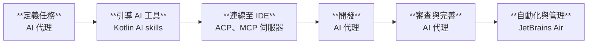

[//]: # (title: 適用於 Kotlin 開發的 AI 工具)
[//]: # (description: 透過 AI 加速您的 Kotlin 開發，並了解如何使用 AI Assistant、Junie、JetBrains Air、Kotlin AI skills、編碼代理 (coding agents) 以及 IDE 整合來撰寫、測試、審查和重構程式碼。)

AI 驅動的工具可協助處理許多 Kotlin 開發任務。它們可以產生和解釋程式碼、實作功能、建立測試、審查變更、重構既有程式碼，以及自動化重複執行的開發任務。

Kotlin 生態系統包含用於互動式開發、AI 代理 (AI agents) 以及大規模代理協調 (agent orchestration) 的工具。根據您的工作流程，您可以：

* [在 IDE 中開發](#develop-in-the-ide)：直接在 IntelliJ IDEA 和 Android Studio 等 IDE 中使用 AI 功能。
* [使用 AI 代理](#use-ai-agents)：選擇 Junie 或第三方代理等 AI 代理，並透過 Kotlin AI skills 提升其 Kotlin 專業能力。
* [管理並擴展 AI 開發](#manage-ai-agents)：協調互動式與自動化的代理工作流程。

本頁將說明這些工具之間的差異，以及它們如何在工作流程的不同階段為您提供協助。

## 在 IDE 中開發 {id="develop-in-the-ide"}

IDE 可以在您的開發環境中直接提供 AI 驅動的功能。您無需離開 IDE 即可撰寫、修改和審查 Kotlin 程式碼。

### AI Assistant {id="ai-assistant"}

[AI Assistant](https://plugins.jetbrains.com/plugin/22282-jetbrains-ai-assistant) 在 JetBrains IDE（例如 [IntelliJ IDEA](https://www.jetbrains.com/idea/download/)）以及 [Android Studio](https://developer.android.com/studio) 中直接提供 AI 輔助。當您想要完全掌控每項變更時，可以將其用於互動式開發任務。

AI Assistant 提供：

* 存取 AI 代理的功能，包含 [Junie](https://www.jetbrains.com/junie/)、Claude Code、OpenAI Codex，以及任何支援 Agent Client Protocol 的第三方代理。
* 使用雲端託管模型（如 Gemini、GPT 和 Claude）以及您自己的本機模型的上下文感知 AI 對話。
* AI 輔助的程式碼補全和後續編輯建議。

進一步了解 [JetBrains IDE 與 AI Assistant 的整合](https://www.jetbrains.com/help/ai-assistant/about-ai-assistant.html)。

### Air in IDEs {id="air-in-ides"}

[Air in IDEs](https://www.jetbrains.com/air/ides/) 是一套外掛程式，可在 JetBrains IDE 中提供與編碼代理協作的環境。使用它可以跨專案啟動代理工作階段、追蹤其進度，並利用程式碼導覽和檢查等 IDE 功能來審查變更。您可以在 diff 上留下評論，並要求代理修改其工作成果。

Air 允許您連線到安裝於本機電腦上的相容代理，或從 [ACP registry](https://agentclientprotocol.com/get-started/registry) 中選擇代理。您也可以在本機執行任務，或透過 [Air Teams](https://air.jetbrains.cloud/) 將耗時較長的任務委派給雲端代理。

進一步了解 [JetBrains IDE 中的 Air](https://www.jetbrains.com/air/ides/)。

## 使用 AI 代理 {id="use-ai-agents"}

相較於互動式 AI 助手，AI 代理可以在較少直接指引的情況下執行開發任務。例如，它們可以探索專案、規劃實作步驟、修改多個檔案，或執行指令與測試。

> 如果您不確定該使用哪款 AI 代理，請查看 [Kotlin Benchmark](https://kotlinlang.org/benchmark/)，比較不同代理在 Kotlin 開發任務上的表現。
> 
{style="tip"}

### Air Gateway {id="air-gateway"}

[Air Gateway](https://www.jetbrains.com/air/gateway/) 是一個命令列工具，可透過 JetBrains 帳戶並使用 JetBrains AI 點數來執行終端代理（如 Claude Code、Codex 和 Junie CLI）。您的代理可以保留現有的終端工作流程，同時可透過 JetBrains 主控台集中管理代理和模型的存取權限。

進一步了解 [Air Gateway](https://www.jetbrains.com/air/gateway/)。

### Air Context {id="air-context"}

[Air Context](https://www.jetbrains.com/air/context/) 是一個具有命令列介面的程式碼庫索引服務，它能為存儲庫建立語意索引，讓編碼代理可以尋找相關的程式碼、API、相依性、測試和實作模式。

當代理需要探索大型程式碼庫或尋找現有實作與專案慣例時，即可使用 Air Context。它整合了支援的代理（包括 Claude Code、Codex CLI 和 Junie CLI），並可在 IDE 及其他支援的編輯器中使用。

進一步了解 [Air Context](https://www.jetbrains.com/air/context/)。

### Junie {id="junie"}

[Junie](https://junie.jetbrains.com/) 是 JetBrains 的 AI 代理。您可以[在 JetBrains IDE 和 Android Studio 中](https://plugins.jetbrains.com/plugin/26104-junie-the-ai-coding-agent-by-jetbrains)、[從您的終端中](https://junie.jetbrains.com/docs/junie-cli.html)，或在 CI/CD 管線中[以無周邊 (headless) 模式](https://junie.jetbrains.com/docs/junie-headless.html)使用 Junie。您也可以將 Junie 整合至您的 [GitHub 工作流程](https://junie.jetbrains.com/docs/junie-on-github.html)。

Junie 專為需要超越單一程式碼建議或對話回覆的任務而設計。適合用於涉及多個檔案或需要規劃與執行的開發任務。您可以要求它實作功能、跨多個檔案更新程式碼、新增測試或執行維護作業。

當 Junie 在 IDE 中執行時，還可以使用 IDE 功能，例如專案索引、程式碼導覽、檢查、重構作業、偵錯以及具備架構感知能力的專案分析。

進一步了解 [Junie](https://junie.jetbrains.com/docs/get-started-with-junie.html)。

### 第三方 AI 代理 {id="third-party-ai-agents"}

許多第三方 AI 開發工具都支援 Kotlin。它們以 IDE 擴充套件、獨立編輯器、命令列工具和雲端開發環境的形式提供。例如：

* GitHub Copilot
* Google Gemini
* Claude Code
* OpenAI Codex

如果第三方工具符合您偏好的開發環境，或提供適合您工作流程的功能，您可以選擇使用它。這些工具多數支援 Kotlin 程式碼產生、解釋、測試建立和重構。

您可以單獨使用第三方工具，也可以透過 ACP 將相容的代理連線至 JetBrains IDE。

### MCP 伺服器 {id="mcp-servers"}

Model Context Protocol (MCP) 能將 AI 模型連線至外部資料來源、工具和系統。JetBrains 維護了數個 MCP 伺服器，可讓您的 Kotlin 開發體驗更具生產力：

* [JetBrains IDE MCP 伺服器](https://plugins.jetbrains.com/plugin/26071-mcp-server)公開了 IDE 的功能。透過此伺服器，AI 代理可以使用專案索引、程式碼導覽、重構、檢查和建置執行等 IDE 功能。這讓代理能更好地理解您的 Kotlin 專案，並以更有效率的方式產生和評估程式碼。
* [MCP Kotlin SDK](kotlin-ai-apps-development-overview.md#model-context-protocol-mcp-kotlin-sdk) 是一個 Kotlin Multiplatform 實作。它能協助您使用 Kotlin 建置 AI 驅動的應用程式，並與跨 JVM、WebAssembly 和 iOS 的大型語言模型介面整合。
* 對於 Kotlin Multiplatform 專案，[klibs.io MCP 伺服器](https://github.com/JetBrains/klibs-io/blob/master/integrations/mcp/README.md)可協助代理存取現有多平台程式庫的目錄，以便更有效率地尋找現有解決方案。
* 對於 Compose Multiplatform 專案，[Compose Hot Reload MCP 伺服器](https://kotlinlang.org/docs/multiplatform/compose-hot-reload.html#mcp-server-for-ai-agents)允許代理直接與支援熱重載的應用程式互動：觸發重載、擷取螢幕截圖、讀取語意樹等等。

### Kotlin AI skills {id="kotlin-ai-skills"}

Kotlin AI skills 是可重複使用的指示，用於引導 AI 代理完成 Kotlin 開發任務。它們能協助代理以更一致的方式執行這些任務。

當您想要引導代理遵循符合習慣的 Kotlin 模式、Kotlin 程式碼慣例以及專案專屬的預期標準時，請使用 Kotlin AI skills。Skills 可協助 AI 代理執行撰寫 Kotlin 程式碼、解釋語言特性、產生文件、建立測試、審查程式碼或套用遷移指引等任務。

Kotlin AI skills 可搭配不同的代理和工作流程使用，包含基於 IDE 的代理、命令列代理，以及支援可重複使用指示的外部 AI 工具。

進一步了解 。

### Kotlin 專屬驗收準則 {id="kotlin-specific-acceptance-criteria"}

特別是 Kotlin Multiplatform 專案，其複雜度足以讓代理迷失於整體的專案結構，以及特定變更所帶來的後續影響中。

為了協助代理，您可以將以下範例納入您的一般驗收準則（[AGENTS.md](https://agents.md/)）或特定任務的成功準則中：

* 在引入變更後，只要有可用的目標專屬測試，就執行該測試。
* 在判定任務完成之前，確認所有已設定的 KMP 目標皆建置成功。
* 審查實作中是否有平台專屬 API 洩漏至通用程式碼 (common code) 中，以避免代理（或開發人員）日後不小心在通用程式碼中使用這些 API。

## 管理 AI 代理 {id="manage-ai-agents"}

開發團隊可能需要多個 AI 代理來自動化重複性任務、監控代理活動，或在決定採用之前評估不同的工具。以下工具可在個別編碼工作階段之外，支援 AI 輔助開發。

### Air Teams {id="air-teams"}

[Air Teams](https://www.jetbrains.com/air/) 讓團隊能在共享專案和專屬雲端環境中針對代理任務進行協作。團隊可以為每個專案設定機器資源、網路存取、變數和密碼金鑰，並連線 MCP 伺服器，讓團隊成員和代理可以使用相同的外部工具。

當您的專案需要用於協作與審查的共享代理環境及工作階段時，請使用 Air Teams。

進一步了解 [Air Teams](https://www.jetbrains.com/air/) 或[存取 Air Teams](https://air.jetbrains.cloud/)。

### Air Governance {id="air-governance"}

[Air Governance](https://www.jetbrains.com/air/governance/) 為 AI 輔助與代理驅動的開發提供組織層級的管控。管理員可以控制開發人員能使用的代理、模型和 MCP 伺服器，並設定 AI 點數上限。政策可套用於整個組織，或為特定團隊或個人量身打造。使用量分析可協助您了解團隊使用哪些工具以及應在何處投入資源。

當您的組織需要跨不同 AI 工具與供應商管理存取權限和成本時，請使用 Air Governance。您可以使用 JetBrains AI，也可以提供組織的供應商 API 金鑰，同時進行集中的用量管理。

進一步了解 [Air Governance](https://www.jetbrains.com/air/governance/)。