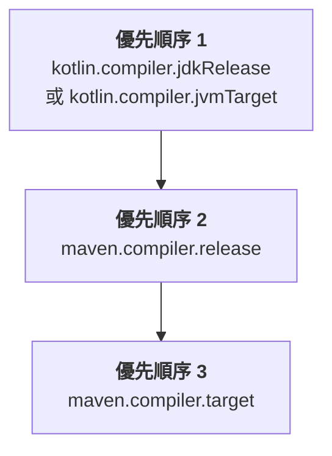

[//]: # (title: 配置 Maven 專案)

當您將 Kotlin 導入現有的 Java Maven 專案，或是建立新的 Kotlin Maven 專案時，需要新增用於編譯 Kotlin 原始碼與模組的 Kotlin Maven 外掛程式。

目前僅支援 Maven v3。

> 如果您計劃將專案遷移至 Maven 4，請使用 [`mvnup`](https://maven.apache.org/tools/mvnup.html) Maven 升級工具來自動遷移您的組建。若要進一步了解遷移資訊，請參閱 [Starting with Maven 4](https://maven.apache.org/guides/mini/guide-migration-to-mvn4.html) 指南。
>
{style="note"}

## 自動配置 {id="automatic-configuration"}

在 Java-Kotlin 混合專案以及純 Kotlin 專案中，您都可以使用 `<extensions>` 選項來簡化 Maven 配置。
這種做法可以為您節省時間，因為您不再需要配置 Maven compiler 外掛程式。

若要使用 `<extensions>` 套用 Kotlin Maven 外掛程式，請依以下方式更新您的 `pom.xml` 建置檔：

1. 在 `<properties>` 區段中定義 Kotlin 與 JVM 的目標版本：

   ```xml
   <properties>
       <maven.compiler.release>17</maven.compiler.release>
       <kotlin.version>%kotlinVersion%</kotlin.version>
   </properties>
   ```

2. 在 `<build><plugins>` 區段中，新增啟用了 `<extensions>` 選項的 Kotlin Maven 外掛程式：

   ```xml
   <build>
       <plugins>
           <!-- Kotlin compiler plugin configuration -->
           <plugin>
               <groupId>org.jetbrains.kotlin</groupId>
               <artifactId>kotlin-maven-plugin</artifactId>
               <version>${kotlin.version}</version>
               <extensions>true</extensions> <!-- Enable the extension -->
           </plugin>
           <!-- No need to configure Maven compiler plugin with extensions -->
       </plugins>
   </build>
   ```

`<extensions>` 選項會：

* 將 `src/main/kotlin` 與 `src/test/kotlin` 目錄（如果它們已存在但未在外掛程式配置中指定）註冊為原始碼根目錄。
* 新增 [`kotlin-stdlib` 相依性](maven-set-dependencies.md#dependency-on-the-standard-library)（如果專案中尚未定義）。
* 將 `compile`、`test-compile`、`kapt` 與 `test-kapt` 執行項目新增至您的組建中，並繫結至相應的[生命週期階段](https://maven.apache.org/guides/introduction/introduction-to-the-lifecycle.html)。
  因此，您不需要手動設定帶有 `<id>` 和 `<goals>` 的 `<executions>` 區段來配置 `kapt`、Kotlin 的 `compile` 以及 Java 的 `compile` 執行項目以確保它們依正確順序執行。
* [自動將 JVM 目標版本與專案中配置的 Java 編譯器版本對齊。](#jvm-target-version)
   
若您的專案混合了 Java 與 Kotlin，此配置可確保：

* Kotlin 程式碼優先編譯。
* Java 程式碼在 Kotlin 之後編譯，並且可以參照 Kotlin 類別。
* 預設的 Maven 行為不會覆寫外掛程式的執行順序。

擴充套件配置會取代整個 `<executions>` 區段。如果您需要自訂配置特定執行項目，請參閱[編譯 Kotlin 與 Java 原始碼](#compile-kotlin-and-java-sources)中的範例。

> 如果有多個建置外掛程式覆寫了預設生命週期，且您也啟用了 `<extensions>` 選項，則 `<build>` 區段中的最後一個外掛程式在生命週期設定上擁有最高優先權。先前所有對生命週期設定的變更都將被忽略。
>
{style="note"}

<anchor name="maven-compiler-extensions-version"/>

目前，搭配 `<extensions>` 使用的 Maven compiler 外掛程式預設版本為 **%mavenExtensionsVersion%**。
您可以個別設定不同的版本：

```xml
<build>
    <plugins>
        <!-- Kotlin compiler plugin configuration -->
        <plugin>
            <groupId>org.jetbrains.kotlin</groupId>
            <artifactId>kotlin-maven-plugin</artifactId>
            <version>${kotlin.version}</version>
            <extensions>true</extensions>
        </plugin>
        <!-- Maven compiler plugin configuration for Java classes -->
        <plugin>
            <groupId>org.apache.maven.plugins</groupId>
            <artifactId>maven-compiler-plugin</artifactId>
            <version>%mavenPluginVersion%</version>
        </plugin>
    </plugins>
</build>
```

### JVM 目標版本 {id="jvm-target-version"}

`<extensions>` 選項可確保 Kotlin 與 Maven 編譯器以相同的位元組碼版本為目標。

Kotlin Maven 外掛程式會依以下優先順序自動解析 JVM 目標版本：



#### Kotlin 編譯器版本 {id="kotlin-compiler-versions"}

若專案中定義了 `kotlin.compiler.jdkRelease` 或 `kotlin.compiler.jvmTarget` 屬性，則該設定具有最高優先權。

請注意，這些 Kotlin 編譯器選項的行為有所不同：

| Kotlin 編譯器選項            | 控制輸出的位元組碼版本 | 將 API 限制為指定的 JDK                                                                      |
|------------------------------|------------------------|-----------------------------------------------------------------------------------------------|
| `kotlin.compiler.jvmTarget`  | 是                     | 對您程式碼中的 JDK API 沒有限制                                                              |
| `kotlin.compiler.jdkRelease` | 是                     | 是 − 僅允許特定 API 版本（相當於 Java 的 `--release` 編譯器選項）                             |

> 請勿同時為 `kotlin.compiler.jdkRelease` 與 `kotlin.compiler.jvmTarget` 設定不同的 JDK 選項，否則會產生錯誤。
>
{style="note"}

#### Maven 編譯器版本 {id="maven-compiler-versions"}

* 若未設定 `kotlin.compiler.jdkRelease` 也未設定 `kotlin.compiler.jvmTarget` 選項，外掛程式將採用 `maven.compiler.release` 版本。

  `maven.compiler.release` 版本可以定義為專案屬性，或在 `maven-compiler-plugin` 配置中定義。
* 若未設定 Maven release 版本，外掛程式將採用 `maven.compiler.target` 版本。

  該版本可以定義為專案屬性，或在 `maven-compiler-plugin` 配置中定義。

請注意，Maven 編譯器的 `target` 與 `release` 選項行為有所不同：

| Maven 編譯器選項         | 設定 Kotlin 的 `jvmTarget` | 設定 Kotlin 的 `jdkRelease` | 將 API 限制為指定的 JDK                      |
|--------------------------|---------------------------|----------------------------|----------------------------------------------|
| `maven.compiler.target`  | 是                        | 否                         | 否 − 組建的 JDK 類別路徑保持可見              |
| `maven.compiler.release` | 是                        | 是                         | 是 − 僅限特定的 API 版本                     |

> `<extensions>` 選項僅檢查專案層級屬性以及全域 `maven-compiler-plugin` 配置。
> 它不會檢查外掛程式 `<executions>` 區段中所定義的配置。
>
{style="note"}

## 手動配置 {id="manual-configuration"}

若未在 Kotlin Maven 外掛程式中啟用 `<extensions>`，您需要手動配置專案以確保原始碼能夠正確編譯。

您可以設定 Maven 專案來編譯[ Java 與 Kotlin 混合原始碼](#compile-kotlin-and-java-sources)或[純 Kotlin 原始碼](#compile-kotlin-only-sources)。

### 編譯 Kotlin 與 Java 原始碼 {id="compile-kotlin-and-java-sources"}

若要編譯同時包含 Kotlin 與 Java 原始程式碼檔案的專案，請確保 Kotlin 編譯器在 Java 編譯器之前執行。

Java 編譯器在 Kotlin 宣告編譯為 `.class` 檔案之前無法識別它們。
如果您的 Java 程式碼使用了 Kotlin 類別，則必須先編譯這些類別，以避免出現 `cannot find symbol` 錯誤。

Maven 主要根據兩個因素決定外掛程式的執行順序：

* `pom.xml` 檔案中外掛程式宣告的順序。
* 內建的預設執行項目（例如 `default-compile` 與 `default-testCompile`），無論其在 `pom.xml` 檔案中的位置為何，這些執行項目一律會在使用者自訂的執行項目之前執行。

若要控制執行順序：

* 在 `maven-compiler-plugin` 之前宣告 `kotlin-maven-plugin`。
* 停用 Java compiler 外掛程式的預設執行項目。
* 新增自訂執行項目以明確控制編譯階段。

> 您可以在 Maven 中使用特殊的 `none` 階段來停用預設執行項目。
>
{style="note"}

若要套用 Kotlin Maven 外掛程式，請依以下方式更新您的 `pom.xml` 建置檔：

```xml
<build>
    <plugins>
        <!-- Kotlin compiler plugin configuration -->
        <plugin>
            <groupId>org.jetbrains.kotlin</groupId>
            <artifactId>kotlin-maven-plugin</artifactId>
            <version>${kotlin.version}</version>
            <executions>
                <execution>
                    <id>kotlin-compile</id>
                    <phase>compile</phase>
                    <goals>
                        <goal>compile</goal>
                    </goals>
                    <configuration>
                        <sourceDirs>
                            <sourceDir>${project.basedir}/src/main/kotlin</sourceDir>
                            <!-- Ensure Kotlin code can reference Java code -->
                            <sourceDir>${project.basedir}/src/main/java</sourceDir>
                        </sourceDirs>
                    </configuration>
                </execution>
                <execution>
                    <id>kotlin-test-compile</id>
                    <phase>test-compile</phase>
                    <goals>
                        <goal>test-compile</goal>
                    </goals>
                    <configuration>
                        <sourceDirs>
                            <sourceDir>${project.basedir}/src/test/kotlin</sourceDir>
                            <sourceDir>${project.basedir}/src/test/java</sourceDir>
                        </sourceDirs>
                    </configuration>
                </execution>
            </executions>
        </plugin>

        <!-- Maven compiler plugin configuration -->
        <plugin>
            <groupId>org.apache.maven.plugins</groupId>
            <artifactId>maven-compiler-plugin</artifactId>
            <version>3.15.0</version>
            <executions>
                <!-- Disable default executions -->
                <execution>
                    <id>default-compile</id>
                    <phase>none</phase>
                </execution>
                <execution>
                    <id>default-testCompile</id>
                    <phase>none</phase>
                </execution>

                <!-- Define custom executions -->
                <execution>
                    <id>java-compile</id>
                    <phase>compile</phase>
                    <goals>
                        <goal>compile</goal>
                    </goals>
                </execution>
                <execution>
                    <id>java-test-compile</id>
                    <phase>test-compile</phase>
                    <goals>
                        <goal>testCompile</goal>
                    </goals>
                </execution>
            </executions>
        </plugin>
    </plugins>
</build>
```

此配置可確保：

* Kotlin 程式碼優先編譯。
* Java 程式碼在 Kotlin 之後編譯，並且可以參照 Kotlin 類別。
* 預設的 Maven 行為不會覆寫外掛程式的執行順序。

如需更多關於 Maven 如何處理外掛程式執行的詳細資訊，請參閱 Maven 官方文件中的 [Guide to default plugin execution IDs](https://maven.apache.org/guides/mini/guide-default-execution-ids.html)。

### 編譯純 Kotlin 原始碼 {id="compile-kotlin-only-sources"}

若要編譯僅包含 Kotlin 原始程式碼檔案的專案，請宣告原始碼根目錄並配置 Kotlin Maven 外掛程式：

1. 在 `<build>` 區段中指定原始碼目錄：

    ```xml
    <build>
        <sourceDirectory>src/main/kotlin</sourceDirectory>
        <testSourceDirectory>src/test/kotlin</testSourceDirectory>
    </build>
    ```

2. 確保已套用 Kotlin Maven 外掛程式：

    ```xml
    <build>
        <plugins>
            <plugin>
                <groupId>org.jetbrains.kotlin</groupId>
                <artifactId>kotlin-maven-plugin</artifactId>
                <version>${kotlin.version}</version>
                <executions>
                    <execution>
                        <id>compile</id>
                        <goals>
                            <goal>compile</goal>
                        </goals>
                    </execution>
                    <execution>
                        <id>test-compile</id>
                        <goals>
                            <goal>test-compile</goal>
                        </goals>
                    </execution>
                </executions>
            </plugin>
        </plugins>
    </build>
    ```

### 設定 JDK 版本 {id="set-jdk-version"}

Kotlin 支援 [Maven Toolchains](https://maven.apache.org/guides/mini/guide-using-toolchains.html)，可協助您管理組建中的 JDK 版本。

如果您在組建中配置了 `maven-toolchains-plugin`，則可以指定用於 Kotlin 編譯的 JDK，這與執行 Maven 的 JVM 版本（於 `JAVA_HOME` 環境變數中設定）各自獨立。接著，Kotlin Maven 外掛程式會自動取得所選的 JDK 工具鏈，並使用 [`-jdk-home` 選項](compiler-reference.md#jdk-home-path)將 JDK 主目錄傳遞給編譯器。

這可讓您配置單一工具鏈，以控制組建中所有外掛程式使用的 JDK（包括 Kotlin 編譯）。例如：

```xml
<plugin>
    <groupId>org.apache.maven.plugins</groupId>
    <artifactId>maven-toolchains-plugin</artifactId>
    <version>3.2.0</version>
    <executions>
        <execution>
            <goals>
                <goal>toolchain</goal>
            </goals>
        </execution>
    </executions>
    <configuration>
        <toolchains>
            <jdk>
                <version>21</version>
            </jdk>
        </toolchains>
    </configuration>
</plugin>
```

您可以透過多種方式配置用於 Kotlin 編譯的 JDK。JDK 版本依以下優先順序進行解析：

```Mermaid
graph TD
    A["<b>優先順序 1</b><br/>kotlin-maven-plugin 的 jdkHome 選項"]
    B["<b>優先順序 2</b><br/>在 maven-toolchains-plugin 中<br/>設定的 JDK 版本"]
    C["<b>優先順序 3</b><br/>JAVA_HOME 版本"]

    A --> B
    B --> C
```

* 在 `kotlin-maven-plugin` 配置中的 `jdkHome` 選項所設定的 JDK 版本，優先權一律高於工具鏈版本。
* 在 `maven-toolchains-plugin` 中的 JDK 版本會覆寫在 `JAVA_HOME` 環境變數中設定的 JDK 版本。

您也可以使用外掛程式專屬的 `<jdkToolchain>` 選項，直接在 `kotlin-maven-plugin` 的工具鏈中設定 JDK 版本。相較於使用 `maven-toolchains-plugin`，此參數僅會影響 Kotlin 編譯，對組建中的其他外掛程式沒有影響。

工具鏈的 JDK 版本（在 `maven-toolchains-plugin` 或 `<jdkToolchain>` 選項中設定）僅會影響 Kotlin 編譯器所使用的 JDK。它不會改變產生的位元組碼版本。

若要控制位元組碼版本，請明確設定 [`jvmTarget`](maven-kotlin-compiler.md#attributes-specific-to-jvm) 選項。如果您未設定該選項，Kotlin Maven 外掛程式將採用 [`jdkRelease`](maven-kotlin-compiler.md#attributes-specific-to-jvm) 選項的值；若 `jdkRelease` 也未設定，則會回退至預設的 `%defaultJvmTargetVersion%`。

> 目前，將 `maven-toolchains-plugin` 設定為使用特定 JDK 版本[並不會影響 `kotlin-maven-plugin` 的 `kapt` 與 `test-kapt` 目標 (goals)](https://youtrack.jetbrains.com/issue/KT-79897)。請改在 `JAVA_HOME` 環境變數中設定所需的版本。
>
{style="note"}

## 配置 Java 模組 (JPMS) {id="configure-java-modules-jpms"}

Kotlin Maven 外掛程式支援 [Java 平台模組系統 (JPMS)](https://dev.java/learn/modules/)，因此您可以將 Kotlin 程式碼與 `module-info.java` 描述元一起編譯，並像其他 Java 模組一樣使用產生的模組。

您不需要在建置檔中加入任何額外的 JPMS 專屬選項。只要在 Maven 之前配置 Kotlin 編譯器即可。

當存在 `module-info.java` 描述元時，Kotlin 編譯器會將其作為來源檔案，並對照其模組路徑（而非類別路徑）進行編譯。Kotlin 編譯器會讀取該描述元以解析模組圖，隨後 Maven 編譯器會將其編譯為 `module-info.class` 檔案。

若要配置 Java 模組，請在 `${project.basedir}/src/main/java` 目錄中建立 `module-info.java` 檔案。
在模組描述元中，宣告您模組需要的所有相依項以及它匯出的套件。例如：

```java
module org.example.myapp {
    requires transitive kotlin.stdlib;
    requires java.net.http;
    
    exports org.example.myapp;
}
```

請注意：

* 您的 Java 模組只能使用您所宣告的內容。由於編譯採用模組路徑而非類別路徑，因此描述元應包含您 Kotlin 程式碼使用的所有相依項：標準函式庫、JDK 模組（`java.base` 除外）以及其他程式庫。否則，您可能會收到 `Unresolved reference` 錯誤。
* 對於模組，Kotlin 檔案中的套件名稱必須與 `module-info.java` 中的套件名稱相符，以避免出現 `Package is empty or does not exist` 的建置失敗。
* `pom.xml` 建置檔應配置為[在 Java 之前編譯 Kotlin](#compile-kotlin-and-java-sources)。
  如果您使用[自動專案配置](#automatic-configuration)，`<extensions>` 選項已能確保這一點。

## 下一步 {id="what-s-next"}

[在您的 Kotlin Maven 專案中設定相依性](maven-set-dependencies.md)